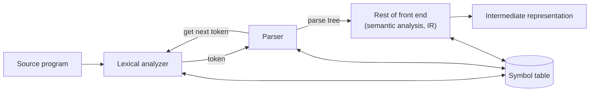
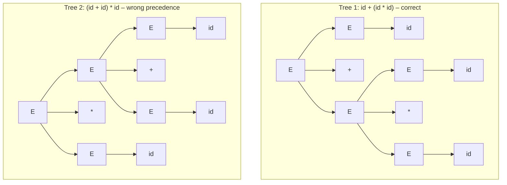
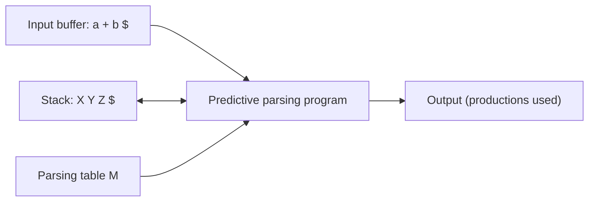
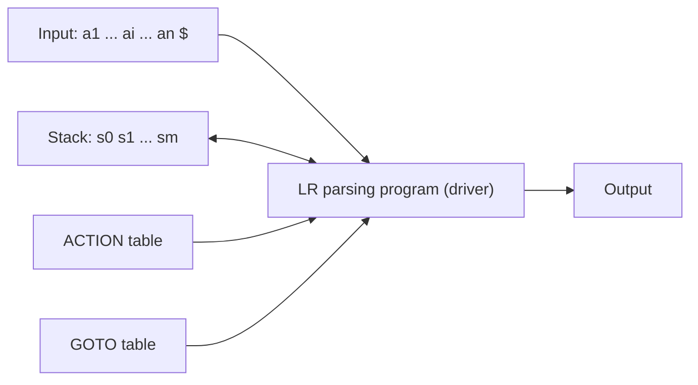
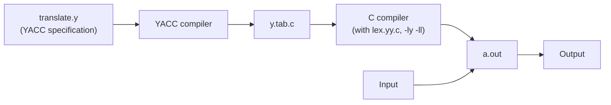

# Compiler Design – CA-2: Syntax Analysis & Parsing `PCC-CS-501`

!!! abstract "What this page covers"
    **CA-2 syllabus:** (1) Parsing – top-down and bottom-up, (2) Syntax analysis.  
    From the main syllabus that means: role of the parser, context-free grammars, writing a grammar, top-down parsing, non-recursive predictive parsing (LL), bottom-up parsing, handles, viable prefixes, operator precedence parsing, LR parsers (SLR, LALR, CLR), parser generators (YACC), and error-recovery strategies for each technique. Syntax-directed definitions are included because the suggested questions (Q14–Q17) ask for them.

    **How to use it:** read Parts 1–10 once for the theory, then work through Part 11 (all suggested questions, solved) with the answer hidden. Part 13 is a one-page revision sheet for the morning of the exam.

!!! info "Question pattern (from Assignment-1)"
    - **2-mark:** definitions and one-line differences – handle, LL vs LR, error recovery.
    - **5-mark theory:** explain-with-example – operator precedence parsing, LEX/YACC design, panic mode, SLR vs LALR vs CLR, S- vs L-attributed.
    - **5-mark numericals:** FIRST/FOLLOW + LL(1) table + trace, eliminate left recursion, SLR table (and "is it SLR(1)?"), LR(1) vs LALR(1) conflict, operator-precedence table + trace, recursive descent code, annotated parse tree + value-stack trace.

| Topic | Typical question | Suggested Q |
|---|---|---|
| Handles, shift-reduce | Define handle, handle pruning | Q1 |
| LL vs LR | Differences | Q2 |
| Error recovery | Strategies, panic mode | Q3, Q7(b) |
| Operator precedence | Relations table + trace | Q4, Q13 |
| Lex / YACC | Design and working | Q5, Q8 |
| Grammar writing | Unambiguous expression grammar, left recursion | Q6(a), Q9(c) |
| LL(1) | FIRST/FOLLOW, table, trace, recursive descent | Q9(a,b), Q11 |
| SLR | Items, GOTO graph, table, conflict | Q6(b), Q10 |
| CLR / LALR | Comparison, LR(1) but not LALR(1) | Q7(a), Q12 |
| SDD | S-/L-attributed, stack evaluation, annotated tree | Q14–Q17 |

---

## 1. The Role of the Parser

The **parser** (syntax analyzer) is the second phase of the compiler. It obtains a stream of tokens from the lexical analyzer and checks whether that stream can be generated by the grammar of the source language.



**Functions of the parser**

1. Verify that the token string is a sentence of the grammar (syntax checking).
2. Build a parse tree (explicitly or implicitly) and pass it to the rest of the front end.
3. Report syntax errors clearly and accurately (line, kind of error).
4. Recover from errors quickly so that later errors can also be detected.
5. Collect information into the symbol table and, in practice, perform semantic actions / generate intermediate code during parsing.

**Kinds of parsers**

| Kind | How it builds the tree | Examples |
|---|---|---|
| Universal | Any CFG, but too slow (O(n³)) for compilers | CYK, Earley |
| Top-down | From the root (start symbol) down to the leaves | Recursive descent, LL(1) |
| Bottom-up | From the leaves (input) up to the root | Shift-reduce: operator precedence, LR(0), SLR, LALR, CLR |

Both top-down and bottom-up parsers scan the input **left to right, one symbol at a time**, and work only for sub-classes of grammars (LL and LR grammars) that are expressive enough for programming languages.

**Kinds of errors a compiler meets**

| Level | Example | Detected by |
|---|---|---|
| Lexical | misspelled keyword / illegal character `@` | lexer |
| Syntactic | missing `;`, unbalanced braces, `a + * b` | **parser** |
| Semantic | type mismatch, undeclared variable | semantic analyzer |
| Logical | infinite loop, `=` instead of `==` | usually not detected |

LL and LR parsers have the **viable-prefix property**: they detect an error as soon as the prefix of the input seen so far cannot be completed into any sentence of the language.

---

## 2. Context-Free Grammars

### 2.1 Definition

A context-free grammar is a 4-tuple **G = (V, T, P, S)**:

- **T** – terminals (tokens): `id`, `+`, `(`, `if`, …
- **V** – non-terminals (syntactic variables): `E`, `stmt`, …
- **P** – productions of the form A → α, where A ∈ V and α ∈ (V ∪ T)*
- **S** – the start symbol, S ∈ V

**Notation used here:** lower-case letters, operators, digits and bold names are terminals; upper-case letters (A, B, S, E) are non-terminals; X, Y are grammar symbols (either); α, β, γ are strings of grammar symbols; w is a string of terminals; ε is the empty string.

### 2.2 Derivations

- **One-step derivation** αAβ ⇒ αγβ when A → γ is a production.
- ⇒\* means "derives in zero or more steps", ⇒⁺ "in one or more steps".
- **Sentential form:** any α with S ⇒\* α (may contain non-terminals).
- **Sentence:** a sentential form with only terminals.
- **Language** L(G) = { w | S ⇒⁺ w, w ∈ T\* }.
- **Leftmost derivation (⇒lm):** always replace the leftmost non-terminal. Top-down parsers trace this.
- **Rightmost derivation (⇒rm, canonical derivation):** always replace the rightmost non-terminal. Bottom-up parsers trace this **in reverse**.

Example with E → E + E | E \* E | ( E ) | id, string `id + id * id`:

- Leftmost: E ⇒ E + E ⇒ id + E ⇒ id + E \* E ⇒ id + id \* E ⇒ id + id \* id
- Rightmost: E ⇒ E + E ⇒ E + E \* E ⇒ E + E \* id ⇒ E + id \* id ⇒ id + id \* id

### 2.3 Parse trees

A parse tree is a graphical representation of a derivation that hides the order of replacement: root = start symbol, interior nodes = non-terminals (a node A with children X₁…Xₙ means A → X₁…Xₙ was used), leaves = terminals or ε. The leaves read left to right form the **yield**. Every parse tree has exactly one leftmost and one rightmost derivation.

### 2.4 Ambiguity

A grammar is **ambiguous** if some sentence has **more than one parse tree** (equivalently, more than one leftmost or more than one rightmost derivation).

`id + id * id` with E → E + E | E \* E | id has two trees:



Another famous ambiguity is the **dangling else**: `stmt → if expr then stmt | if expr then stmt else stmt | other`. In `if E1 then if E2 then S1 else S2` the `else` can attach to either `if`. The rule used by all languages: *match each else with the closest unmatched then*.

**Removing ambiguity in expressions:** introduce one non-terminal per precedence level; use left recursion for left-associative operators and right recursion for right-associative ones (e.g. `^`).

```
E → E + T | E - T | T        (lowest: + -, left assoc)
T → T * F | T / F | F        (higher: * /, left assoc)
F → ( E ) | id               (highest)
```

!!! note "Why CFGs and not regular expressions for syntax?"
    Every regular language is context-free, but not vice versa. Regular expressions cannot count/match nesting (e.g. balanced parentheses, aⁿbⁿ). Lexical structure (identifiers, numbers) is simple, so REs → efficient DFAs are used in the lexer; nested structure (expressions, blocks) needs a CFG. Separating them keeps the grammar smaller and the front end modular.

---

## 3. Writing a Grammar for Parsing

### 3.1 Eliminating left recursion

A grammar is **left recursive** if A ⇒⁺ Aα for some A. Top-down parsers loop forever on such grammars (A calls A without consuming input), so left recursion must be removed.

**Immediate left recursion.** Group the A-productions as

A → Aα₁ | Aα₂ | … | Aαₘ | β₁ | β₂ | … | βₙ  (no βᵢ begins with A)

and replace them by

A → β₁A′ | β₂A′ | … | βₙA′  
A′ → α₁A′ | α₂A′ | … | αₘA′ | ε

Both generate β(α)\*; the new grammar is right recursive.

| Original | After elimination |
|---|---|
| E → E + T \| T | E → T E′,  E′ → + T E′ \| ε |
| T → T \* F \| F | T → F T′,  T′ → \* F T′ \| ε |
| X → X a \| X b \| c \| d | X → c X′ \| d X′,  X′ → a X′ \| b X′ \| ε |

**Indirect left recursion** (e.g. S → Aa | b, A → Sd: S ⇒ Aa ⇒ Sda). Algorithm (works if there are no cycles A ⇒⁺ A and no ε-productions, though it often works anyway):

```
arrange the non-terminals in some order A1, A2, ..., An
for i = 1 to n:
    for j = 1 to i-1:
        replace each production Ai → Aj γ by Ai → δ1 γ | δ2 γ | ... | δk γ,
        where Aj → δ1 | δ2 | ... | δk are the current Aj-productions
    eliminate immediate left recursion among the Ai-productions
```

*Example:* S → Aa | b, A → Ac | Sd | ε. Order S, A.  
i = 1 (S): no immediate left recursion.  
i = 2 (A): substitute S in A → Sd: A → Ac | Aad | bd | ε. Remove immediate recursion:  
**S → Aa | b,  A → bdA′ | A′,  A′ → cA′ | adA′ | ε**

### 3.2 Left factoring

When two alternatives of A start with the same prefix, a predictive parser cannot decide which to use. Defer the decision:

A → αβ₁ | αβ₂  becomes  A → αA′,  A′ → β₁ | β₂

Repeat until no two alternatives share a common prefix.

*Example 1 (dangling else):* S → iEtS | iEtSeS | a, E → b  
⇒ **S → iEtSS′ | a,  S′ → eS | ε,  E → b**

*Example 2:* A → abB | aB | cdg | cdeB | cdfB  
⇒ A → aA′ | cdA″,  A′ → bB | B,  A″ → g | eB | fB

!!! warning "Left factoring and left-recursion removal do not make a grammar LL(1) automatically"
    They remove two obvious obstacles. An **ambiguous** grammar is never LL(1) (or LR). The left-factored dangling-else grammar above is still not LL(1) – see §4.6.

---

## 4. FIRST and FOLLOW

These two functions are used to build both LL(1) tables and SLR tables. **Learn the rules exactly.**

### 4.1 FIRST(α)

FIRST(α) = set of terminals that begin strings derived from α; ε ∈ FIRST(α) if α ⇒\* ε.

1. If X is a terminal, FIRST(X) = { X }.
2. If X → ε is a production, add ε to FIRST(X).
3. If X → Y₁Y₂…Yₖ: add FIRST(Y₁) − {ε}. If ε ∈ FIRST(Y₁), also add FIRST(Y₂) − {ε}; continue while the previous Y's all derive ε. If **all** Y₁…Yₖ derive ε, add ε.

FIRST of a string X₁X₂…Xₙ is computed the same way as rule 3.

### 4.2 FOLLOW(A)

FOLLOW(A) = set of terminals that can appear immediately to the right of A in some sentential form. ε is **never** in FOLLOW.

1. Put `$` in FOLLOW(S) (S = start symbol, `$` = end marker).
2. For A → αBβ: everything in FIRST(β) except ε is in FOLLOW(B).
3. For A → αB, or A → αBβ where ε ∈ FIRST(β): everything in FOLLOW(A) is in FOLLOW(B).

Apply the rules repeatedly until no set changes.

### 4.3 Worked example

E → TE′, E′ → +TE′ | ε, T → FT′, T′ → \*FT′ | ε, F → (E) | id

| Non-terminal | FIRST | FOLLOW | How FOLLOW was obtained |
|---|---|---|---|
| E | { (, id } | { ), `$` } | start symbol; F → (E) |
| E′ | { +, ε } | { ), `$` } | E → TE′ (end of body) |
| T | { (, id } | { +, ), `$` } | FIRST(E′) − ε, and E′ ⇒ ε so FOLLOW(E) |
| T′ | { \*, ε } | { +, ), `$` } | T → FT′ |
| F | { (, id } | { +, \*, ), `$` } | FIRST(T′) − ε, and T′ ⇒ ε so FOLLOW(T) |

!!! tip "Common mistakes"
    - Forgetting rule 3 when the following symbols can vanish (ε).
    - Writing ε in a FOLLOW set.
    - Forgetting `$` in FOLLOW of the start symbol.
    - Computing FIRST(β) of the *whole* remaining body instead of just the symbols **after** B.

---

## 5. Top-Down Parsing

Top-down parsing constructs the parse tree from the root in preorder, i.e. it finds a **leftmost derivation**. At each step the key problem is: *which production to apply for the leftmost non-terminal?*

### 5.1 Recursive-descent parsing (general, with backtracking)

One procedure per non-terminal; the procedure for A tries its alternatives one after another, matching terminals against the input. If an alternative fails, the input pointer is reset (**backtracking**) and the next alternative is tried.

*Example:* S → cAd, A → ab | a, input `cad`.  
S matches c, calls A. A tries ab: a matches, b ≠ d → fail, reset input to `ad`. A tries a: matches. S matches d. **Accept.**

Drawbacks: backtracking is slow (exponential in the worst case), undoes semantic actions, gives poor error location, and **left-recursive grammars cause infinite loops**.

### 5.2 Predictive parsing

A **predictive parser** is a recursive-descent parser that **needs no backtracking**: by looking at the current input symbol (one look-ahead), it can always choose the correct alternative. This works when the grammar is **LL(1)**. It can be written either as recursive procedures (see Q11) or as a table-driven non-recursive parser (§5.4).

### 5.3 LL(1) grammars

**LL(1)**: first **L** – scan input Left to right; second **L** – produce a Leftmost derivation; **1** – one symbol of look-ahead.

A grammar G is LL(1) **iff** for every pair of distinct productions A → α | β:

1. FIRST(α) ∩ FIRST(β) = ∅ (no terminal begins strings from both; at most one can derive ε).
2. If β ⇒\* ε, then FIRST(α) ∩ FOLLOW(A) = ∅ (and vice versa).

Equivalently: **the predictive parsing table has no multiply-defined entry.**

No ambiguous grammar and no left-recursive grammar is LL(1). Grammars that are not left factored are usually not LL(1).

### 5.4 Construction of the predictive parsing table M[A, a]

For each production A → α:

1. For each terminal a in FIRST(α), add A → α to M[A, a].
2. If ε ∈ FIRST(α), add A → α to M[A, b] for **each b in FOLLOW(A)** (including `$` if `$` ∈ FOLLOW(A)).

Every undefined entry is **error**.

Table for the grammar of §4.3:

| | id | + | \* | ( | ) | `$` |
|---|---|---|---|---|---|---|
| **E** | E → TE′ | | | E → TE′ | | |
| **E′** | | E′ → +TE′ | | | E′ → ε | E′ → ε |
| **T** | T → FT′ | | | T → FT′ | | |
| **T′** | | T′ → ε | T′ → \*FT′ | | T′ → ε | T′ → ε |
| **F** | F → id | | | F → (E) | | |

### 5.5 Non-recursive predictive parser (table-driven LL(1))



The parser keeps an explicit stack of grammar symbols (`$` at the bottom, start symbol on top initially) instead of recursion.

**Algorithm.** Let X = top of stack, a = current input symbol.

1. If X = a = `$`: **accept**.
2. If X = a ≠ `$`: pop X, advance the input (**match**).
3. If X is a terminal ≠ a: **error**.
4. If X is a non-terminal: if M[X, a] = X → Y₁Y₂…Yₖ, pop X, push Yₖ, …, Y₂, Y₁ (Y₁ on top) and output the production; if M[X, a] is blank, **error**.

**Trace for `id + id * id`** (top of stack at the **right**):

| Step | Stack | Input | Action |
|---|---|---|---|
| 1 | `$E` | `id+id*id$` | E → TE′ |
| 2 | `$E′T` | `id+id*id$` | T → FT′ |
| 3 | `$E′T′F` | `id+id*id$` | F → id |
| 4 | `$E′T′id` | `id+id*id$` | match id |
| 5 | `$E′T′` | `+id*id$` | T′ → ε |
| 6 | `$E′` | `+id*id$` | E′ → +TE′ |
| 7 | `$E′T+` | `+id*id$` | match + |
| 8 | `$E′T` | `id*id$` | T → FT′ |
| 9 | `$E′T′F` | `id*id$` | F → id |
| 10 | `$E′T′id` | `id*id$` | match id |
| 11 | `$E′T′` | `*id$` | T′ → \*FT′ |
| 12 | `$E′T′F*` | `*id$` | match \* |
| 13 | `$E′T′F` | `id$` | F → id |
| 14 | `$E′T′id` | `id$` | match id |
| 15 | `$E′T′` | `$` | T′ → ε |
| 16 | `$E′` | `$` | E′ → ε |
| 17 | `$` | `$` | **accept** |

The productions output, in order, form the leftmost derivation.

### 5.6 A grammar that is not LL(1)

S → iEtSS′ | a, S′ → eS | ε, E → b.  
FIRST(S′) = {e, ε}, FOLLOW(S′) = FOLLOW(S) = {e, `$`}.  
For S′ → eS: M[S′, e] gets S′ → eS. For S′ → ε: M[S′, e] and M[S′, `$`] get S′ → ε.  
**M[S′, e] has two entries ⇒ not LL(1)** (the grammar is ambiguous – dangling else). In practice the conflict is resolved by choosing S′ → eS, which attaches `else` to the nearest `then`.

### 5.7 Error recovery in predictive parsing

An error is detected when (a) the terminal on top of the stack does not match the input, or (b) M[A, a] is blank.

**Panic mode** – skip input until a token in a *synchronizing set* appears. Good choices for the synch set of A:

1. All of FOLLOW(A): skip tokens until one in FOLLOW(A), then pop A.
2. Symbols that begin higher-level constructs (keywords starting statements), so a missing `;` does not make the parser skip the next statement.
3. FIRST(A): if a symbol in FIRST(A) appears, resume parsing A.
4. If A ⇒ ε, use the ε-production as a default.
5. If a terminal on top of the stack cannot be matched, pop it and report "token inserted".

Table usage: if M[A, a] is blank → skip a; if M[A, a] = **synch** → pop A; terminal mismatch → pop the terminal. (A worked trace is in Q7(b).)

**Phrase-level recovery** – fill blank entries with pointers to error routines that may insert, delete or change symbols and print a message. Care is needed to avoid infinite loops (the routine must consume input or pop the stack eventually).

---

## 6. Bottom-Up Parsing

### 6.1 Reductions

Bottom-up parsing builds the tree from the leaves up. It can be seen as **reducing** the input string w to the start symbol: at each step a substring matching the body of a production is replaced by the head. Read forwards, the sequence of reductions is a **rightmost derivation in reverse**.

For E → E + T | T, T → T \* F | F, F → ( E ) | id and input `id * id`, the reductions are:  
id \* id → F \* id → T \* id → T \* F → T → E,  
which is the reverse of the rightmost derivation E ⇒ T ⇒ T \* F ⇒ T \* id ⇒ F \* id ⇒ id \* id.

### 6.2 Handles and handle pruning

A **handle** of a right-sentential form γ is a production A → β together with a position in γ where β can be found, such that replacing β by A at that position produces the previous right-sentential form in a rightmost derivation of γ.

Formally, if S ⇒\*rm αAw ⇒rm αβw, then A → β in the position following α is a handle of αβw. The string w to the right of the handle contains **only terminals**. If the grammar is unambiguous, every right-sentential form has exactly one handle.

| Right-sentential form | Handle | Reducing production |
|---|---|---|
| id₁ \* id₂ | id₁ | F → id |
| F \* id₂ | F | T → F |
| T \* id₂ | id₂ | F → id |
| T \* F | T \* F | T → T \* F |
| T | T | E → T |

!!! warning "A matching body is not necessarily a handle"
    In T \* id₂ the substring T matches the body of E → T, but reducing it gives E \* id₂, which is **not** a right-sentential form. So T is not a handle there; the handle is id₂.

**Handle pruning:** repeatedly locate the handle βₙ in γₙ, replace it by the head to obtain γₙ₋₁, and continue until the start symbol is reached. This produces a rightmost derivation in reverse.

### 6.3 Shift-reduce parsing

A stack holds grammar symbols; the input buffer holds the rest of the string. Initially stack = `$`, input = w`$`. **The handle always appears on top of the stack.** Four actions:

| Action | Meaning |
|---|---|
| **Shift** | move the next input symbol onto the stack |
| **Reduce** | the right end of the handle is on top; locate its left end, pop it, push the head |
| **Accept** | stack is `$S` and input is `$` |
| **Error** | a syntax error is found; call a recovery routine |

Trace for `id * id`:

| Stack | Input | Action |
|---|---|---|
| `$` | `id*id$` | shift |
| `$id` | `*id$` | reduce F → id |
| `$F` | `*id$` | reduce T → F |
| `$T` | `*id$` | shift |
| `$T*` | `id$` | shift |
| `$T*id` | `$` | reduce F → id |
| `$T*F` | `$` | reduce T → T \* F |
| `$T` | `$` | reduce E → T |
| `$E` | `$` | accept |

### 6.4 Conflicts during shift-reduce parsing

For some grammars, knowing the stack and the next input symbol is not enough:

- **Shift/reduce conflict:** cannot decide whether to shift or reduce. Example: dangling else – stack `… if expr then stmt`, input `else …`: reduce `if expr then stmt` to `stmt`, or shift `else`?
- **Reduce/reduce conflict:** cannot decide which of several reductions to make. Example: two productions with the same body (A → c, B → c) where the look-ahead does not separate them (see Q12).

Grammars with such conflicts (for a given technique) are not LR(k) / not SLR, etc. Every ambiguous grammar has conflicts.

### 6.5 Viable prefixes

Not every prefix of a right-sentential form can appear on the stack: the stack never extends **past the right end of the handle** (the parser reduces as soon as the handle is complete).

A **viable prefix** is a prefix of a right-sentential form that does not continue past the right end of the rightmost handle of that form. Equivalently, viable prefixes are exactly the possible **stack contents** of a shift-reduce parser for the grammar.

*Example:* E ⇒\*rm F \* id ⇒rm id \* id. In F \* id the handle is F, so `F` is a viable prefix but `F*` is not (F would be reduced to T before `*` is shifted).

**Key theorem (basis of LR parsing):** the set of viable prefixes of any CFG is a **regular language**, and the DFA of LR(0) items (the LR(0) automaton) recognizes it. Item A → β₁•β₂ is *valid* for viable prefix αβ₁ if S ⇒\*rm αAw ⇒rm αβ₁β₂w. If β₂ ≠ ε the handle is not complete yet → shift; if β₂ = ε, A → β₁ is the handle → reduce.

---

## 7. Operator Precedence Parsing

### 7.1 Operator grammars

An **operator grammar** has

1. no production with ε on the right side, and
2. no production with **two adjacent non-terminals** on the right side.

E → EAE | (E) | id, A → + | \* is **not** an operator grammar (EAE has adjacent non-terminals), but substituting A gives the equivalent operator grammar **E → E + E | E \* E | (E) | id**.

### 7.2 Precedence relations

Three disjoint relations between **terminals** a and b:

| Relation | Meaning |
|---|---|
| a `<·` b | a "yields precedence to" b – b's handle starts after a |
| a `=·` b | a and b have equal precedence – they belong to the same handle |
| a `·>` b | a "takes precedence over" b – a handle ends at a; reduce |

These are **not** like `<`, `=`, `>` on numbers: a `<·` b and a `·>` b may both be undefined, and a `<·` a or a `·>` a can hold.

**Intuitive rules (for an expression grammar with operators θ):**

1. If θ₁ has higher precedence than θ₂: θ₁ `·>` θ₂ and θ₂ `<·` θ₁.
2. If θ₁, θ₂ have equal precedence: left-associative ⇒ θ₁ `·>` θ₂ and θ₂ `·>` θ₁; right-associative ⇒ θ₁ `<·` θ₂ and θ₂ `<·` θ₁.
3. For every operator θ: θ `<·` id, id `·>` θ, θ `<·` (, ( `<·` θ, ) `·>` θ, θ `·>` ), θ `·>` `$`, `$` `<·` θ.
4. Also: ( `=·` ),  `$` `<·` (,  `$` `<·` id,  ( `<·` (,  ) `·>` ),  ( `<·` id,  id `·>` ),  ) `·>` `$`,  id `·>` `$`.

**Formal method – LEADING and TRAILING**

- LEADING(A) = terminals that can be the **first terminal** in a string derived from A: a ∈ LEADING(A) if A ⇒⁺ γaδ where γ is ε or a single non-terminal.
- TRAILING(A) = terminals that can be the **last terminal**: a ∈ TRAILING(A) if A ⇒⁺ γaδ where δ is ε or a single non-terminal.

Rules, for every production A → X₁X₂…Xₙ:

1. **`=·`** : if Xᵢ and Xᵢ₊₁ are both terminals, or Xᵢ and Xᵢ₊₂ are terminals with a non-terminal Xᵢ₊₁ between them, then Xᵢ `=·` Xᵢ₊₁ (resp. Xᵢ₊₂).
2. **`<·`** : if Xᵢ is a terminal and Xᵢ₊₁ a non-terminal, then Xᵢ `<·` every a in LEADING(Xᵢ₊₁).
3. **`·>`** : if Xᵢ is a non-terminal and Xᵢ₊₁ a terminal, then every a in TRAILING(Xᵢ) `·>` Xᵢ₊₁.
4. `$` `<·` every a in LEADING(S); every a in TRAILING(S) `·>` `$`.

*Example:* E → E + T | T, T → T \* F | F, F → ( E ) | id

| | LEADING | TRAILING |
|---|---|---|
| F | { (, id } | { ), id } |
| T | { \*, (, id } | { \*, ), id } |
| E | { +, \*, (, id } | { +, \*, ), id } |

Relations produced: E → E + T gives {+, \*, ), id} `·>` + and + `<·` {\*, (, id}; T → T \* F gives {\*, ), id} `·>` \* and \* `<·` {(, id}; F → ( E ) gives ( `=·` ), ( `<·` {+, \*, (, id}, {+, \*, ), id} `·>` ); plus the `$` rules.

| | + | \* | ( | ) | id | `$` |
|---|---|---|---|---|---|---|
| **+** | `·>` | `<·` | `<·` | `·>` | `<·` | `·>` |
| **\*** | `·>` | `·>` | `<·` | `·>` | `<·` | `·>` |
| **(** | `<·` | `<·` | `<·` | `=·` | `<·` | |
| **)** | `·>` | `·>` | | `·>` | | `·>` |
| **id** | `·>` | `·>` | | `·>` | | `·>` |
| **`$`** | `<·` | `<·` | `<·` | | `<·` | accept |

(Rows: topmost terminal on the stack; columns: current input. Blank = error.)

### 7.3 Using the relations – finding the handle

Insert the relations between consecutive terminals of the right-sentential form (non-terminals are ignored). Then the **handle** is the string enclosed between the leftmost `<·` and the following `·>` (including any intervening non-terminals and `=·` terminals).

`$ <· id ·> + <· id ·> * <· id ·> $` → the first `<· id ·>` is the handle.

### 7.4 Operator-precedence parsing algorithm

```
set ip to point to the first symbol of w$; stack = $
loop:
    a = topmost terminal on the stack;  b = symbol pointed to by ip
    if a == $ and b == $: accept
    if a <· b or a =· b:  push b; advance ip            /* shift */
    else if a ·> b:                                     /* reduce */
        repeat pop the stack
        until the top terminal <· the terminal most recently popped
        (the popped string is the handle; push the head non-terminal)
    else: error()
```

Trace for `(id + id) * id` with E → E + E | E \* E | (E) | id and the table above:

| Stack | Input | Relation | Action |
|---|---|---|---|
| `$` | `(id+id)*id$` | `$` `<·` ( | shift |
| `$(` | `id+id)*id$` | ( `<·` id | shift |
| `$(id` | `+id)*id$` | id `·>` + | reduce E → id |
| `$(E` | `+id)*id$` | ( `<·` + | shift |
| `$(E+` | `id)*id$` | + `<·` id | shift |
| `$(E+id` | `)*id$` | id `·>` ) | reduce E → id |
| `$(E+E` | `)*id$` | + `·>` ) | reduce E → E + E |
| `$(E` | `)*id$` | ( `=·` ) | shift |
| `$(E)` | `*id$` | ) `·>` \* | reduce E → (E) |
| `$E` | `*id$` | `$` `<·` \* | shift |
| `$E*` | `id$` | \* `<·` id | shift |
| `$E*id` | `$` | id `·>` `$` | reduce E → id |
| `$E*E` | `$` | \* `·>` `$` | reduce E → E \* E |
| `$E` | `$` | – | accept |

### 7.5 Precedence functions

The relation table for n terminals has n² entries. It can be compressed into two functions f and g such that

f(a) < g(b) when a `<·` b, f(a) = g(b) when a `=·` b, f(a) > g(b) when a `·>` b.

**Construction:**

1. Create symbols `fₐ` and `gₐ` for each terminal a (and `$`).
2. If a `=·` b, put `fₐ` and `g_b` in the same group.
3. If a `<·` b, draw an edge from `g_b`'s group to `fₐ`'s group; if a `·>` b, draw an edge from `fₐ`'s group to `g_b`'s group.
4. If the graph has a cycle, no precedence functions exist. Otherwise f(a) = length of the longest path from `fₐ`'s group; g(a) likewise.

For the relations over {id, +, \*, `$`} (\* above +, both left-associative):

| | + | \* | id | `$` |
|---|---|---|---|---|
| f | 2 | 4 | 4 | 0 |
| g | 1 | 3 | 5 | 0 |

Check: + vs \*: f(+) = 2 < g(\*) = 3 ⇒ + `<·` \* ✓; \* vs +: f(\*) = 4 > g(+) = 1 ⇒ \* `·>` + ✓. The drawback: error entries disappear (every pair compares), so errors are detected later.

### 7.6 Advantages, disadvantages, error recovery

**Advantages:** simple, easy to construct by hand, efficient; good for expressions.  
**Disadvantages:** works only for operator grammars (small class); hard to handle tokens like unary minus that have two precedences; the parser may accept some invalid strings because it ignores non-terminals; the relation between grammar and parser is not always clear.

**Error detection:** (1) no relation holds between the top terminal and the input (blank entry); (2) a handle is found but no production has it as its body.

**Error routines for blank entries** (phrase-level recovery):

| Routine | Situation | Fix and message |
|---|---|---|
| e1 | expression missing entirely (`$` followed by `$`, or operator followed by `$`) | insert id; "missing operand" |
| e2 | expression begins with `)` | delete `)`; "unbalanced right parenthesis" |
| e3 | id or `)` followed by id or `(` | insert +; "missing operator" |
| e4 | expression ends with `(` | pop `(`; "missing right parenthesis" |

---

## 8. LR Parsing

### 8.1 Why LR?

**LR(k)**: **L** = left-to-right scan, **R** = rightmost derivation in reverse, **k** = number of look-ahead symbols (k = 1 when omitted).

- LR parsers recognize virtually all programming-language constructs for which a CFG can be written.
- It is the most general **non-backtracking** shift-reduce method known, yet as efficient as others.
- Detects a syntax error as soon as possible on a left-to-right scan.
- The class of LR grammars properly contains the LL grammars (an LR parser decides after seeing the whole body plus k symbols; an LL parser must decide after seeing only the first k symbols of the body).
- Drawback: too much work to build by hand – use a generator like YACC.

### 8.2 Model of an LR parser



The stack holds **states** (each state summarizes the symbols below it; symbols can be shown alongside for clarity). The driver is the same for all LR parsers; only the table changes.

- **ACTION[s, a]** (s state, a terminal): shift j / reduce A → β / accept / error.
- **GOTO[s, A]** (A non-terminal): next state.

**LR parsing algorithm.** Let s = state on top of the stack, a = current input symbol.

1. ACTION[s, a] = **shift j**: push j, advance input.
2. ACTION[s, a] = **reduce A → β**: pop |β| states; let t be the new top; push GOTO[t, A]; output A → β.
3. ACTION[s, a] = **accept**: parsing done.
4. ACTION[s, a] = **error**: call error recovery.

### 8.3 LR(0) items, CLOSURE and GOTO

An **LR(0) item** is a production with a dot somewhere in the body: A → XYZ gives A → •XYZ, A → X•YZ, A → XY•Z, A → XYZ•. A → ε gives only A → •. The dot shows how much of the body has been seen.

- **Augmented grammar G′:** add S′ → S. Accept when reducing S′ → S, i.e. when S′ → S• is in the state and input is `$`.
- **Kernel items:** S′ → •S and all items with the dot not at the left end. **Non-kernel items:** dot at the left end (except S′ → •S).

**CLOSURE(I):**

1. Every item of I is in CLOSURE(I).
2. If A → α•Bβ is in CLOSURE(I) and B → γ is a production, add B → •γ (if not already there). Repeat until nothing new is added.

**GOTO(I, X)** = CLOSURE of { A → αX•β | A → α•Xβ ∈ I }. It is the transition of the LR(0) automaton on symbol X.

**Canonical collection of LR(0) items:**

```
C = { CLOSURE({ S' → •S }) }
repeat
    for each set I in C and each grammar symbol X:
        if GOTO(I, X) is non-empty and not in C: add GOTO(I, X) to C
until no new sets are added
```

### 8.4 SLR(1) parsing table

**Algorithm:**

1. Construct C = {I₀, I₁, …, Iₙ}, the LR(0) collection of G′. State i comes from Iᵢ.
2. (a) If A → α•aβ ∈ Iᵢ (a terminal) and GOTO(Iᵢ, a) = Iⱼ, set ACTION[i, a] = **shift j**.  
   (b) If A → α• ∈ Iᵢ (A ≠ S′), set ACTION[i, a] = **reduce A → α** for **all a in FOLLOW(A)**.  
   (c) If S′ → S• ∈ Iᵢ, set ACTION[i, `$`] = **accept**.
3. If GOTO(Iᵢ, A) = Iⱼ for non-terminal A, set GOTO[i, A] = j.
4. All other entries are error. The initial state is the one containing S′ → •S.

If any entry gets two actions, the grammar is **not SLR(1)**.

**Running example** (used again for CLR and LALR so the three can be compared):  
(0) S′ → S, (1) S → CC, (2) C → cC, (3) C → d

| State | LR(0) items | Transitions |
|---|---|---|
| I₀ | S′ → •S, S → •CC, C → •cC, C → •d | S→I₁, C→I₂, c→I₃, d→I₄ |
| I₁ | S′ → S• | accept |
| I₂ | S → C•C, C → •cC, C → •d | C→I₅, c→I₃, d→I₄ |
| I₃ | C → c•C, C → •cC, C → •d | C→I₆, c→I₃, d→I₄ |
| I₄ | C → d• | reduce 3 |
| I₅ | S → CC• | reduce 1 |
| I₆ | C → cC• | reduce 2 |

FOLLOW(S) = { `$` }, FOLLOW(C) = FIRST(C) ∪ FOLLOW(S) = { c, d, `$` }.

| State | c | d | `$` | S | C |
|---|---|---|---|---|---|
| 0 | s3 | s4 | | 1 | 2 |
| 1 | | | acc | | |
| 2 | s3 | s4 | | | 5 |
| 3 | s3 | s4 | | | 6 |
| 4 | r3 | r3 | r3 | | |
| 5 | | | r1 | | |
| 6 | r2 | r2 | r2 | | |

No conflicts ⇒ SLR(1). Parse of `cdd`:

| Stack (states) | Symbols | Input | Action |
|---|---|---|---|
| 0 | | `cdd$` | s3 |
| 0 3 | c | `dd$` | s4 |
| 0 3 4 | c d | `d$` | r3 (C → d), GOTO[3, C] = 6 |
| 0 3 6 | c C | `d$` | r2 (C → cC), GOTO[0, C] = 2 |
| 0 2 | C | `d$` | s4 |
| 0 2 4 | C d | `$` | r3, GOTO[2, C] = 5 |
| 0 2 5 | C C | `$` | r1 (S → CC), GOTO[0, S] = 1 |
| 0 1 | S | `$` | accept |

**Where SLR fails.** S → L = R | R, L → \*R | id, R → L (unambiguous). The state GOTO(I₀, L) = { S → L•=R, R → L• }. FOLLOW(R) = { =, `$` } (because L → \*R makes FOLLOW(L) ⊆ FOLLOW(R) and S → L=R puts = in FOLLOW(L)). So on `=` the table has *shift* (from S → L•=R) and *reduce R → L* – a **shift/reduce conflict**. SLR is too weak because FOLLOW(R) is the set of symbols that can follow R *anywhere*, while after an L at the start of a statement, R → L is only valid on `$`. LR(1) items carry this precise information.

### 8.5 Canonical LR(1) (CLR) parsing

An **LR(1) item** is [A → α•β, a], where a is a terminal or `$` (the look-ahead). The look-ahead has no effect when β ≠ ε, but for [A → α•, a] it means: *reduce by A → α only if the next input is a.* The set of such a's is always a subset of FOLLOW(A), often a proper one.

**CLOSURE(I) for LR(1):** for each item [A → α•Bβ, a] in I, for each production B → γ and **each terminal b in FIRST(βa)**, add [B → •γ, b]. Repeat.  
**GOTO(I, X):** move the dot over X in every item that has •X, keep look-aheads, then take the closure.  
**Start:** CLOSURE({[S′ → •S, `$`]}).

**CLR table:** shift entries as in SLR; for [A → α•, a] in Iᵢ (A ≠ S′) set ACTION[i, a] = reduce A → α **only for that a**; [S′ → S•, `$`] gives accept. A grammar is **LR(1)** if this table has no conflicts.

LR(1) collection for S → CC, C → cC | d:

| State | LR(1) items | Transitions |
|---|---|---|
| I₀ | [S′→•S, `$`], [S→•CC, `$`], [C→•cC, c/d], [C→•d, c/d] | S→1, C→2, c→3, d→4 |
| I₁ | [S′→S•, `$`] | |
| I₂ | [S→C•C, `$`], [C→•cC, `$`], [C→•d, `$`] | C→5, c→6, d→7 |
| I₃ | [C→c•C, c/d], [C→•cC, c/d], [C→•d, c/d] | C→8, c→3, d→4 |
| I₄ | [C→d•, c/d] | |
| I₅ | [S→CC•, `$`] | |
| I₆ | [C→c•C, `$`], [C→•cC, `$`], [C→•d, `$`] | C→9, c→6, d→7 |
| I₇ | [C→d•, `$`] | |
| I₈ | [C→cC•, c/d] | |
| I₉ | [C→cC•, `$`] | |

(In I₀ the look-aheads of the C-items are FIRST(C`$`) = {c, d}, because C is followed by another C in S → •CC.)

| State | c | d | `$` | S | C |
|---|---|---|---|---|---|
| 0 | s3 | s4 | | 1 | 2 |
| 1 | | | acc | | |
| 2 | s6 | s7 | | | 5 |
| 3 | s3 | s4 | | | 8 |
| 4 | r3 | r3 | | | |
| 5 | | | r1 | | |
| 6 | s6 | s7 | | | 9 |
| 7 | | | r3 | | |
| 8 | r2 | r2 | | | |
| 9 | | | r2 | | |

10 states versus 7 for SLR – CLR tables are much bigger for real languages (thousands of states vs hundreds).

### 8.6 LALR(1) parsing

**Core** of an LR(1) item set = the set of LR(0) items obtained by dropping look-aheads. **LALR** = merge all LR(1) sets with the same core, taking the union of look-aheads.

**Algorithm (simple version):**

1. Construct the LR(1) collection.
2. Merge sets with identical cores; GOTO of a merged set is the merged set of the GOTOs (well defined because GOTO depends only on the core).
3. Build ACTION as in CLR. If there is a conflict, the grammar is **not LALR(1)**.

For S → CC: I₃ and I₆ merge to I₃₆, I₄ and I₇ to I₄₇, I₈ and I₉ to I₈₉:

| State | c | d | `$` | S | C |
|---|---|---|---|---|---|
| 0 | s36 | s47 | | 1 | 2 |
| 1 | | | acc | | |
| 2 | s36 | s47 | | | 5 |
| 36 | s36 | s47 | | | 89 |
| 47 | r3 | r3 | r3 | | |
| 5 | | | r1 | | |
| 89 | r2 | r2 | r2 | | |

Same number of states as SLR. Behaviour on wrong input: for `cd$`, the CLR parser reaches state 4 and finds ACTION[4, `$`] = error immediately; the LALR parser in state 47 reduces C → d, then C → cC, reaches state 2 and only then reports the error. **LALR may make extra reductions but never shifts an erroneous symbol.**

**Properties of merging (important theory):**

- Merging can **never produce a new shift/reduce conflict.** Suppose the merged state has [A → α•, a] and [B → β•aγ, b]. The item [A → α•, a] came from some original set; that set has the same core, so it also contains B → β•aγ (with some look-ahead) – it already had the shift/reduce conflict on a.
- Merging **can produce reduce/reduce conflicts** (look-aheads of two different reduce items get combined) – e.g. Q12.
- LALR tables are as small as SLR tables but almost as powerful as CLR; this is what **YACC/Bison** use. (Efficient construction builds LALR sets directly from LR(0) kernels by propagating look-aheads, without building the full LR(1) collection.)

### 8.7 Comparison and hierarchy

| Point | LR(0) | SLR(1) | LALR(1) | CLR(1) |
|---|---|---|---|---|
| Items | LR(0) | LR(0) | LR(1), same cores merged | LR(1) |
| Reduce placed on | all terminals | FOLLOW(A) | merged look-aheads | exact look-ahead |
| No. of states | n | n | n | ≫ n |
| Power | least | more | more | most |
| Used by | – | teaching | YACC, Bison | rarely in full form |

**Grammar class inclusion:** LR(0) ⊂ SLR(1) ⊂ LALR(1) ⊂ LR(1); also LL(1) ⊂ LR(1). (LL(1) is **not** a subset of SLR or LALR – see practice problem P1.) Every LR(1) grammar is unambiguous.

### 8.8 Using ambiguous grammars

An ambiguous grammar is never LR, but E → E + E | E \* E | (E) | id is shorter and gives a smaller, faster parser than the layered grammar. Its LR table has conflicts that can be resolved by **precedence and associativity**: in a state with E → E + E• and E → E•\*E on input `*`, shift (since \* is higher); on input `+`, reduce (left associativity). For dangling else, resolve the shift/reduce conflict in favour of **shift**. YACC does exactly this with `%left`, `%right`, `%nonassoc`.

### 8.9 Error recovery in LR parsing

An LR parser detects an error when it consults ACTION and finds an error entry (never on GOTO). CLR detects it before any reduction; SLR/LALR may perform a few reductions first but never shift a wrong token.

**Panic mode:** scan down the stack until a state s with a GOTO on some major non-terminal A (e.g. `stmt`, `expr`, `block`) is found. Discard zero or more input symbols until a symbol a that can legitimately follow A (a ∈ FOLLOW(A)) is found. Push GOTO[s, A] and resume. The parser assumes that a string derivable from A contained the error and skips it.

**Phrase-level recovery:** examine each error entry and, based on the language usage, write an error routine for it (insert, delete or replace a symbol, adjust the stack). E.g. for an expression grammar: e1 – operand expected: push an id state, "missing operand"; e2 – unbalanced `)`: delete it; e3 – operator expected: push `+`, "missing operator"; e4 – `)` expected at end: push `)`, "missing right parenthesis".

---

## 9. Parser Generator – YACC

**YACC** (Yet Another Compiler-Compiler, S. C. Johnson, Unix) generates an **LALR(1)** parser from a grammar plus semantic actions. GNU **Bison** is the compatible successor.



**Structure of a YACC program**

```
declarations          %{ C declarations %}, %token, %left, %right, %union, %start
%%
translation rules     head : body1 { action1 } | body2 { action2 } ;
%%
supporting C routines yylex(), yyerror(), main()
```

**Working**

1. YACC reads the grammar, builds the LALR(1) item sets and ACTION/GOTO tables, and writes them with the fixed driver `yyparse()` into `y.tab.c` (`-d` also writes `y.tab.h` with token codes; `-v` writes `y.output` describing states and conflicts).
2. `yyparse()` calls `yylex()` for each token; the token's attribute value is passed in `yylval`.
3. On a shift, the state and `yylval` are pushed; on a reduce, the body is popped, the C action is executed, and the head is pushed.
4. **Value stack:** in an action, `$$` is the value of the head and `$1, $2, …` are values of the body symbols – i.e. YACC implements S-attributed (postfix) translation. Default action: `$$ = $1`.
5. Returns 0 on success; calls `yyerror()` on a syntax error.

**Conflict resolution by default:** shift/reduce → **shift**; reduce/reduce → the production **listed first**. YACC reports the number of conflicts. `%left`, `%right`, `%nonassoc` (later lines = higher precedence) and `%prec` override this – a production gets the precedence of its rightmost terminal.

**Error recovery:** productions containing the special token `error`, e.g. `stmt : error ';'`. On an error the parser pops states until one with a shift on `error`, shifts `error`, then discards input until a token that can follow (here `;`) – a panic mode guided by the grammar writer. `yyerrok` resets the error state so that new errors are reported.

**Interface with Lex:** `cc y.tab.c lex.yy.c -ly -ll`. Tokens declared with `%token` get integer codes in `y.tab.h`; Lex actions `return` these codes and set `yylval`.

(A complete calculator example is in Q8.)

---

## 10. Syntax-Directed Definitions (for Q14–Q17)

### 10.1 Basic ideas

A **syntax-directed definition (SDD)** is a CFG together with **attributes** attached to grammar symbols and **semantic rules** attached to productions. A **syntax-directed translation scheme (SDT)** embeds program fragments (semantic actions) inside production bodies, e.g. E → E₁ + T { print('+') }.

- **Synthesized attribute** of a node N (non-terminal A): defined by a rule at the production of N itself, using attributes of N's **children** and N itself. Flows **upward**. Terminals have only synthesized attributes (from the lexer, e.g. `digit.lexval`).
- **Inherited attribute** of N: defined by a rule at the production of N's **parent**, using attributes of the parent, N itself and N's **siblings**. Flows **downward/sideways** – used when meaning depends on context (e.g. type of a declaration list).

**Annotated parse tree:** a parse tree showing the attribute values at each node.  
**Dependency graph:** an edge from attribute a to attribute b if b is computed from a. Any **topological sort** of an acyclic dependency graph gives a valid evaluation order; if the graph has a cycle, the SDD cannot be evaluated.

### 10.2 S-attributed and L-attributed definitions

- **S-attributed:** every attribute is synthesized. Evaluated by a **post-order** traversal; fits **bottom-up** (LR) parsing perfectly – keep values on the parser stack next to the states and compute the head's value at each reduction (postfix SDT; YACC's `$$`).
- **L-attributed:** for every production A → X₁X₂…Xₙ, each **inherited** attribute of Xᵢ depends only on (a) inherited attributes of the head A, and (b) attributes (inherited or synthesized) of X₁…Xᵢ₋₁ located to the **left** of Xᵢ, and (c) attributes of Xᵢ itself, provided no cycle results. Synthesized attributes are unrestricted. Evaluated in one **depth-first, left-to-right** traversal; fits **top-down** (LL / recursive descent) parsing – the action computing Xᵢ's inherited attribute is placed just before Xᵢ in the body.
- **Every S-attributed definition is L-attributed.**

**Inherited attributes in bottom-up parsing:** either (1) copy rules whose source is at a predictable position on the stack below the handle (Q15), or (2) insert **marker non-terminals** M → ε whose reduction computes the inherited value and leaves it on the stack.

---

## 11. Suggested Questions – Solved

!!! tip "How to practise"
    Cover the answer, attempt the question on paper (with the marks in mind), then expand and compare. Numerical answers have been re-checked step by step.

### Q1. What are handles in bottom-up parsing? [2]

??? success "Answer"
    In bottom-up (shift-reduce) parsing the input is reduced to the start symbol by tracing a rightmost derivation in reverse. A **handle** of a right-sentential form γ is a substring β that matches the body of a production A → β, **together with its position** in γ, such that replacing β by A gives the previous right-sentential form of a rightmost derivation:

    S ⇒\*rm αAw ⇒rm αβw — A → β at the position after α is a handle of αβw (w contains only terminals).

    *Example:* for E → E + E | E \* E | id and the form id + id \* id, the first handle is the leftmost id (reduce by E → id). In a shift-reduce parser the handle always appears on top of the stack; repeatedly finding and reducing handles is called **handle pruning**.

### Q2. Distinguish between LL parser and LR parser. [2]

??? success "Answer"
    | LL parser | LR parser |
    |---|---|
    | Top-down: builds the tree from root to leaves | Bottom-up: builds the tree from leaves to root |
    | Left-to-right scan, **Leftmost** derivation | Left-to-right scan, **Rightmost** derivation in reverse |
    | Chooses a production after seeing only the first k symbols derived from it (predicts) | Chooses a reduction after seeing the whole body plus k look-ahead symbols |
    | Cannot handle left recursion; needs left factoring | Handles left recursion; larger class (LL(k) ⊂ LR(k)) |
    | Stack holds symbols still to be expanded/matched | Stack holds states (symbols already seen) |
    | Easy to write by hand (recursive descent) | Large tables, generated by tools (YACC) |

### Q3. What is error recovery in parsing? Name any two strategies. [2]

??? success "Answer"
    **Error recovery** is the ability of a parser, after detecting a syntax error, to report it and bring itself into a state from which it can continue parsing the rest of the program, so that further errors are found in the same run without a flood of spurious messages.

    Strategies:

    1. **Panic-mode recovery** – discard input symbols until a synchronizing token (e.g. `;`, `}`, `end`) is found.
    2. **Phrase-level recovery** – make a local correction to the remaining input (insert a missing `;`, delete an extra `,`, replace `,` by `;`).
    3. (Also) **Error productions** – augment the grammar with productions that generate common errors; **Global correction** – find the minimum number of changes that turn the input into a valid program (theoretical, costly).

### Q4. Discuss operator precedence parsing with a suitable example. [5]

??? success "Answer"
    Operator precedence parsing is a simple **shift-reduce** technique for **operator grammars**: grammars with (i) no ε-production and (ii) no two adjacent non-terminals in any body. Example: E → E + E | E \* E | ( E ) | id.

    **Precedence relations** between terminals a and b:

    | Relation | Meaning |
    |---|---|
    | a `<·` b | a yields precedence to b (b starts a handle) |
    | a `=·` b | same precedence (same handle, e.g. ( `=·` )) |
    | a `·>` b | a takes precedence over b (handle ends; reduce) |

    They come from precedence and associativity: if θ₁ is higher than θ₂ then θ₁ `·>` θ₂ and θ₂ `<·` θ₁; for equal left-associative operators θ₁ `·>` θ₂ and θ₂ `·>` θ₁; id has highest precedence; `$` `<·` every terminal and every terminal `·>` `$`.

    **Algorithm.** Push `$`, append `$` to the input. Let a = topmost **terminal** on the stack, b = current input.

    1. a = b = `$`: accept.
    2. a `<·` b or a `=·` b: shift b.
    3. a `·>` b: pop until the top terminal is `<·` the terminal most recently popped; the popped string is the handle – reduce.
    4. Otherwise: error.

    **Example:** E → E + E | E \* E | id, input `id * id + id`.

    | | id | + | \* | `$` |
    |---|---|---|---|---|
    | **id** | | `·>` | `·>` | `·>` |
    | **+** | `<·` | `·>` | `<·` | `·>` |
    | **\*** | `<·` | `·>` | `·>` | `·>` |
    | **`$`** | `<·` | `<·` | `<·` | accept |

    | Stack | Input | Relation | Action |
    |---|---|---|---|
    | `$` | `id*id+id$` | `$` `<·` id | shift |
    | `$id` | `*id+id$` | id `·>` \* | reduce E → id |
    | `$E` | `*id+id$` | `$` `<·` \* | shift |
    | `$E*` | `id+id$` | \* `<·` id | shift |
    | `$E*id` | `+id$` | id `·>` + | reduce E → id |
    | `$E*E` | `+id$` | \* `·>` + | reduce E → E \* E |
    | `$E` | `+id$` | `$` `<·` + | shift |
    | `$E+` | `id$` | + `<·` id | shift |
    | `$E+id` | `$` | id `·>` `$` | reduce E → id |
    | `$E+E` | `$` | + `·>` `$` | reduce E → E + E |
    | `$E` | `$` | – | accept |

    `*` is reduced before `+` is shifted because \* `·>` +, so precedence is respected.  
    **Advantages:** simple, hand-implementable. **Limitations:** only operator grammars; unary minus is hard (same symbol, two precedences); small class of grammars. (Precedence functions f, g can compress the table – §7.5.)

### Q5. Explain the design of a lexical analyzer generator (LEX). [5]

??? success "Answer"
    **Lex** (GNU version **Flex**) generates a lexical analyzer from a specification of regular expressions and C actions.

    ```mermaid
    flowchart LR
        A["lex.l (Lex source)"] --> B["Lex compiler"] --> C["lex.yy.c"]
        C --> D["C compiler"] --> E["a.out"]
        F["Input stream"] --> E --> G["Sequence of tokens"]
    ```

    **Structure of a Lex program**

    ```
    declarations          %{ C declarations %}  and regular definitions, e.g. digit [0-9]
    %%
    translation rules     pattern   { action }
    %%
    auxiliary functions   C functions used by actions, main(), yywrap()
    ```

    ```c
    %{
    #include <stdio.h>
    %}
    digit   [0-9]
    letter  [a-zA-Z]
    %%
    "if"                        { printf("KEYWORD if\n"); }
    {letter}({letter}|{digit})* { printf("ID %s\n", yytext); }
    {digit}+                    { printf("NUM %s\n", yytext); }
    [ \t\n]                     ;   /* skip white space */
    .                           { printf("OP %s\n", yytext); }
    %%
    int yywrap(void) { return 1; }
    int main(void)  { yylex(); return 0; }
    ```

    **Design – how Lex builds the analyzer**

    ```mermaid
    flowchart LR
        P["Lex program<br/>(regex + actions)"] --> N["NFA for each pattern<br/>(Thompson)"] --> C["Combined NFA → DFA<br/>(subset construction)"] --> M["Minimised DFA<br/>transition table"]
        IB["Input buffer<br/>(lexemeBegin, forward)"] --> S["Automaton simulator<br/>(driver)"]
        M --> S --> AC["Action → token"]
    ```

    1. **RE → NFA:** each pattern pᵢ is converted to an NFA Nᵢ by Thompson's construction.
    2. **Combine NFAs:** a new start state with ε-transitions to the start states of N₁…Nₙ; each accepting state remembers its pattern/action.
    3. **NFA → DFA:** subset construction, then minimisation; stored as a **transition table**.
    4. **Driver:** a fixed simulator (same for every Lex program) reads characters from the input buffer using two pointers `lexemeBegin` and `forward` and moves through the table.
    5. **Conflict resolution:** (a) **longest match** – keep reading until no move is possible, then back up to the last accepting state; (b) for equal-length matches, the pattern **listed first** wins (so keywords are listed before the identifier rule).
    6. **Action:** the action of the matched pattern runs; `yytext` holds the lexeme, `yyleng` its length; usually it returns a token code to the parser (which calls `yylex()`).
    7. **Look-ahead operator** r₁/r₂ matches r₁ only if followed by r₂; the extra characters are pushed back.

### Q6. (a) Write a grammar for simple arithmetic expressions involving +, −, \*, /. [4]

??? success "Answer"
    A simple but **ambiguous** grammar: E → E + E | E − E | E \* E | E / E | ( E ) | id  
    (id + id \* id has two parse trees.)

    To build in precedence (\* / above + −) and **left associativity**, use one non-terminal per level:

    ```
    E → E + T | E - T | T        (lowest precedence : + -)
    T → T * F | T / F | F        (higher precedence : * /)
    F → ( E ) | id               (highest : parentheses / operands)
    ```

    Left recursion makes the operators left-associative; \* and / are generated lower in the tree, so they are evaluated first. Leftmost derivation of id + id \* id:

    E ⇒ E + T ⇒ T + T ⇒ F + T ⇒ id + T ⇒ id + T \* F ⇒ id + F \* F ⇒ id + id \* F ⇒ id + id \* id

    ```mermaid
    flowchart TB
        E0["E"] --> E1["E"] & P["+"] & T0["T"]
        E1 --> T1["T"] --> F1["F"] --> I1["id"]
        T0 --> T2["T"] & S["*"] & F3["F"]
        T2 --> F2["F"] --> I2["id"]
        F3 --> I3["id"]
    ```

    The tree is unique, and the \* sub-tree is deeper (evaluated first).

### Q6. (b) Construct the SLR parsing table for S → E, E → E + T | T, T → T \* F | F, F → ( E ) | id. [5]

??? success "Answer"
    **Step 1 – Numbering** (S → E acts as the augmented production):

    | No. | Production | No. | Production |
    |---|---|---|---|
    | 0 | S → E | 4 | T → F |
    | 1 | E → E + T | 5 | F → ( E ) |
    | 2 | E → T | 6 | F → id |
    | 3 | T → T \* F | | |

    **Step 2 – FOLLOW:** FOLLOW(S) = { `$` }, FOLLOW(E) = { +, ), `$` }, FOLLOW(T) = FOLLOW(F) = { +, \*, ), `$` }.

    **Step 3 – LR(0) item sets:**

    | State | Items |
    |---|---|
    | I₀ | S → •E, E → •E+T, E → •T, T → •T\*F, T → •F, F → •(E), F → •id |
    | I₁ = goto(I₀, E) | S → E•, E → E•+T |
    | I₂ = goto(I₀, T) | E → T•, T → T•\*F |
    | I₃ = goto(I₀, F) | T → F• |
    | I₄ = goto(I₀, ( ) | F → (•E), E → •E+T, E → •T, T → •T\*F, T → •F, F → •(E), F → •id |
    | I₅ = goto(I₀, id) | F → id• |
    | I₆ = goto(I₁, +) | E → E+•T, T → •T\*F, T → •F, F → •(E), F → •id |
    | I₇ = goto(I₂, \*) | T → T\*•F, F → •(E), F → •id |
    | I₈ = goto(I₄, E) | F → (E•), E → E•+T |
    | I₉ = goto(I₆, T) | E → E+T•, T → T•\*F |
    | I₁₀ = goto(I₇, F) | T → T\*F• |
    | I₁₁ = goto(I₈, ) ) | F → (E)• |

    Other transitions: goto(I₄, T) = I₂, goto(I₄, F) = I₃, goto(I₄, ( ) = I₄, goto(I₄, id) = I₅, goto(I₆, F) = I₃, goto(I₆, ( ) = I₄, goto(I₆, id) = I₅, goto(I₇, ( ) = I₄, goto(I₇, id) = I₅, goto(I₈, +) = I₆, goto(I₉, \*) = I₇.

    ```mermaid
    flowchart LR
        I0 -->|E| I1
        I0 -->|T| I2
        I0 -->|F| I3
        I0 -->|"("| I4
        I0 -->|id| I5
        I1 -->|"+"| I6
        I2 -->|"*"| I7
        I4 -->|E| I8
        I4 -->|T| I2
        I4 -->|F| I3
        I4 -->|"("| I4
        I4 -->|id| I5
        I6 -->|T| I9
        I6 -->|F| I3
        I6 -->|"("| I4
        I6 -->|id| I5
        I7 -->|F| I10
        I7 -->|"("| I4
        I7 -->|id| I5
        I8 -->|")"| I11
        I8 -->|"+"| I6
        I9 -->|"*"| I7
    ```

    **Step 4 – Table.** A → α•aβ in Iᵢ with goto(Iᵢ, a) = Iⱼ ⇒ sj; A → α• in Iᵢ ⇒ r(A → α) on FOLLOW(A); S → E• ⇒ acc on `$`.

    | State | id | + | \* | ( | ) | `$` | E | T | F |
    |---|---|---|---|---|---|---|---|---|---|
    | 0 | s5 | | | s4 | | | 1 | 2 | 3 |
    | 1 | | s6 | | | | acc | | | |
    | 2 | | r2 | s7 | | r2 | r2 | | | |
    | 3 | | r4 | r4 | | r4 | r4 | | | |
    | 4 | s5 | | | s4 | | | 8 | 2 | 3 |
    | 5 | | r6 | r6 | | r6 | r6 | | | |
    | 6 | s5 | | | s4 | | | | 9 | 3 |
    | 7 | s5 | | | s4 | | | | | 10 |
    | 8 | | s6 | | | s11 | | | | |
    | 9 | | r1 | s7 | | r1 | r1 | | | |
    | 10 | | r3 | r3 | | r3 | r3 | | | |
    | 11 | | r5 | r5 | | r5 | r5 | | | |

    No entry has two actions ⇒ the grammar is **SLR(1)**. (Note states 2 and 9: \* ∉ FOLLOW(E), so the reduce never clashes with s7.)

### Q7. (a) Differentiate between SLR, LALR and CLR parsers. [5]

??? success "Answer"
    | Point | SLR | LALR | CLR |
    |---|---|---|---|
    | Items used | LR(0) items | LR(1) items with same core merged | LR(1) items [A → α•β, a] |
    | Reduce entries placed on | all of FOLLOW(A) | merged look-aheads of the item | only the item's look-ahead a |
    | Number of states | fewest (= LR(0) states) | same as SLR | largest (often many times more) |
    | Power | least | in between | most |
    | Grammar classes | SLR ⊂ LALR | LALR ⊂ CLR | all LR(1) grammars |
    | Conflicts | S/R and R/R conflicts common | no new S/R vs CLR; may get R/R on merging | fewest |
    | Table size / effort | small, easy to build | small, harder to build | very large, costly |
    | Error detection | may do extra reductions before detecting | may do extra reductions, never shifts an erroneous symbol | detects immediately |
    | Used in | teaching, simple tools | YACC, Bison | rarely (where full power is needed) |

    Example: S → L = R | R, L → \*R | id, R → L is LALR(1) but not SLR(1); the grammar of Q12 is LR(1) but not LALR(1).

### Q7. (b) Explain panic mode error recovery with an example. [5]

??? success "Answer"
    In **panic mode**, on detecting an error the parser **discards input symbols one at a time** until it finds one from a designated set of **synchronizing tokens** (delimiters like `;`, `}`, `end`). It then adjusts the stack so that parsing can continue from that token.

    In a predictive (LL(1)) parser this uses **synch** entries:

    - Put synch in M[A, a] for every a ∈ FOLLOW(A) where M[A, a] is otherwise blank (FIRST(A) and statement keywords may be added too).
    - If M[A, a] is blank → skip input symbol a.
    - If M[A, a] is synch → pop A (assume it is complete).
    - If the terminal on top of the stack does not match the input → pop it (as if it were inserted).

    **Example.** E → TE′, E′ → +TE′ | ε, T → FT′, T′ → \*FT′ | ε, F → (E) | id; FOLLOW(E) = FOLLOW(E′) = { ), `$` }, FOLLOW(T) = FOLLOW(T′) = { +, ), `$` }, FOLLOW(F) = { +, \*, ), `$` }.

    | | id | + | \* | ( | ) | `$` |
    |---|---|---|---|---|---|---|
    | **E** | E → TE′ | | | E → TE′ | synch | synch |
    | **E′** | | E′ → +TE′ | | | E′ → ε | E′ → ε |
    | **T** | T → FT′ | synch | | T → FT′ | synch | synch |
    | **T′** | | T′ → ε | T′ → \*FT′ | | T′ → ε | T′ → ε |
    | **F** | F → id | synch | synch | F → (E) | synch | synch |

    Erroneous input: `) id * + id`

    | Stack | Input | Remark |
    |---|---|---|
    | `$E` | `)id*+id$` | error, skip `)` (E is the start symbol, so skip instead of popping) |
    | `$E` | `id*+id$` | E → TE′ |
    | `$E′T` | `id*+id$` | T → FT′ |
    | `$E′T′F` | `id*+id$` | F → id |
    | `$E′T′id` | `id*+id$` | match id |
    | `$E′T′` | `*+id$` | T′ → \*FT′ |
    | `$E′T′F*` | `*+id$` | match \* |
    | `$E′T′F` | `+id$` | error, M[F, +] = synch → pop F |
    | `$E′T′` | `+id$` | T′ → ε |
    | `$E′` | `+id$` | E′ → +TE′ |
    | `$E′T+` | `+id$` | match + |
    | `$E′T` | `id$` | T → FT′ |
    | `$E′T′F` | `id$` | F → id |
    | `$E′T′id` | `id$` | match id |
    | `$E′T′` | `$` | T′ → ε |
    | `$E′` | `$` | E′ → ε |
    | `$` | `$` | done (2 errors reported) |

    Both errors (extra `)` and missing operand after `*`) were reported and parsing finished.  
    **Advantages:** simple; guaranteed not to loop. **Disadvantage:** may skip a large part of the input without checking it.  
    (In LR parsers: pop states until one with a GOTO on a major non-terminal A, skip input to a symbol in FOLLOW(A), push GOTO on A.)

### Q8. Discuss in detail the working of a parser generator (YACC). [5]

??? success "Answer"
    **YACC** (Yet Another Compiler-Compiler, S. C. Johnson; GNU **Bison**) takes a context-free grammar with semantic actions and produces a C program for an **LALR(1)** parser.

    ```mermaid
    flowchart LR
        A["translate.y (YACC spec)"] --> B["YACC compiler"] --> C["y.tab.c"]
        C --> D["C compiler (+ lex.yy.c)"] --> E["a.out (parser)"]
        F["Input"] --> E --> G["Output"]
    ```

    **Working**

    1. `yacc translate.y` builds the LALR(1) item sets and ACTION/GOTO tables and writes them with a fixed driver `yyparse()` into **y.tab.c** (`-d` also produces `y.tab.h` with token codes).
    2. y.tab.c is compiled with the lexer: `cc y.tab.c lex.yy.c -ly -ll`.
    3. At run time `yyparse()` repeatedly calls `yylex()` for the next token (attribute in `yylval`), shifts tokens/states onto a stack and, on a reduce, pops the body, executes the C action and pushes the head.
    4. Every symbol has a value on a **value stack**: `$$` = value of the head, `$1, $2, …` = values of body symbols – S-attributed translation.
    5. On acceptance `yyparse()` returns 0; on error it calls `yyerror()`.

    **Structure of a YACC program** (desk calculator)

    ```c
    %{                                  /* Declarations part */
    #include <ctype.h>
    #include <stdio.h>
    %}
    %token DIGIT
    %left '+' '-'                       /* lower precedence, left assoc. */
    %left '*' '/'                       /* higher precedence             */
    %%                                  /* Translation rules part        */
    line : expr '\n'          { printf("%d\n", $1); }
         ;
    expr : expr '+' expr      { $$ = $1 + $3; }
         | expr '*' expr      { $$ = $1 * $3; }
         | '(' expr ')'       { $$ = $2; }
         | DIGIT
         ;
    %%                                  /* Supporting C routines         */
    int yylex(void) {
        int c = getchar();
        if (isdigit(c)) { yylval = c - '0'; return DIGIT; }
        return c;
    }
    void yyerror(char *s) { fprintf(stderr, "%s\n", s); }
    int main(void) { return yyparse(); }
    ```

    **Special features**

    - **Conflicts:** reported; by default S/R → shift, R/R → production listed first. `%left`, `%right`, `%nonassoc`, `%prec` declare precedence/associativity so ambiguous expression grammars can be used.
    - **Error recovery:** productions like `stmt : error ';'`; on an error the parser pops states until one that can shift `error`, shifts it, and discards input until `;` (panic mode); `yyerrok` resets the error state.
    - **Interface with Lex:** `%token` names get integer codes; Lex actions return them and pass values through `yylval`.

### Q9. (a) Construct the predictive parsing table for S → aAcd | BcAe, A → b | ε, B → Cf | d, C → fe. [5]

??? success "Answer"
    No left recursion and no common prefixes. FIRST and FOLLOW:

    | NT | FIRST | FOLLOW | Reason |
    |---|---|---|---|
    | S | { a, f, d } | { `$` } | start symbol |
    | A | { b, ε } | { c, e } | S → aA**c**d and S → BcA**e** |
    | B | { f, d } | { c } | S → B**c**Ae |
    | C | { f } | { f } | B → C**f** |

    FIRST(aAcd) = {a}; FIRST(BcAe) = FIRST(B) = {f, d}; FIRST(Cf) = {f}; for A → ε use FOLLOW(A) = {c, e}.

    | | a | b | c | d | e | f | `$` |
    |---|---|---|---|---|---|---|---|
    | **S** | S → aAcd | | | S → BcAe | | S → BcAe | |
    | **A** | | A → b | A → ε | | A → ε | | |
    | **B** | | | | B → d | | B → Cf | |
    | **C** | | | | | | C → fe | |

    Every cell has at most one entry ⇒ the grammar is **LL(1)**.

### Q9. (b) Show how the string "fefcbe" is parsed. [5]

??? success "Answer"
    | Step | Stack (top at right) | Input | Action |
    |---|---|---|---|
    | 1 | `$S` | `fefcbe$` | M[S, f]: S → BcAe |
    | 2 | `$eAcB` | `fefcbe$` | M[B, f]: B → Cf |
    | 3 | `$eAcfC` | `fefcbe$` | M[C, f]: C → fe |
    | 4 | `$eAcfef` | `fefcbe$` | match f |
    | 5 | `$eAcfe` | `efcbe$` | match e |
    | 6 | `$eAcf` | `fcbe$` | match f |
    | 7 | `$eAc` | `cbe$` | match c |
    | 8 | `$eA` | `be$` | M[A, b]: A → b |
    | 9 | `$eb` | `be$` | match b |
    | 10 | `$e` | `e$` | match e |
    | 11 | `$` | `$` | **accept** |

    Leftmost derivation traced: S ⇒ BcAe ⇒ CfcAe ⇒ fefcAe ⇒ fefcbe. The string is accepted.

### Q9. (c) Eliminate left recursion from E → E + T | T, T → T \* F | F, F → ( E ) | id. [5]

??? success "Answer"
    **Rule:** A → Aα₁ | … | Aαₘ | β₁ | … | βₙ (no βᵢ starts with A) becomes  
    A → β₁A′ | … | βₙA′,  A′ → α₁A′ | … | αₘA′ | ε.  
    Both generate β α α … α, but the new grammar is right-recursive.

    - E → E + T | T: A = E, α = +T, β = T ⇒ **E → TE′, E′ → +TE′ | ε**
    - T → T \* F | F: A = T, α = \*F, β = F ⇒ **T → FT′, T′ → \*FT′ | ε**
    - F → ( E ) | id: no left recursion, unchanged.

    ```
    E  → T E'
    E' → + T E' | ε
    T  → F T'
    T' → * F T' | ε
    F  → ( E ) | id
    ```

    The language is unchanged and the grammar can now be used by a recursive-descent or LL(1) parser (it is in fact LL(1) – table in §5.4).

### Q10. S → aAd | ace | bAe, A → c. Construct the SLR(1) table. Is the grammar SLR(1)? [5]

??? success "Answer"
    Augmented: (0) S′ → S, (1) S → aAd, (2) S → ace, (3) S → bAe, (4) A → c.  
    FOLLOW(S) = { `$` }; FOLLOW(A) = { d, e }.

    | State | Items | Transitions |
    |---|---|---|
    | I₀ | S′ → •S, S → •aAd, S → •ace, S → •bAe | S→I₁, a→I₂, b→I₃ |
    | I₁ | S′ → S• | accept on `$` |
    | I₂ | S → a•Ad, S → a•ce, A → •c | A→I₄, c→I₅ |
    | I₃ | S → b•Ae, A → •c | A→I₆, c→I₇ |
    | I₄ | S → aA•d | d→I₈ |
    | I₅ | S → ac•e, A → c• | e→I₉; reduce A → c |
    | I₆ | S → bA•e | e→I₁₀ |
    | I₇ | A → c• | reduce A → c |
    | I₈ | S → aAd• | reduce 1 |
    | I₉ | S → ace• | reduce 2 |
    | I₁₀ | S → bAe• | reduce 3 |

    | State | a | b | c | d | e | `$` | S | A |
    |---|---|---|---|---|---|---|---|---|
    | 0 | s2 | s3 | | | | | 1 | |
    | 1 | | | | | | acc | | |
    | 2 | | | s5 | | | | | 4 |
    | 3 | | | s7 | | | | | 6 |
    | 4 | | | | s8 | | | | |
    | 5 | | | | r4 | **s9 / r4** | | | |
    | 6 | | | | | s10 | | | |
    | 7 | | | | r4 | r4 | | | |
    | 8 | | | | | | r1 | | |
    | 9 | | | | | | r2 | | |
    | 10 | | | | | | r3 | | |

    **Not SLR(1).** In I₅, S → ac•e says *shift e*, while A → c• says *reduce* on every symbol of FOLLOW(A) = {d, e}. On input e both apply – a **shift/reduce conflict** in ACTION[5, e].

    The conflict exists only because SLR uses the whole FOLLOW set. After "ac" the reduction A → c is valid only before d. With LR(1) look-aheads I₅ would contain [A → c•, d] only, so the grammar **is LALR(1) and LR(1)**, but not SLR(1).

### Q11. Construct a recursive descent parser in C for S → aBCd | dCBe, B → Bb | ε, C → ca | ac | ε. [5]

??? success "Answer"
    **Step 1 – Remove left recursion.** B → Bb | ε (generates b\*): α = b, β = ε ⇒ B → bB | ε.

    **Step 2 – FIRST/FOLLOW** (to choose alternatives without backtracking):

    | NT | Productions | FIRST | FOLLOW |
    |---|---|---|---|
    | S | aBCd \| dCBe | { a, d } | { `$` } |
    | B | bB \| ε | { b, ε } | { a, c, d, e } |
    | C | ca \| ac \| ε | { c, a, ε } | { b, d, e } |

    FOLLOW(B): in S → aBCd, B is followed by C (FIRST = {c, a}) and, as C ⇒ ε, by d; in S → dCBe by e. FOLLOW(C): d from S → aBCd; FIRST(B) − ε = {b} and e from S → dCBe.  
    Alternatives have disjoint FIRST sets and FIRST ∩ FOLLOW = ∅ for each ε-alternative, so a predictive parser with one function per non-terminal works.

    **Step 3 – Program**

    ```c
    /* Recursive descent parser for
     *   S -> aBCd | dCBe
     *   B -> bB | epsilon     (left recursion B -> Bb | epsilon removed)
     *   C -> ca | ac | epsilon
     */
    #include <stdio.h>
    #include <stdlib.h>
    #include <string.h>

    char input[100];
    int pos = 0;

    void S(void);
    void B(void);
    void C(void);

    void error(void)
    {
        printf("String rejected (error at position %d)\n", pos + 1);
        exit(1);
    }

    void match(char t)
    {
        if (input[pos] == t)
            pos++;
        else
            error();
    }

    void S(void)
    {
        if (input[pos] == 'a') {            /* S -> aBCd */
            match('a'); B(); C(); match('d');
        } else if (input[pos] == 'd') {     /* S -> dCBe */
            match('d'); C(); B(); match('e');
        } else
            error();
    }

    void B(void)
    {
        if (input[pos] == 'b') {            /* B -> bB */
            match('b'); B();
        }
        /* else B -> epsilon : FOLLOW(B) = {a, c, d, e} */
    }

    void C(void)
    {
        if (input[pos] == 'c') {            /* C -> ca */
            match('c'); match('a');
        } else if (input[pos] == 'a') {     /* C -> ac */
            match('a'); match('c');
        }
        /* else C -> epsilon : FOLLOW(C) = {b, d, e} */
    }

    int main(void)
    {
        printf("Enter the string: ");
        scanf("%98s", input);
        strcat(input, "$");                 /* end marker */
        S();
        if (input[pos] == '$')
            printf("String accepted\n");
        else
            error();
        return 0;
    }
    ```

    | Input | Output | Derivation |
    |---|---|---|
    | abbcad | accepted | S ⇒ aBCd, B ⇒ bb, C ⇒ ca |
    | dcabbe | accepted | S ⇒ dCBe, C ⇒ ca, B ⇒ bb |
    | ad | accepted | B ⇒ ε, C ⇒ ε |
    | aca | rejected (position 4) | d expected at end |

### Q12. S → aAd | bBd | aBe | bAe; A → c; B → c. Construct the LR(1) item sets after "ac" and "bc". Show the grammar is LR(1) but not LALR(1). [5]

??? success "Answer"
    Augmented with S′ → S.

    | State | LR(1) items |
    |---|---|
    | I₀ | [S′→•S, `$`], [S→•aAd, `$`], [S→•bBd, `$`], [S→•aBe, `$`], [S→•bAe, `$`] |
    | I₁ = goto(I₀, S) | [S′→S•, `$`] |
    | I₂ = goto(I₀, a) | [S→a•Ad, `$`], [S→a•Be, `$`], [A→•c, d], [B→•c, e] |
    | I₃ = goto(I₀, b) | [S→b•Bd, `$`], [S→b•Ae, `$`], [B→•c, d], [A→•c, e] |
    | I₄ = goto(I₂, A) | [S→aA•d, `$`] |
    | I₅ = goto(I₂, B) | [S→aB•e, `$`] |
    | **I₆ = goto(I₂, c)** (after "ac") | **[A→c•, d], [B→c•, e]** |
    | I₇ = goto(I₃, B) | [S→bB•d, `$`] |
    | I₈ = goto(I₃, A) | [S→bA•e, `$`] |
    | **I₉ = goto(I₃, c)** (after "bc") | **[B→c•, d], [A→c•, e]** |
    | I₁₀ – I₁₃ | [S→aAd•, `$`], [S→aBe•, `$`], [S→bBd•, `$`], [S→bAe•, `$`] |

    The look-aheads in I₂ are FIRST of what follows: in S → a•Ad, A is followed by d; in S → a•Be, B is followed by e (similarly in I₃).

    **LR(1):** in I₆, reduce A → c on d and B → c on e; in I₉, reduce B → c on d and A → c on e. No state has two actions on the same symbol ⇒ no conflict ⇒ **LR(1)**.

    | State | d | e |
    |---|---|---|
    | I₆ | reduce A → c | reduce B → c |
    | I₉ | reduce B → c | reduce A → c |

    **Not LALR(1):** I₆ and I₉ have the same core { A → c•, B → c• }, so LALR merges them:

    I₆₉ = { [A → c•, d/e], [B → c•, d/e] }

    | State | d | e |
    |---|---|---|
    | I₆₉ | reduce A → c **and** reduce B → c | reduce A → c **and** reduce B → c |

    Two reductions on d and on e – a **reduce/reduce conflict**. Hence the grammar is LR(1) but not LALR(1). (Merging never creates a new shift/reduce conflict, but, as here, it can create reduce/reduce conflicts.)

### Q13. For E → E + E | E \* E | id, construct the operator-precedence table over {id, +, \*, `$`} (\* higher than +, both left-associative). Trace id + id \* id. [5]

??? success "Answer"
    Rules: id has the highest precedence (id `·>` every operator, every operator `<·` id); \* higher than + ⇒ \* `·>` + and + `<·` \*; left associativity ⇒ + `·>` + and \* `·>` \*; `$` `<·` all terminals; all terminals `·>` `$`.

    | | id | + | \* | `$` |
    |---|---|---|---|---|
    | **id** | – | `·>` | `·>` | `·>` |
    | **+** | `<·` | `·>` | `<·` | `·>` |
    | **\*** | `<·` | `·>` | `·>` | `·>` |
    | **`$`** | `<·` | `<·` | `<·` | accept |

    (– = error: two ids cannot be adjacent.) Compare the topmost **terminal** on the stack with the input:

    | Step | Stack | Input | Relation | Action |
    |---|---|---|---|---|
    | 1 | `$` | `id+id*id$` | `$` `<·` id | shift id |
    | 2 | `$id` | `+id*id$` | id `·>` + | reduce E → id |
    | 3 | `$E` | `+id*id$` | `$` `<·` + | shift + |
    | 4 | `$E+` | `id*id$` | + `<·` id | shift id |
    | 5 | `$E+id` | `*id$` | id `·>` \* | reduce E → id |
    | 6 | `$E+E` | `*id$` | + `<·` \* | shift \* |
    | 7 | `$E+E*` | `id$` | \* `<·` id | shift id |
    | 8 | `$E+E*id` | `$` | id `·>` `$` | reduce E → id |
    | 9 | `$E+E*E` | `$` | \* `·>` `$` | reduce E → E \* E |
    | 10 | `$E+E` | `$` | + `·>` `$` | reduce E → E + E |
    | 11 | `$E` | `$` | – | accept |

    At step 6, + `<·` \* makes the parser shift \* instead of reducing E + E, so id \* id is reduced first – the correct structure id + (id \* id).

### Q14. SDD: D → T L {L.in = T.type}; T → int {T.type = integer} | float {T.type = real}; L → L₁ , id {L₁.in = L.in; addtype(id.entry, L.in)} | id {addtype(id.entry, L.in)}. (a) Classify as S-attributed, L-attributed or both. [5]

??? success "Answer"
    | Attribute | Kind | Reason |
    |---|---|---|
    | T.type | synthesized | computed at T from its child (int / float) |
    | L.in | inherited | computed from sibling T (D → T L) or from parent (L₁.in = L.in) |

    **Not S-attributed:** S-attributed definitions use only synthesized attributes; this one uses the inherited attribute L.in.

    **L-attributed:** every inherited attribute of a body symbol Xᵢ must depend only on inherited attributes of the head and attributes of X₁…Xᵢ₋₁ (to its left).

    - D → T L, L.in = T.type: depends on T, to the left of L ✓
    - L → L₁ , id, L₁.in = L.in: depends on an inherited attribute of the head ✓
    - addtype(…) uses only L.in and id.entry; a side effect at the head, no right-to-left dependency ✓
    - T.type is synthesized – always allowed ✓

    **Conclusion: L-attributed but not S-attributed.** Information flows left to right (T → L, then down the chain of L's), so all attributes are evaluated in one depth-first, left-to-right traversal.

    ```mermaid
    flowchart TB
        D["D"] --> T["T.type = integer"] & L1["L.in = integer<br/>addtype(b, integer)"]
        T --> INT["int"]
        L1 --> L2["L.in = integer<br/>addtype(a, integer)"] & C[","] & IDB["id (b)"]
        L2 --> IDA["id (a)"]
    ```

    *Annotated parse tree for `int a, b`: type is synthesized at T, passed sideways to L, then down the L-chain.*

### Q15. (b) Show how L.in can be evaluated during bottom-up parsing without explicit inherited attributes, by locating it on the parser stack. Trace "int a, b". [5]

??? success "Answer"
    In a bottom-up parser, **L is always reduced while T is still on the stack just below it**, because the only production using L is D → T L. So whenever a reduction to L happens, L.in (= T.type) is already in the value stack at a **known position below the handle**; we copy it from there instead of passing an inherited attribute.

    Let `val[]` be the value stack and `top` its top before the reduction (`ntop = top − r + 1` after popping a body of length r):

    | Production | Stack when reducing | Semantic action |
    |---|---|---|
    | D → T L | … T L | (nothing; type already used) |
    | T → int | … int | `val[ntop] = integer` |
    | T → float | … float | `val[ntop] = real` |
    | L → L₁ , id | … T L₁ , id (T at top−3) | `addtype(val[top], val[top-3])` |
    | L → id | … T id (T at top−1) | `addtype(val[top], val[top-1])` |

    (`val[top]` holds id.entry.) For L → L₁ , id the handle has 3 symbols, so T is at top−3; for L → id, T is at top−1.

    | Step | Stack (symbol : value) | Input | Action |
    |---|---|---|---|
    | 1 | `$` | `int a , b $` | shift int |
    | 2 | `$ int` | `a , b $` | reduce T → int; T.type = integer |
    | 3 | `$ T:integer` | `a , b $` | shift a |
    | 4 | `$ T:integer id:a` | `, b $` | reduce L → id; addtype(a, val[top−1] = integer) |
    | 5 | `$ T:integer L` | `, b $` | shift , |
    | 6 | `$ T:integer L ,` | `b $` | shift b |
    | 7 | `$ T:integer L , id:b` | `$` | reduce L → L , id; addtype(b, val[top−3] = integer) |
    | 8 | `$ T:integer L` | `$` | reduce D → T L |
    | 9 | `$ D` | `$` | accept |

    Both a and b get type integer although L never received an inherited attribute – the value was read from T's stack slot.

### Q16. (a) Differentiate between S-attributed and L-attributed definitions.

??? success "Answer"
    | S-attributed | L-attributed |
    |---|---|
    | Only synthesized attributes | Synthesized + restricted inherited attributes |
    | A node's attribute depends only on its children | Inherited attribute of Xᵢ depends only on the parent's inherited attributes and on X₁…Xᵢ₋₁ (left siblings) |
    | Evaluated bottom-up (post-order) | Evaluated depth-first, left-to-right |
    | Natural for LR parsing; values on the parser stack (YACC `$$`, `$1`) | Natural for LL / recursive descent; in LR needs marker non-terminals or stack tricks |
    | Actions at the end of the production | Actions may appear inside the body (before the symbol whose inherited attribute they compute) |
    | Every S-attributed SDD is L-attributed | Larger class (S-attributed ⊂ L-attributed) |
    | e.g. E → E₁ + T { E.val = E₁.val + T.val } | e.g. D → T L { L.in = T.type } |

### Q16. (b) Explain inherited and synthesized attributes with suitable examples. [5]

??? success "Answer"
    In syntax-directed translation, attributes are attached to grammar symbols and computed by semantic rules attached to productions. For a parse-tree node N labelled X:

    **Synthesized attribute** – defined by a rule at the production **of N itself**, using attributes of N's **children** (and N). Information flows **upward**. Terminals have only synthesized attributes, supplied by the lexer.

    | Production | Semantic rule |
    |---|---|
    | L → E n | L.val = E.val (print) |
    | E → E₁ + T | E.val = E₁.val + T.val |
    | E → T | E.val = T.val |
    | T → T₁ \* F | T.val = T₁.val × F.val |
    | T → F | T.val = F.val |
    | F → ( E ) | F.val = E.val |
    | F → digit | F.val = digit.lexval |

    For `3 * 5 + 4 n`: F.val = 3, F.val = 5 ⇒ T.val = 15; F.val = 4 ⇒ T.val = 4 ⇒ E.val = 19 – computed from leaves to root. All attributes synthesized ⇒ S-attributed.

    **Inherited attribute** – defined by a rule at the production **of N's parent**, using attributes of the parent, N and N's **siblings**. Information flows **downward / sideways**; used when meaning depends on context.

    | Production | Semantic rule |
    |---|---|
    | D → T L | L.in = T.type |
    | T → int | T.type = integer |
    | T → float | T.type = float |
    | L → L₁ , id | L₁.in = L.in; addtype(id.entry, L.in) |
    | L → id | addtype(id.entry, L.in) |

    For `float x, y`: float is synthesized at T, passed sideways to L, and down to every L as L.in, where x and y are entered in the symbol table with type float (see the tree in Q14).

### Q17. (a) Grammar S → L.L | L; L → LB | B; B → 0 | 1. Design an S-attributed definition computing the decimal value of the binary number, including the fraction. [5]

??? success "Answer"
    **Idea.** For the integer part, each new bit shifts the value left: value = 2 × value + bit. For the fraction b₁b₂…bₖ, its value is (integer value of b₁…bₖ) / 2ᵏ. So every L synthesizes **val** (value as an integer) and **len** (number of bits).

    | Production | Semantic rules (all synthesized) |
    |---|---|
    | S → L₁ . L₂ | S.val = L₁.val + L₂.val / 2^(L₂.len) |
    | S → L | S.val = L.val |
    | L → L₁ B | L.val = 2 × L₁.val + B.val; L.len = L₁.len + 1 |
    | L → B | L.val = B.val; L.len = 1 |
    | B → 0 | B.val = 0 |
    | B → 1 | B.val = 1 |

    Every attribute (S.val, L.val, L.len, B.val) is computed from children only ⇒ **S-attributed**, evaluable during LR parsing. (YACC form: `S : L '.' L { $$ = $1.val + $3.val / pow(2, $3.len); }`.)

### Q17. (b) Draw the annotated parse tree for 101.11 and show the bottom-up evaluation using the value stack. [5]

??? success "Answer"
    ```mermaid
    flowchart TB
        S["S.val = 5 + 3/2² = 5.75"] --> LA["L.val=5, len=3"] & DOT["."] & LB["L.val=3, len=2"]
        LA --> LA2["L.val=2, len=2"] & BA3["B.val=1"]
        LA2 --> LA1["L.val=1, len=1"] & BA2["B.val=0"]
        LA1 --> BA1["B.val=1"] --> D1["1"]
        BA2 --> D2["0"]
        BA3 --> D3["1"]
        LB --> LB1["L.val=1, len=1"] & BB2["B.val=1"]
        LB1 --> BB1["B.val=1"] --> D4["1"]
        BB2 --> D5["1"]
    ```

    Integer part 101: 1 → 2×1+0 = 2 → 2×2+1 = 5, len = 3. Fraction 11: 1 → 2×1+1 = 3, len = 2. S.val = 5 + 3/2² = 5 + 0.75 = **5.75**.

    **Value-stack trace** (each entry = symbol[val, len]; on a reduction the body values are popped and the head's computed value pushed):

    | Step | Stack | Input | Action / computation |
    |---|---|---|---|
    | 1 | `$` | `101.11$` | shift 1 |
    | 2 | `$ 1` | `01.11$` | reduce B → 1: B.val = 1 |
    | 3 | `$ B[1]` | `01.11$` | reduce L → B: L = [1, 1] |
    | 4 | `$ L[1,1]` | `01.11$` | shift 0 |
    | 5 | `$ L[1,1] 0` | `1.11$` | reduce B → 0: B.val = 0 |
    | 6 | `$ L[1,1] B[0]` | `1.11$` | reduce L → LB: val = 2·1+0 = 2, len = 2 |
    | 7 | `$ L[2,2]` | `1.11$` | shift 1 |
    | 8 | `$ L[2,2] 1` | `.11$` | reduce B → 1 |
    | 9 | `$ L[2,2] B[1]` | `.11$` | reduce L → LB: val = 2·2+1 = 5, len = 3 |
    | 10 | `$ L[5,3]` | `.11$` | shift . |
    | 11 | `$ L[5,3] .` | `11$` | shift 1 |
    | 12 | `$ L[5,3] . 1` | `1$` | reduce B → 1 |
    | 13 | `$ L[5,3] . B[1]` | `1$` | reduce L → B: L = [1, 1] |
    | 14 | `$ L[5,3] . L[1,1]` | `1$` | shift 1 |
    | 15 | `$ L[5,3] . L[1,1] 1` | `$` | reduce B → 1 |
    | 16 | `$ L[5,3] . L[1,1] B[1]` | `$` | reduce L → LB: val = 2·1+1 = 3, len = 2 |
    | 17 | `$ L[5,3] . L[3,2]` | `$` | reduce S → L.L: 5 + 3/2² = 5.75 |
    | 18 | `$ S[5.75]` | `$` | accept, value = 5.75 |

    Thus (101.11)₂ = (5.75)₁₀, computed entirely with synthesized attributes during bottom-up parsing.

---

## 12. Extra Practice (exam-style)

**P1.** Show that S → AaAb | BbBa, A → ε, B → ε is LL(1) but not SLR(1).

??? success "Answer"
    **LL(1):** FIRST(AaAb) = {a}, FIRST(BbBa) = {b} – disjoint; A and B have only one production each. Table: M[S, a] = S → AaAb, M[S, b] = S → BbBa, M[A, a] = M[A, b] = A → ε, M[B, a] = M[B, b] = B → ε. No multiple entries ⇒ LL(1).  
    **SLR(1):** I₀ = { S′ → •S, S → •AaAb, S → •BbBa, A → •, B → • }. FOLLOW(A) = {a, b} = FOLLOW(B). In I₀ both A → • and B → • are reduced on a and on b ⇒ **reduce/reduce conflict** ⇒ not SLR(1). (With LR(1) look-aheads [A → •, a] and [B → •, b] there is no conflict, so it is LALR(1).) This shows LL(1) ⊄ SLR(1).

**P2.** Compute FIRST and FOLLOW for S → ABCDE, A → a | ε, B → b | ε, C → c, D → d | ε, E → e | ε.

??? success "Answer"
    | NT | FIRST | FOLLOW |
    |---|---|---|
    | S | { a, b, c } | { `$` } |
    | A | { a, ε } | { b, c } |
    | B | { b, ε } | { c } |
    | C | { c } | { d, e, `$` } |
    | D | { d, ε } | { e, `$` } |
    | E | { e, ε } | { `$` } |

    FIRST(S) stops at C because C cannot derive ε, so ε ∉ FIRST(S).

**P3.** Left factor A → abB | aB | cdg | cdeB | cdfB.

??? success "Answer"
    A → aA′ | cdA″, A′ → bB | B, A″ → g | eB | fB.

**P4.** Is S → aSbS | bSaS | ε LL(1)?

??? success "Answer"
    FIRST(aSbS) = {a}, FIRST(bSaS) = {b}, and S → ε needs FOLLOW(S) = {a, b, `$`}. So M[S, a] = {S → aSbS, S → ε} and M[S, b] = {S → bSaS, S → ε} ⇒ **not LL(1)** (the grammar is ambiguous, e.g. "abab").

**P5.** Show that S → Aa | bAc | dc | bda, A → d is LALR(1) but not SLR(1).

??? success "Answer"
    FOLLOW(A) = {a, c}. The state reached on d from I₀ is { S → d•c, A → d• }: SLR reduces A → d on {a, c} and shifts on c ⇒ **S/R conflict on c** ⇒ not SLR(1).  
    In LR(1), that state is { [S → d•c, `$`], [A → d•, a] }: reduce only on a, shift on c – no conflict. After "bd" the state is { [S → bd•a, `$`], [A → d•, c] }: reduce on c, shift on a – no conflict. The two states have different cores, so LALR merging does not combine them ⇒ **LALR(1)**.

**P6.** Eliminate left recursion: X → Xa | Xb | c | d.

??? success "Answer"
    X → cX′ | dX′, X′ → aX′ | bX′ | ε.

**P7.** For S → CC, C → cC | d, parse `ccdd` using the SLR table of §8.4.

??? success "Answer"
    | States | Input | Action |
    |---|---|---|
    | 0 | `ccdd$` | s3 |
    | 0 3 | `cdd$` | s3 |
    | 0 3 3 | `dd$` | s4 |
    | 0 3 3 4 | `d$` | r3 (C → d), goto[3, C] = 6 |
    | 0 3 3 6 | `d$` | r2 (C → cC), goto[3, C] = 6 |
    | 0 3 6 | `d$` | r2, goto[0, C] = 2 |
    | 0 2 | `d$` | s4 |
    | 0 2 4 | `$` | r3, goto[2, C] = 5 |
    | 0 2 5 | `$` | r1 (S → CC), goto[0, S] = 1 |
    | 0 1 | `$` | accept |

---

## 13. One-Page Revision Sheet

!!! summary "Definitions to write word-for-word"
    - **Handle:** substring matching a production body whose reduction is one step of a rightmost derivation in reverse (with its position).
    - **Viable prefix:** prefix of a right-sentential form not extending past the right end of its handle = possible stack contents. Recognized by the LR(0) automaton; the set is regular.
    - **Operator grammar:** no ε-production, no two adjacent non-terminals.
    - **LL(1):** for A → α | β: FIRST(α) ∩ FIRST(β) = ∅; if β ⇒\* ε then FIRST(α) ∩ FOLLOW(A) = ∅.
    - **LR(1) item:** [A → α•β, a]; reduce on a only when β = ε.
    - **Core:** LR(1) item set without look-aheads; LALR merges equal cores.
    - **S-attributed:** only synthesized. **L-attributed:** inherited attributes depend only on parent's inherited and left siblings.

!!! summary "Formulas and rules"
    - Left recursion: A → Aα | β ⇒ A → βA′, A′ → αA′ | ε.
    - Left factoring: A → αβ₁ | αβ₂ ⇒ A → αA′, A′ → β₁ | β₂.
    - LL table: A → α under FIRST(α); if ε ∈ FIRST(α), also under FOLLOW(A).
    - SLR reduce: under FOLLOW(A). CLR reduce: under the item's look-ahead. LALR: merged look-aheads.
    - LR(1) closure: [A → α•Bβ, a] adds [B → •γ, b] for b ∈ FIRST(βa).
    - LR reduce A → β: pop |β| states, push GOTO[top, A].
    - Operator precedence: a `<·` b or a `=·` b ⇒ shift; a `·>` b ⇒ reduce; handle = between `<·` and `·>`.
    - YACC defaults: S/R → shift; R/R → first production. Uses LALR(1).

!!! summary "Hierarchy and conflict facts"
    - LR(0) ⊂ SLR(1) ⊂ LALR(1) ⊂ LR(1); LL(1) ⊂ LR(1); ambiguous ⇒ none of these.
    - States: SLR = LALR = LR(0) count < CLR.
    - LALR merging: no new S/R conflicts, possibly new R/R conflicts.
    - Error detection: CLR immediately; SLR/LALR may reduce a few times first, never shift an erroneous token.

!!! summary "Error recovery by technique"
    | Technique | Panic mode | Phrase level |
    |---|---|---|
    | LL(1) | synch entries from FOLLOW(A) (+ FIRST, keywords); pop A on synch, skip on blank | error routines in blank table cells |
    | Operator precedence | – | routines for missing operand / operator / unbalanced parentheses; check handle has a production |
    | LR | pop to a state with GOTO on major A; skip input to FOLLOW(A); push GOTO | routines in blank ACTION entries |
    | YACC | `error` token productions + `yyerrok` | – |
    | General | panic mode, phrase level, **error productions**, **global correction** | |