# Object Oriented Programming (Java) `PCC-CS-503`

**Written-exam study guide: CA-1 and CA-2 (CSE, 3rd Year, 5th Semester)**

This guide follows the **college lecture slides** for every topic the slides cover (Inheritance, Final/Abstract/Interface, Access Protection and Arrays, Scanner, Vector, Wrapper Classes, String and StringBuffer, Exceptions, I/O). The class names, examples and outputs below are the ones used in the slides, so your answers will match what the teacher expects. Where the slides have no material (Chapters 1-4), the guide uses standard textbook content.

Every chapter has the same shape: **Theory → Code examples → Short questions → Long questions**.

!!! note "Syllabus map"

    | Chapter | Topic | CA-1 | CA-2 | Based on |
    |---|---|:---:|:---:|---|
    | 1 | Object Oriented Concepts | ✔ | ✔ | Textbook |
    | 2 | Introduction to Java Language (with `Scanner`) | ✔ | ✔ | Textbook + Scanner slides |
    | 3 | Classes and Objects in Java | ✔ | ✔ | Textbook |
    | 4 | Constructors, Overloading and static members | ✔ | ✔ | Textbook |
    | 5 | Inheritance | ✔ | ✔ | Inheritance slides |
    | 6 | `final`, Abstract Class, Dynamic Method Dispatch, Interface | | ✔ | Final & Abstract Classes slides |
    | 7 | Access Modifiers, Arrays (and Vector) | | ✔ | Access Protection + Arrays slides, Vector slides |
    | 8 | Wrapper Classes | | ✔ | Wrapper Class slides |
    | 9 | String and StringBuffer | | ✔ | String Operations slides |
    | 10 | Exception Handling | | ✔ | Exceptions slides |
    | 11 | Input and Output (Files) | | ✔ | Input/Output slides |

    The CA-2 notice lists "8. Wrapper Class" and then "10. String and StringBuffer", so number 9 is skipped in the notice. This guide numbers the chapters continuously, so Chapter 9 is String and StringBuffer.

!!! tip "Exam strategy for a written paper"

    - **Short questions (2-3 marks):** a definition plus one point or a tiny example. 3-4 lines.
    - **Long questions (5-10 marks):** definition → explanation in points → program → output → diagram or table if possible.
    - Always **write the program with correct syntax** (semicolons, `public static void main(String[] args)`, class name matching).
    - "Differentiate between…" questions: **always draw a table**.
    - "Write a program…" questions: write the code, then **show the output**.
    - Prefer the **slide examples** (`Room`/`Room1`, `person`/`student`, `Speaker`, `Area`, `callme()`, `MyException`, `CountBytes`…) because the examiner will recognise them.

!!! warning "About the boxes marked *Slide correction*"

    A few slide programs have typing mistakes or wrong outputs. This guide gives the corrected version and says what changed, so you don't copy an error into the answer script.

---

## Chapter 1: Object Oriented Concepts

### 1.1 Programming paradigms

| Procedural (e.g. C) | Object Oriented (e.g. Java, C++) |
|---|---|
| Program = **functions** operating on data | Program = **objects** that contain data **and** methods |
| Top-down design | Bottom-up design |
| Data is global and exposed, so it is less secure | Data is hidden inside objects (encapsulation), so it is more secure |
| Adding new data types is difficult | Easy to extend through classes and inheritance |
| Little code reuse | Strong code reuse (inheritance, composition) |
| Focus on *"what to do"* (the steps) | Focus on *"who does it"* (the objects) |

### 1.2 Basic terminology

- **Object:** a real-world entity with **state** (data/attributes), **behaviour** (methods) and **identity** (a unique reference/address). Example: a `Car` with colour, speed (state) and `accelerate()`, `brake()` (behaviour).
- **Class:** a **blueprint/template** from which objects are created; a collection of data and the methods that operate on that data. A class is a *logical* entity; an object is a *physical* (memory-occupying) entity.
- **Message passing:** objects communicate by calling each other's methods.

### 1.3 The four pillars of OOP

#### (a) Abstraction
Showing **only essential features** and hiding the implementation details.
Example: you press the brake pedal and the car stops, without knowing the hydraulics. In Java it is achieved with **abstract classes** and **interfaces**.

#### (b) Encapsulation
**Wrapping data and the methods that operate on it into a single unit (class)** and restricting direct access to the data (using `private` + getters/setters). It is **data hiding** plus **bundling**. Access modifiers are the tool Java uses for it (Chapter 7).

```java
class Account {
    private double balance;            // hidden data

    public double getBalance() { return balance; }
    public void deposit(double amt) {
        if (amt > 0) balance += amt;   // controlled access with validation
    }
}
```

**Benefits:** security, control over data validity, flexibility (internal changes do not affect users), maintainability.

#### (c) Inheritance
A class acquires the properties and behaviour of another class (**IS-A** relationship). Gives **reusability** and **runtime polymorphism**.

```java
class Animal { void eat() { System.out.println("eating"); } }
class Dog extends Animal { void bark() { System.out.println("barking"); } }
```

#### (d) Polymorphism ("many forms")
One name, many behaviours.

| Compile-time (static) | Run-time (dynamic) |
|---|---|
| **Method overloading** | **Method overriding** |
| Resolved by the compiler (early binding) | Resolved by the JVM at run time (late binding) |
| Same class, different parameters | Parent and child class, same signature |

### 1.4 Other concepts

- **Dynamic binding:** linking a method call to its code at run time.
- **Coupling and cohesion:** good OO design has *low coupling* (classes depend little on each other) and *high cohesion* (a class does one well-defined job).
- **Association, aggregation, composition:** *HAS-A* relationships. Aggregation is a weak "has-a" (`Department` has `Teacher`s who can exist without it). Composition is a strong "has-a" (`House` has `Room`s that die with the house).

### 1.5 Advantages of OOP
Code reusability · modularity · security via data hiding · easy maintenance · easy modelling of real-world problems · extensibility · reduced complexity in large systems.

### Short Questions: Chapter 1

**Q1. Define class and object.**

**Ans.** A *class* is a user-defined blueprint that describes the data members and methods common to a group of similar entities. An *object* is an instance of a class that occupies memory and has state, behaviour and identity. E.g. `Student s = new Student();` creates the object `s`.

**Q2. What is encapsulation? How is it achieved in Java?**

**Ans.** Encapsulation binds data and methods into one unit and hides the data from outside. In Java, make the variables `private` and give `public` getter/setter methods.

**Q3. Differentiate abstraction and encapsulation.**

**Ans.**

| Abstraction | Encapsulation |
|---|---|
| Hides **implementation complexity** (design level) | Hides **data** by binding it with methods (implementation level) |
| Achieved by abstract classes/interfaces | Achieved by access modifiers (`private`) |
| Focus: *what* an object does | Focus: *how* the data is protected |

**Q4. What is polymorphism? Name its types.**

**Ans.** The ability of an entity to take many forms. Compile-time (method overloading) and run-time (method overriding).

**Q5. What is message passing?**

**Ans.** Communication between objects by invoking each other's methods, e.g. `account.deposit(500)`.

**Q6. Differentiate object-oriented and procedure-oriented programming.**

**Ans.** See the table in 1.1 (give at least 4 points).

### Long Questions: Chapter 1

**Q1. Explain the main features (pillars) of object-oriented programming with examples. (8 marks)**

**Ans.** Write: definition of OOP → each of the four pillars in 2-3 lines with a small Java snippet → advantages. Mention that Java's `interface`/`abstract` give abstraction, `private` + getters give encapsulation, `extends` gives inheritance, and overloading/overriding give polymorphism.

**Q2. Compare procedural and object-oriented paradigms. Why is OOP preferred for large systems? (6 marks)**

**Ans.** Table from 1.1, then: OOP gives modularity (each class is developed and tested independently), reuse (inheritance), security (encapsulation), and maintainability (change in one class does not break others).

---

## Chapter 2: Introduction to Java Language

### 2.1 History
Developed by **James Gosling** and team at **Sun Microsystems** (1991, initially called *Oak*, renamed **Java** in 1995). Sun was acquired by **Oracle** in 2010. Motto: **"Write Once, Run Anywhere" (WORA).**

### 2.2 Java characteristics (features)

| Feature | Meaning |
|---|---|
| **Simple** | Syntax similar to C/C++, but no pointers, no operator overloading, no multiple inheritance of classes |
| **Object-oriented** | Everything (except primitives) is an object, and code lives inside classes |
| **Platform independent** | Source → **bytecode** → runs on any OS with a JVM |
| **Architecture neutral / Portable** | Primitive sizes are fixed (`int` is always 4 bytes) |
| **Robust** | Strong type checking, exception handling, automatic garbage collection, no pointers |
| **Secure** | No explicit pointers, bytecode verifier, security manager and sandbox |
| **Multithreaded** | Built-in thread support |
| **Distributed** | Network support (RMI, sockets, URL) |
| **High performance** | JIT (Just-In-Time) compiler |
| **Dynamic** | Classes are loaded at run time as needed |
| **Interpreted + compiled** | Compiled to bytecode, then interpreted/JIT-compiled by the JVM |

### 2.3 JDK, JRE, JVM and Bytecode

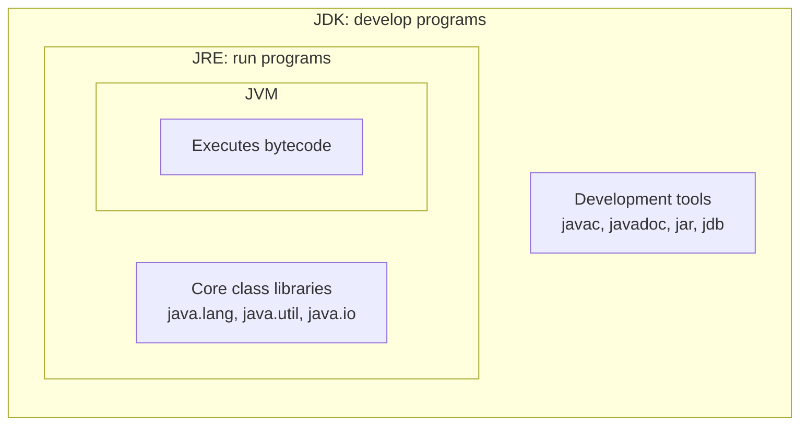

JDK = JRE + development tools · JRE = JVM + core libraries · JVM = the engine that executes bytecode.

- **Bytecode:** the platform-independent, intermediate `.class` code produced by `javac`. It is **not** machine code. It is the instruction set of the JVM.
- **JVM (Java Virtual Machine):** an abstract machine that loads, verifies and executes bytecode. It is **platform dependent** (a different JVM for Windows, Linux, macOS), but bytecode stays the same, and this is what gives Java its portability. Parts: **Class Loader**, **Bytecode Verifier**, **Interpreter**, **JIT compiler**, **Garbage Collector**, memory areas (**Heap, Stack, Method Area, PC registers, Native Method Stack**).
- **JRE (Java Runtime Environment):** what you need to **run** Java programs (JVM + libraries).
- **JDK (Java Development Kit):** what you need to **develop** Java programs (JRE + compiler `javac` + tools).

**Compilation and execution flow**

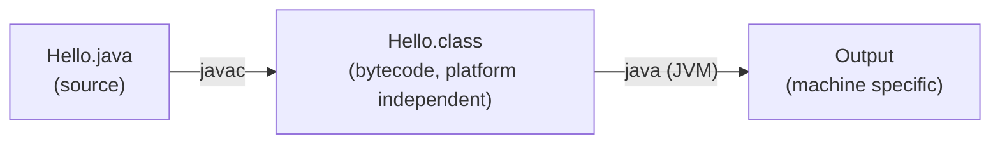

### 2.4 Java applications
Standalone/desktop applications (Swing/JavaFX), web applications (Servlets/JSP/Spring), enterprise applications (Java EE), mobile applications (Android), embedded systems/IoT, big-data tools (Hadoop), games, scientific tools.

### 2.5 First program and its anatomy

```java
public class Hello {
    public static void main(String[] args) {
        System.out.println("Hello, Java!");
    }
}
```

| Part | Meaning |
|---|---|
| `public class Hello` | The class declaration. The file must be named **Hello.java** if the class is `public` |
| `public` | The JVM must be able to access `main` from outside |
| `static` | The JVM calls `main` **without creating an object** |
| `void` | `main` returns nothing to the JVM |
| `main` | Entry point of the program |
| `String[] args` | Command-line arguments |
| `System.out.println` | `System` is a class, `out` is a static `PrintStream` object, `println` is its method |

**Run:**

```text
javac Hello.java
java Hello
```

### 2.6 Basics: data types, variables, operators

**Primitive data types (8):**

| Type | Size | Default | Example |
|---|---|---|---|
| `byte` | 1 byte | 0 | `byte b = 10;` |
| `short` | 2 bytes | 0 | |
| `int` | 4 bytes | 0 | `int a = 5;` |
| `long` | 8 bytes | 0L | `long l = 100L;` |
| `float` | 4 bytes | 0.0f | `float f = 1.5f;` |
| `double` | 8 bytes | 0.0d | `double d = 2.5;` |
| `char` | 2 bytes (16-bit Unicode) | `'\u0000'` | `char c = 'A';` |
| `boolean` | JVM dependent (1 bit of information) | false | `boolean ok = true;` |

**Non-primitive (reference) types:** classes, interfaces, arrays, `String`.

**Type casting**

- *Widening (implicit, automatic):* `byte → short → int → long → float → double`. Example: `int i = 5; double d = i;`
- *Narrowing (explicit):* `double d = 9.7; int i = (int) d;` → `9` (data may be lost).

**Operators:** arithmetic (`+ - * / %`), relational, logical (`&& || !`), bitwise (`& | ^ ~ << >> >>>`), assignment, ternary `?:`, `instanceof`, increment/decrement.

**Control statements:** `if/else`, `switch`, `for`, `while`, `do-while`, `break`, `continue`, enhanced `for-each`.

**Variable types:** *local* (inside a method, no default value, must be initialised), *instance* (non-static, inside a class, one copy per object), *static/class* (one copy per class).

### 2.7 Interactive programs with `Scanner` (college slides)

An **interactive program** reads input from the console while it runs: it asks the user to type something, and the typed value is stored in variables. Users are unpredictable, so input must be handled carefully, but interactive programs behave more interestingly.

**`Scanner`** is an object that can read input from many sources. It communicates with **`System.in`** (the opposite of `System.out`), and it can also read from files, web sites and so on.

**Syntax**

```java
import java.util.*;                        // Scanner is in java.util
Scanner console = new Scanner(System.in);  // Scanner name = new Scanner(System.in);
```

**Scanner methods**

| Method | Description |
|---|---|
| `nextInt()` | reads an `int` from the user and returns it |
| `nextDouble()` | reads a `double` from the user |
| `next()` | reads a one-word `String` from the user |
| `nextLine()` | reads a one-line `String` from the user |

Each method waits until the user presses Enter, then returns the typed value. A **prompt** is a message telling the user what to type.

**Example 1: years until retirement**

```java
import java.util.*;                 // so that I can use Scanner

public class UserInputExample {
    public static void main(String[] args) {
        Scanner console = new Scanner(System.in);

        System.out.print("How old are you? ");   // prompt
        int age = console.nextInt();

        int years = 65 - age;
        System.out.println(years + " years until retirement!");
    }
}
/* Console (user types 29):
How old are you? 29
36 years until retirement!
*/
```

**Example 2: product of two numbers (several values on one line)**

```java
import java.util.*;

public class ScannerMultiply {
    public static void main(String[] args) {
        Scanner console = new Scanner(System.in);

        System.out.print("Please type two numbers: ");
        int num1 = console.nextInt();
        int num2 = console.nextInt();

        int product = num1 * num2;
        System.out.println("The product is " + product);
    }
}
/* Output (user types 8 6):
Please type two numbers: 8 6
The product is 48
*/
```

!!! warning "The `nextLine()` trap"
    After `nextInt()`, the Enter key (newline) is still left in the input. A `nextLine()` called right after it returns an **empty string**. Call an extra `console.nextLine();` to consume the leftover newline first.

**Command-line arguments** (another way to give input)

```java
public class CLA {
    public static void main(String[] args) {
        System.out.println("Count = " + args.length);
        for (String s : args) System.out.println(s);
    }
}
// java CLA hello 10  → Count = 2, hello, 10
```

### 2.8 Java vs C++

| Java | C++ |
|---|---|
| Platform independent (bytecode) | Platform dependent (machine code) |
| No pointers | Supports pointers |
| No multiple inheritance of classes (uses interfaces) | Supports multiple inheritance |
| Automatic garbage collection | Manual (`delete`) |
| No operator overloading | Supports it |
| No `goto`, no preprocessor, no header files | Has them |
| Everything lives inside classes | Can have global functions |

### 2.9 Naming conventions
Classes: `PascalCase` (`StudentRecord`) · methods/variables: `camelCase` (`getName`) · constants: `UPPER_CASE` (`MAX_SIZE`) · packages: lowercase (`java.util`).

### Short Questions: Chapter 2

**Q1. Why is Java called platform independent?**

**Ans.** The compiler converts source code into bytecode, not machine code. Bytecode can run on any machine that has a JVM, so the same `.class` file works on every platform.

**Q2. Differentiate JDK, JRE and JVM.**

**Ans.** JVM executes bytecode. JRE = JVM + libraries (to run programs). JDK = JRE + development tools like `javac` (to develop programs).

**Q3. What is bytecode?**

**Ans.** The intermediate, platform-neutral instruction set generated by the Java compiler and stored in a `.class` file. The JVM interprets or JIT-compiles it.

**Q4. Why is `main` declared `public static void`?**

**Ans.** `public` so the JVM can call it from outside; `static` so it can be called without creating an object; `void` because it returns nothing to the JVM.

**Q5. Is Java a purely object-oriented language? Why?**

**Ans.** No. It has 8 primitive data types that are not objects, and `static` members that belong to the class and not to an object.

**Q6. What is a JIT compiler?**

**Ans.** A part of the JVM that compiles frequently executed bytecode into native machine code at run time to improve performance.

**Q7. What is `Scanner`? Which package contains it?**

**Ans.** A class used to read input (from `System.in`, files, etc.). It is in `java.util`.

**Q8. Difference between `next()` and `nextLine()`?**

**Ans.** `next()` reads one word (up to a space); `nextLine()` reads the whole line up to Enter.

**Q9. What is the role of the garbage collector?**

**Ans.** It automatically frees heap memory occupied by objects that are no longer reachable.

### Long Questions: Chapter 2

**Q1. Explain the features of Java. (6 marks)**

**Ans.** Use the table in 2.2. Write at least 8 features, with one line of explanation each.

**Q2. Explain the architecture of the JVM and the process of executing a Java program. Distinguish JDK, JRE and JVM. (8 marks)**

**Ans.** Draw the flow `Source → javac → bytecode → Class Loader → Bytecode Verifier → Interpreter/JIT → Output`. Explain the JVM components (class loader, verifier, execution engine, runtime memory areas, GC). Then give the JDK ⊃ JRE ⊃ JVM relationship.

**Q3. Explain the structure of a simple Java program and each keyword of `public static void main(String[] args)`. (5 marks)**

**Ans.** Use the program and table in 2.5.

**Q4. What is an interactive program? Write a program using `Scanner` to read two numbers and print their product. (5 marks)**

**Ans.** Definition and `Scanner` syntax from 2.7 → methods table → `ScannerMultiply` with output.

---

## Chapter 3: Classes and Objects in Java

### 3.1 Declaring a class

```java
class Student {
    // instance variables (state)
    int roll;
    String name;

    // method (behaviour)
    void display() {
        System.out.println(roll + " " + name);
    }
}
```

General form: `[access] class ClassName [extends Super] [implements Interfaces] { fields; constructors; methods; blocks }`

### 3.2 Creating objects (instances)

```java
Student s1 = new Student();   // declaration + instantiation + initialisation
s1.roll = 1;
s1.name = "Asha";
s1.display();
```

`Student s1;` only **declares a reference**. `new Student()` allocates memory on the **heap** and calls the constructor. The reference `s1` (on the stack) holds the address of the object. Members are accessed with the **dot** operator (`s1.roll`).

```text
Stack            Heap
s1 ──────────►  [ roll=1 | name="Asha" ]
```

**Multiple references:** `Student s2 = s1;` both refer to the **same** object. Changes through `s2` are visible through `s1`.

### 3.3 Methods

```java
returnType methodName(parameterList) { body; return value; }
```

```java
class Calc {
    int add(int a, int b) { return a + b; }
}
```

### 3.4 The `this` keyword
A reference to the **current object**. Uses:

1. Differentiate an instance variable from a parameter with the same name.
2. Call another method of the current class.
3. Call another constructor: `this(...)` (constructor chaining, see Chapter 4).
4. Pass the current object as an argument.
5. Return the current object (method chaining).

```java
class Box {
    int w;
    Box(int w) { this.w = w; }          // this.w = field, w = parameter
    Box setW(int w) { this.w = w; return this; }
}
```

### 3.5 Argument passing: Java is *always pass-by-value*

- **Primitives:** a **copy of the value** is passed, so changes inside the method do not affect the caller.
- **Objects:** a **copy of the reference** is passed. The method can **modify the object's contents** (visible to the caller), but **reassigning** the parameter to a new object does not change the caller's reference.

```java
class Test {
    static void change(int x)      { x = 100; }                 // no effect
    static void change(int[] a)    { a[0] = 100; }              // visible
    static void reassign(int[] a)  { a = new int[]{9, 9}; }     // no effect on caller

    public static void main(String[] args) {
        int n = 5;       change(n);        System.out.println(n);       // 5
        int[] arr = {1}; change(arr);      System.out.println(arr[0]);  // 100
        reassign(arr);                     System.out.println(arr[0]);  // 100
    }
}
```

### 3.6 Returning objects

```java
class Point {
    int x, y;
    Point(int x, int y) { this.x = x; this.y = y; }
    Point add(Point p) { return new Point(x + p.x, y + p.y); }
}
```

### 3.7 Inner classes (nested classes)

A class defined **inside another class**. Reasons: logical grouping, better encapsulation, more readable code.

| Type | Declared | Key points |
|---|---|---|
| **Member (non-static) inner class** | Inside a class, outside methods | Needs an outer object: `Outer.Inner in = outer.new Inner();` Can access **all** members of the outer class (even `private`) |
| **Static nested class** | Inside a class with `static` | No outer object needed: `Outer.Nested n = new Outer.Nested();` Can access only **static** members of the outer class directly |
| **Local inner class** | Inside a method | Visible only inside that method. Can use `final`/effectively final local variables |
| **Anonymous inner class** | Declared and instantiated in one expression, with no name | Used to override a method or implement an interface instantly |

```java
class Outer {
    private int data = 10;

    class Inner {                       // member inner class
        void show() { System.out.println("data = " + data); }
    }

    static class Nested {               // static nested class
        void show() { System.out.println("static nested"); }
    }

    void method() {
        class Local {                   // local inner class
            void show() { System.out.println("local, data = " + data); }
        }
        new Local().show();
    }
}

public class InnerDemo {
    public static void main(String[] args) {
        Outer o = new Outer();
        Outer.Inner in = o.new Inner();
        in.show();                              // data = 10
        new Outer.Nested().show();              // static nested
        o.method();                             // local, data = 10

        Runnable r = new Runnable() {           // anonymous inner class
            public void run() { System.out.println("anonymous"); }
        };
        r.run();
    }
}
```

### 3.8 Garbage collection and `finalize()`
Objects are **not explicitly freed or destroyed** in Java; the JVM automatically reclaims unused objects. Objects with **no references** are eligible for GC. `System.gc()` only *requests* collection. `finalize()` (deprecated in recent versions) was called by the GC just before destroying an object. An object becomes eligible when you set its reference to `null`, reassign the reference, or when it was created inside a method that has finished.

### Short Questions: Chapter 3

**Q1. Difference between class and object?**

**Ans.** Class = blueprint (logical, no memory for instance data until objects are created). Object = instance of a class (physical, occupies heap memory).

**Q2. What is the use of the `new` operator?**

**Ans.** It allocates memory for an object on the heap, calls the constructor and returns the reference.

**Q3. What is the `this` keyword? Give two uses.**

**Ans.** A reference to the current object. Uses: resolve the name conflict between a field and a parameter (`this.x = x`); call another constructor with `this(...)`.

**Q4. Is Java pass-by-value or pass-by-reference?**

**Ans.** Always pass-by-value. For objects, the value passed is a copy of the reference.

**Q5. What is an inner class? Why use it?**

**Ans.** A class declared inside another class. It groups related classes, increases encapsulation, and has direct access to the outer class's members.

**Q6. How do you create an object of a member inner class from `main`?**

**Ans.** `Outer.Inner obj = new Outer().new Inner();`

**Q7. What is an anonymous class?**

**Ans.** An inner class without a name, declared and instantiated in a single expression, used to implement an interface or extend a class once.

### Long Questions: Chapter 3

**Q1. What is a class? Explain how a class is declared and objects are created, with a program. (6 marks)**

**Ans.** Definition → syntax → a `Student` or `Rectangle` class with fields, a method and `main` creating two objects → the stack/heap diagram.

**Q2. Explain argument passing in Java with examples for primitives and objects. (6 marks)**

**Ans.** Use the program in 3.5 and explain each of the three outputs (5, 100, 100).

**Q3. Explain the types of inner classes with examples. (8 marks)**

**Ans.** Use the table and program in 3.7.

---

## Chapter 4: Constructors, Overloading and static Members

### 4.1 Constructors

A **constructor** is a special member that **initialises an object** when it is created.

**Rules:** the name is the **same as the class** name · **no return type** (not even `void`) · called **automatically** with `new` · cannot be `static`, `final` or `abstract` · can be overloaded.

#### Types

**1. Default constructor.** If you write **no** constructor, Java provides a default no-argument constructor that initialises fields to defaults (0, null, false).

**2. No-argument (user-defined) constructor**

```java
class A { A() { System.out.println("created"); } }
```

**3. Parameterised constructor**

```java
class Student {
    int roll; String name;
    Student(int roll, String name) { this.roll = roll; this.name = name; }
}
Student s = new Student(1, "Ravi");
```

**4. Copy constructor** (Java has no built-in one, so you write it)

```java
Student(Student s) { this.roll = s.roll; this.name = s.name; }
```

!!! warning "Common trap"
    If you write **any** constructor (e.g. a parameterised one), the compiler does **not** add a default one. `new Student()` then gives a compile error unless you also write a no-arg constructor.

#### Constructor chaining with `this()`

```java
class Rect {
    int l, b;
    Rect()            { this(1, 1); }                 // calls the 2-arg constructor
    Rect(int s)       { this(s, s); }
    Rect(int l, int b){ this.l = l; this.b = b; }
}
```
`this(...)` must be the **first statement** in the constructor.

#### Constructor vs method

| Constructor | Method |
|---|---|
| Initialises an object | Defines behaviour |
| Same name as class | Any name |
| No return type | Must have a return type |
| Called implicitly by `new` | Called explicitly |
| Compiler provides a default | Not provided |

### 4.2 Method overloading (compile-time polymorphism)

**Method overloading** is defining multiple methods with **the same name but different argument lists** (different number, type or order) in the same class. The **return type alone cannot** distinguish overloaded methods.

```java
class Calc {
    int add(int a, int b)           { return a + b; }
    int add(int a, int b, int c)    { return a + b + c; }
    double add(double a, double b)  { return a + b; }
}
```

**Resolution with type promotion:** if no exact match exists, Java widens the argument (`byte → short → int → long → float → double`).

```java
class P {
    static void f(int x)    { System.out.println("int"); }
    static void f(double x) { System.out.println("double"); }
    public static void main(String[] a) {
        f(5);       // int
        f(5.5);     // double
        f('A');     // int   (char is promoted to int)
        f(5L);      // double (long promoted, there is no f(long))
    }
}
```

**Constructor overloading** works the same way (see the `Rect` example).

### 4.3 The `static` keyword

`static` members belong to the **class**, not to any object (**class variables** vs **instance variables**). They are loaded once when the class is loaded.

#### (a) Static variable
One shared copy for all objects.

```java
class Student {
    int roll;
    static String college = "KGEC";     // shared
    static int count = 0;
    Student() { count++; roll = count; }
}
```

#### (b) Static method

- Called with the class name: `ClassName.method()`.
- Can access **only static** members directly.
- Cannot use `this` or `super`.

```java
class MathUtil {
    static int square(int n) { return n * n; }
}
// MathUtil.square(5)
```

#### (c) Static block
Runs **once**, when the class is loaded, **before `main`** and before any object is created.

```java
class T {
    static int x;
    static { x = 10; System.out.println("static block"); }
    public static void main(String[] a) { System.out.println("main " + x); }
}
// Output: static block
//         main 10
```

#### (d) Instance initialiser block
Runs **every time an object is created**, **before the constructor body**.

```java
class U {
    { System.out.println("init block"); }
    U() { System.out.println("constructor"); }
    public static void main(String[] a) { new U(); new U(); }
}
// init block, constructor, init block, constructor
```

#### Order of initialisation
static variables/blocks (once, top to bottom) → instance variables/blocks (each object, top to bottom) → constructor body.

#### Can we override a static method?
No. A static method with the same signature in the subclass **hides** the parent's (method hiding). It is resolved at compile time.

#### Static vs instance

| Static | Instance |
|---|---|
| One copy per class | One copy per object |
| Accessed via class name | Accessed via an object |
| Loaded at class loading | Created at object creation |
| Cannot access instance members directly | Can access both |

### Short Questions: Chapter 4

**Q1. What is a constructor? Can it be private?**

**Ans.** A special method that initialises an object, named like the class with no return type. Yes, it can be private (used in the Singleton pattern or to block instantiation).

**Q2. What happens if there is no constructor in a class?**

**Ans.** Java provides a default no-argument constructor.

**Q3. Can a constructor be overloaded? Can it be inherited?**

**Ans.** It can be overloaded. Constructors are **not** inherited by subclasses.

**Q4. What is method overloading? Can we overload by return type?**

**Ans.** Same method name with different argument lists in one class. No, the return type alone is not enough.

**Q5. Why can a static method not use non-static members?**

**Ans.** Static methods run without any object, so there is no `this` and no instance data to refer to.

**Q6. What is a static block? When does it run?**

**Ans.** A block marked `static` used to initialise static data. It runs once when the class is loaded, before `main`.

**Q7. What is constructor chaining?**

**Ans.** Calling one constructor from another using `this(...)` (same class) or `super(...)` (parent class).

**Q8. Output?**

```java
class A { static int x = 5; int y = 5; }
// new A().x++ ; new A().y++ ; then print new A().x + " " + new A().y
```

**Ans.** `6 5`. `x` is shared (incremented once), `y` is per-object.

### Long Questions: Chapter 4

**Q1. What is a constructor? Explain its types with examples. How does it differ from a method? (8 marks)**

**Ans.** Definition and rules → default, parameterised, copy (with code) → constructor chaining with `this()` → comparison table.

**Q2. Explain method overloading with a program. How does Java resolve an overloaded call? (6 marks)**

**Ans.** Definition → the `Calc` program → type-promotion example → overloading is compile-time polymorphism.

**Q3. Explain the `static` keyword: variables, methods and blocks, with a program. (8 marks)**

**Ans.** Use 4.3 (a)-(c) and the `Student.count` program. State the restrictions on static methods.

**Q4. Write a program to count the number of objects created for a class.**

```java
class Counter {
    static int count = 0;
    Counter() { count++; }
    static int getCount() { return count; }
    public static void main(String[] args) {
        new Counter(); new Counter(); new Counter();
        System.out.println("Objects: " + Counter.getCount());   // 3
    }
}
```

---

## Chapter 5: Inheritance (Classes and Subclasses, or Extending a Class)

### 5.1 Introduction

**Reusability**, building new components by using existing ones, is an important aspect of the OO paradigm. It is more productive to reuse something that already exists than to create it all over again. Java achieves this by **creating new classes that reuse the properties of existing classes**.

**Inheritance** is the mechanism of **deriving a new class from an existing (old) class**.

- The old class is called the **base class**, **super class** or **parent class**.
- The new class is called the **sub class**, **derived class** or **child class**.
- The subclass inherits all the **properties (variables and methods)** of its parent class (except private members and constructors) and can add its own.

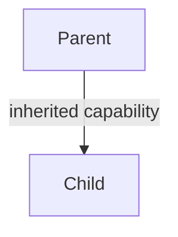

### 5.2 Forms of inheritance

| Form | Meaning |
|---|---|
| **Single** | Only one super class (`B` from `A`) |
| **Multiple** | Several super classes (`C` from `A` and `B`) |
| **Hierarchical** | One super class, many sub classes (`B`, `C`, `D` from `A`) |
| **Multi-level** | Derived from a derived class (`A → B → C`) |
| **Hybrid** | A combination of two or more of the above |

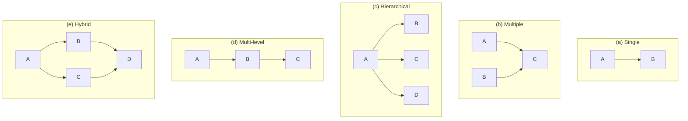

!!! info "Which forms do Java classes support?"
    Java classes support **single, multi-level and hierarchical** inheritance. **Multiple** (and therefore most **hybrid**) inheritance is **not** allowed with classes, because of the **diamond problem**: if `C` extends both `A` and `B` and both define `show()`, `C` cannot decide which `show()` it inherits. Java gets the same effect through **interfaces** (Chapter 6): a class can extend only one class but implement many interfaces.

### 5.3 Defining a subclass

```java
class SubClassName extends SuperClassName
{
    fields declaration;
    methods declaration;
}
```

The keyword **`extends`** signifies that the properties of the super class are extended to the subclass. The subclass contains **its own members as well as those of the super class**. This is used when we want to **enhance the properties of an existing class without actually modifying it**.

#### Slide example: Circle and GraphicCircle

A `Circle` class captures basic properties (`x, y, r`, `area()`, `circumference()`). A drawing application needs a circle that can also draw itself (`GraphicCircle`).

**Without inheritance** (not elegant: every method must be forwarded to the inner circle):

```java
public class GraphicCircle {
    public Circle c;                       // keep a copy of a circle
    public double area()          { return c.area(); }
    public double circumference() { return c.circumference(); }
    // new instance variables, methods for this class
    public Color outline, fill;
    public void draw(DrawWindow dw) { /* drawing code here */ }
}
```

**With inheritance** (`GraphicCircle` becomes a subclass of `Circle`):

```java
public class GraphicCircle extends Circle {
    // automatically inherits all the variables and methods of Circle,
    // so only the 'new stuff' is written here
    Color outline, fill;
    public void draw(DrawWindow dw) {
        dw.drawCircle(x, y, r, outline, fill);
    }
}
```

```text
        Circle                     ← superclass / base / parent
   x, y, r : double
   area() : double
   circumference() : double
          ▲
          │ extends
     GraphicCircle                 ← subclass / derived / child
   outline, fill : Color
   draw(DrawWindow) : void
```

**Each `GraphicCircle` object is also a `Circle`** (IS-A relationship). (`DrawWindow` is only an illustrative class in the slide.)

### 5.4 Subclasses and constructors

- A **default constructor** of the subclass automatically calls the constructor of the base class:
  `GraphicCircle drawableCircle = new GraphicCircle();` → the default constructor of `Circle` is called first.
- A **defined constructor** can invoke a specific base class constructor with `super`:

```java
public GraphicCircle(double x, double y, double r, Color outline, Color fill) {
    super(x, y, r);            // calls Circle(double, double, double)
    this.outline = outline;
    this.fill = fill;
}
```

### 5.5 Program for single inheritance (slide program)

```java
class Room {
    int length, breadth;
    Room(int x, int y) {
        length = x;
        breadth = y;
    }
    int Area() {
        return (length * breadth);
    }
}

class Room1 extends Room {
    int height;
    Room1(int x, int y, int z) {
        super(x, y);            // pass values to the super class constructor
        height = z;
    }
    int Volume() {
        return (length * breadth * height);
    }
}

class SingleInheritance {
    public static void main(String args[]) {
        Room1 r1 = new Room1(10, 12, 14);
        int area1 = r1.Area();          // inherited from Room
        int volume1 = r1.Volume();
        System.out.println("Area=" + area1);
        System.out.println("Volume=" + volume1);
    }
}
/* Output:
Area=120
Volume=1680
*/
```

**Multi-level and hierarchical (short forms)**

```java
// Multi-level
class Grand  { void g() { System.out.println("grand"); } }
class Parent extends Grand  { void p() { System.out.println("parent"); } }
class Child  extends Parent { void c() { System.out.println("child"); } }
// a Child object can call g(), p() and c()

// Hierarchical
class Shape  { void draw() { System.out.println("drawing"); } }
class Circle extends Shape { }
class Square extends Shape { }
```

### 5.6 The `super` keyword

Whenever a subclass needs to refer to its **immediate super class**, it uses the keyword **`super`**. It has **two general forms**:

1. **It calls the super class constructor:** `super(argument-list);`
2. **It accesses a member of the super class that has been hidden by a member of the subclass:** `super.member` (a field or an overridden method).

**Conditions for using `super(...)` to call the constructor** (slide):

- `super` may only be used **within a subclass constructor** method.
- The call to the super class constructor must appear as **the first statement** in the subclass constructor.
- The parameters in the `super` call must **match the order and type** of the instance variables declared in the super class (i.e. match a super class constructor).

**Second form: access hidden members**

```java
class A { int x = 10; void show() { System.out.println("A.show"); } }
class B extends A {
    int x = 20;
    void show() {
        System.out.println(x);        // 20 (own field)
        System.out.println(super.x);  // 10 (hidden super class field)
        super.show();                 // A.show (overridden super class method)
    }
}
```

#### Constructor call order
When a child object is created, the **parent constructor runs first**, then the child's. If you don't write `super(...)`, the compiler inserts a hidden `super();`, so the parent must have a no-arg constructor (otherwise compile error).

```java
class A { A() { System.out.println("A"); } }
class B extends A { B() { System.out.println("B"); } }
class C extends B { C() { System.out.println("C"); } }
// new C();  →  A  B  C
```

### 5.7 Method overriding

When a derived class defines a method with the **same name, return type and arguments** as a method in its parent class, the derived class method **overrides** the parent's method. A call through a subclass object runs the subclass version.

**Slide program**

```java
class A {
    int x;
    A(int x) {
        this.x = x;
    }
    void display() {
        System.out.println("Super x=" + x);
    }
}

class B extends A {
    int y;
    B(int x, int y) {
        super(x);
        this.y = y;
    }
    void display() {                         // overrides A's display()
        System.out.println("Super x=" + x);
        System.out.println("Sub y=" + y);
    }
}

class OverrideDemo {
    public static void main(String args[]) {
        B b = new B(10, 20);
        b.display();
    }
}
/* Output:
Super x=10
Sub y=20
*/
```

**Rules of overriding**

1. Same method name and same parameter list.
2. The return type must be the same or a **covariant** (subclass) type.
3. The access level cannot be **more restrictive** (`public` can't become `protected`).
4. The overriding method cannot throw **new or broader checked exceptions**.
5. **`static`, `private` and `final` methods cannot be overridden.**
6. Constructors cannot be overridden.
7. From a subclass, the overridden super class method can still be called with **`super.method()`**.
8. `@Override` asks the compiler to check that you really are overriding.

#### Overloading vs Overriding

| Overloading | Overriding |
|---|---|
| Same class | Parent–child classes |
| Same name, **different argument lists** | Same name, **same arguments and return type** |
| Compile-time polymorphism | Runtime polymorphism (dynamic method dispatch) |
| Return type can differ | Same or covariant |
| No access restriction | Cannot reduce visibility |
| `static` methods can be overloaded | `static` methods cannot be overridden (hiding) |

### 5.8 Using all in one: `person` and `student` (slide program)

```text
        person                    ← superclass
   name : String   (private)
   sex  : char     (protected)
   age  : int      (public)
   Display() : void
          ▲
        student                   ← subclass
   RollNo : int    (private)
   branch : String
   Display() : void   (overrides)
```

```java
// Student.java: student inheriting properties of person class
class person {
    private String name;
    protected char sex;          // note protected
    public int age;

    person() {
        name = null;
        sex = 'U';               // unknown
        age = 0;
    }
    person(String name, char sex, int age) {
        this.name = name;
        this.sex = sex;
        this.age = age;
    }
    String getName() {
        return name;
    }
    void Display() {
        System.out.println("Name = " + name);
        System.out.println("Sex = " + sex);
        System.out.println("Age = " + age);
    }
}

class student extends person {
    private int RollNo;
    String branch;

    student(String name, char sex, int age, int RollNo, String branch) {
        super(name, sex, age);   // calls parent class's constructor with 3 arguments
        this.RollNo = RollNo;
        this.branch = branch;
    }
    void Display() {             // method overriding
        System.out.println("Roll No = " + RollNo);
        System.out.println("Name = " + getName());   // name is private in person
        System.out.println("Sex = " + sex);
        System.out.println("Age = " + age);
        System.out.println("Branch = " + branch);
    }
    void TestMethod() {          // test what is valid to access
        // name = "Mark";        // Error: name is private
        sex = 'M';               // OK: protected
        RollNo = 20;             // OK: own member
    }
}

class MyTest {
    public static void main(String args[]) {
        student s1 = new student("Rama", 'M', 21, 1, "Computer Science");
        student s2 = new student("Sita", 'F', 19, 2, "Software Engineering");
        System.out.println("Student 1 Details...");
        s1.Display();
        System.out.println("Student 2 Details...");
        s2.Display();
        person p1 = new person("Rao", 'M', 45);
        System.out.println("Person Details...");
        p1.Display();
    }
}
```

```text
Student 1 Details...
Roll No = 1
Name = Rama
Sex = M
Age = 21
Branch = Computer Science
Student 2 Details...
Roll No = 2
Name = Sita
Sex = F
Age = 19
Branch = Software Engineering
Person Details...
Name = Rao
Sex = M
Age = 45
```

**Points from the slide**

- `name` is **private**, so `student` cannot use it directly; it calls `getName()` instead.
- `sex` is **protected** and `age` is **public**, so `student` can use them directly.
- *What happens if the super class constructor is not explicitly invoked?* The **default (no-arg) constructor** of `person` is invoked automatically.
- *Can we create an object of the `person` class?* **Yes**, because `person` is not abstract (`p1` above).

### 5.9 The `Object` class
`java.lang.Object` is the **default superclass** of every class; it is the **root of the Java class hierarchy**. Important methods: `toString()`, `equals()`, `hashCode()`, `getClass()`, `clone()`, `finalize()`, `wait()/notify()`.

### 5.10 Important points

- A subclass inherits the **non-private** methods and variables of its super class. **Constructors and private members are not inherited.**
- A superclass reference can hold a subclass object (**upcasting**). The reverse needs an explicit cast (**downcasting**).
- Reference: *Balagurusamy, Programming with Java*, Chapter 8 (Sections 8.11 to 8.14).

### Short Questions: Chapter 5

**Q1. What is inheritance? What are its advantages?**

**Ans.** The mechanism of deriving a new class (subclass) from an existing class (super class) using `extends`. Advantages: reusability, extending an existing class without modifying it, runtime polymorphism, less redundancy.

**Q2. List the forms of inheritance. Which are supported by Java classes?**

**Ans.** Single, multiple, hierarchical, multi-level and hybrid. Java classes support single, multi-level and hierarchical; multiple inheritance is achieved through interfaces.

**Q3. Why is multiple inheritance not supported with classes in Java?**

**Ans.** To avoid the diamond problem (ambiguity when two parents provide the same method). Interfaces are used instead.

**Q4. What are the two forms of `super`?**

**Ans.** (1) `super(args)` calls the super class constructor; (2) `super.member` accesses a super class member hidden by the subclass.

**Q5. State the conditions for using `super` to call a constructor.**

**Ans.** Only inside a subclass constructor; it must be the first statement; its parameters must match a super class constructor in order and type.

**Q6. Are constructors inherited?**

**Ans.** No. But a child constructor calls the parent constructor through `super()`.

**Q7. Difference between `this` and `super`?**

**Ans.**

| `this` | `super` |
|---|---|
| Refers to the current class object | Refers to the immediate parent class |
| `this()` calls a constructor of the same class | `super()` calls the parent constructor |
| Accesses current-class members | Accesses hidden/overridden parent members |

**Q8. What is method overriding? Which methods cannot be overridden?**

**Ans.** A subclass redefining a method inherited from its super class with the same name, return type and arguments. `static`, `private` and `final` methods cannot be overridden.

**Q9. What is the output?**

```java
class A { A() { System.out.println("A"); } }
class B extends A { B() { System.out.println("B"); } }
public class M { public static void main(String[] a) { new B(); } }
```

**Ans.** `A` then `B` (the parent constructor runs first).

### Long Questions: Chapter 5

**Q1. What is inheritance? Explain the different forms of inheritance with diagrams. (8 marks)**

**Ans.** Definition (base/derived class names) → table and diagrams of the five forms in 5.2 → note on Java's support → `extends` syntax.

**Q2. Write a program to demonstrate single inheritance using `super`. (6 marks)**

**Ans.** The `Room`/`Room1` program in 5.5 with output 120 and 1680.

**Q3. Explain the `super` keyword with its rules and examples. (6 marks)**

**Ans.** Two forms → three conditions → `Room1` constructor and the hidden-member example → constructor order.

**Q4. What is method overriding? Explain with a program and differentiate it from overloading. (8 marks)**

**Ans.** Definition → `A`/`B` `display()` program and output → rules → comparison table.

**Q5. Write a program where a `student` class inherits a `person` class, showing the use of private, protected and public members. (10 marks)**

**Ans.** The full program and output in 5.8 plus the points listed below it.

---

## Chapter 6: `final` Keyword, Abstract Class, Dynamic Method Dispatch and Interface

### 6.1 Restricting inheritance: the `final` keyword

#### Final members: preventing overriding
By default, all methods and variables can be overridden (redefined) in subclasses. This can be prevented by declaring them **`final`**:

```java
final int marks = 100;      // final variable: value cannot be altered
final void display() { }    // final method: cannot be overridden
```

This ensures that the functionality defined in the method **cannot be altered in any way**, and the value of a final variable **cannot be changed**.

#### Final classes: preventing a class from being extended

```java
final class Person {
    // members
}

final class Student extends Person {   // ERROR: cannot inherit from final class Person
    // members
}
```

Any attempt to inherit from a final class causes a compile-time error. (Library examples: `String`, `Integer`.)

| Applied to | Effect |
|---|---|
| **Variable** | Becomes a **constant**: assigned only once. `static final double PI = 3.14;` is a class constant |
| **Method** | **Cannot be overridden** in a subclass |
| **Class** | **Cannot be extended** |
| **Parameter** | Cannot be reassigned inside the method |

- A **blank final** variable (declared but not initialised) must be initialised in **every constructor**.
- A `final` reference cannot point to another object, but the **object's contents can still change**:

```java
final int[] arr = {1, 2};
arr[0] = 9;          // allowed
// arr = new int[3]; // ERROR
```

### 6.2 Abstract classes

When a class is `final`, it cannot be extended. In some situations we want the opposite: the properties of a class should **always be extended and used**. Such classes are **abstract classes**.

- An abstract class is a **conceptual class**.
- It **cannot be instantiated** (objects cannot be created).
- It provides a **common root for a group of classes**.

**Syntax**

```java
abstract class ClassName
{
    ...
    abstract Type MethodName1();      // no body

    Type Method2()
    {
        // method body
    }
}
```

- When a class contains one or more abstract methods, it **should be declared abstract**.
- The abstract methods of an abstract class **must be defined in its subclass**.
- We **cannot declare abstract constructors or abstract static methods**.

#### Slide example: `Shape`, `Circle`, `Rectangle`

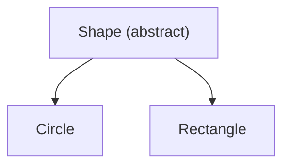

```java
public abstract class Shape {
    public abstract double area();        // abstract method
    public void move() {                  // non-abstract method
        // implementation
    }
}

class Circle extends Shape {
    protected double r;
    protected static final double PI = 3.1415926535;
    public Circle() { r = 1.0; }
    public double area() { return PI * r * r; }
}

class Rectangle extends Shape {
    protected double w, h;
    public Rectangle() { w = 0.0; h = 0.0; }
    public double area() { return w * h; }
}
```

**Is `Shape s = new Shape();` valid?** **No.** It is illegal because `Shape` is abstract and cannot be instantiated. But a **reference** is allowed: `Shape s = new Circle();`

!!! warning "Slide correction"
    The slide writes `public Circle extends Shape` and `{ r = 1.0; )`. The correct form is `class Circle extends Shape` with matching braces `{ r = 1.0; }`.

**A complete program to write in the exam**

```java
abstract class Shape {
    String color;
    Shape(String c) { color = c; }                      // constructors are allowed
    abstract double area();
    void showColor() { System.out.println("Colour: " + color); }
}
class Circle extends Shape {
    double r;
    Circle(String c, double r) { super(c); this.r = r; }
    double area() { return Math.PI * r * r; }
}
class Rectangle extends Shape {
    double l, b;
    Rectangle(String c, double l, double b) { super(c); this.l = l; this.b = b; }
    double area() { return l * b; }
}
public class AbsDemo {
    public static void main(String[] args) {
        Shape s1 = new Circle("Red", 2);
        Shape s2 = new Rectangle("Blue", 3, 4);
        System.out.println(s1.area());       // 12.566370614359172
        System.out.println(s2.area());       // 12.0
        s2.showColor();                      // Colour: Blue
    }
}
```

#### Properties of abstract classes (slide)

1. A class with **one or more abstract methods** is automatically abstract and cannot be instantiated.
2. A class **declared abstract, even with no abstract methods**, cannot be instantiated.
3. A subclass of an abstract class **can be instantiated if it overrides (implements) all** the abstract methods.
4. A subclass that **does not implement all** the superclass abstract methods is **itself abstract** and cannot be instantiated.

Also: an abstract class may have constructors, fields, concrete and static methods; `abstract` cannot be combined with `final`, `private` or `static` on a method.

#### Summary: `final` vs `abstract` (slide)

| `final` | `abstract` |
|---|---|
| Use when you **do not want** the class to be extended or a method to be overridden | Use when you **want** the class/methods to be extended by everyone who uses it |
| Applied to classes, methods, variables | Applied to classes and methods |
| A final class has no subclasses | An abstract class must have subclasses to be useful; they must implement the abstract methods |

### 6.3 Dynamic Method Dispatch

Method overriding forms the basis of one of Java's most powerful concepts: **dynamic method dispatch**.

**Dynamic method dispatch is the mechanism by which a call to an overridden method is resolved at run time rather than at compile time.** It is how Java implements **run-time polymorphism**. A super class reference variable can refer to a subclass object; Java decides which version of the overridden method to run **by the type of the object being referred to**, not by the type of the reference.

**Slide program**

```java
class A {
    void callme() {
        System.out.println("Inside A's callme method");
    }
}
class B extends A {
    void callme() {                 // override callme()
        System.out.println("Inside B's callme method");
    }
}
class C extends A {
    void callme() {                 // override callme()
        System.out.println("Inside C's callme method");
    }
}

class DynamicDemo {
    public static void main(String args[]) {
        A a = new A();      // object of type A
        B b = new B();      // object of type B
        C c = new C();      // object of type C
        A r;                // obtain a reference of type A

        r = a;  r.callme(); // calls A's version
        r = b;  r.callme(); // calls B's version
        r = c;  r.callme(); // calls C's version
    }
}
/* Output:
Inside A's callme method
Inside B's callme method
Inside C's callme method
*/
```

!!! warning "Slide correction"
    The slide writes `Class A`, `Class B`… with a capital C and misses a semicolon after the last `r.callme()`. The keyword is lowercase `class`.

**Key points**

- Which method runs depends on the **object**, not the reference variable.
- The reference can only access members **declared in the superclass**; a subclass-only method needs a cast.
- **Only methods are dispatched dynamically; fields are not.** Field access depends on the reference type.

```java
class P { int x = 1; void show() { System.out.println("P"); } }
class Q extends P { int x = 2; void show() { System.out.println("Q"); } }
// P ref = new Q();
// ref.show()  → Q    (dynamic)
// ref.x       → 1    (static, based on the reference type)
```

- `static`, `private` and `final` methods are bound at compile time (**static/early binding**).
- Safe downcasting uses `instanceof`: `if (r instanceof B) { B bb = (B) r; }`. A wrong cast throws `ClassCastException`.

### 6.4 Interfaces: design abstraction and multiple inheritance

An **interface** is a conceptual entity similar to an abstract class, but it **can contain only constants (final variables) and abstract methods** (no implementation). This is what makes it different from an abstract class.

- Use it when a number of classes **share a common interface** (common behaviour); each class implements the interface.
- It is the **responsibility of the class that implements the interface** to supply the code for its methods.
- A class **can implement any number of interfaces, but cannot extend more than one class**. So interfaces are an **informal way of realising multiple inheritance** in Java.

#### Defining an interface

```java
interface InterfaceName {
    // constant / final variable declarations
    // method declarations (no body)
}
```

- Variables are implicitly `public static final`.
- Methods are implicitly `public abstract`.
- No constructors; an interface cannot be instantiated.

#### Implementing an interface

```java
class ClassName implements InterfaceName [, InterfaceName2, ...]
{
    // body of class
}
```

#### Slide example: `Speaker`

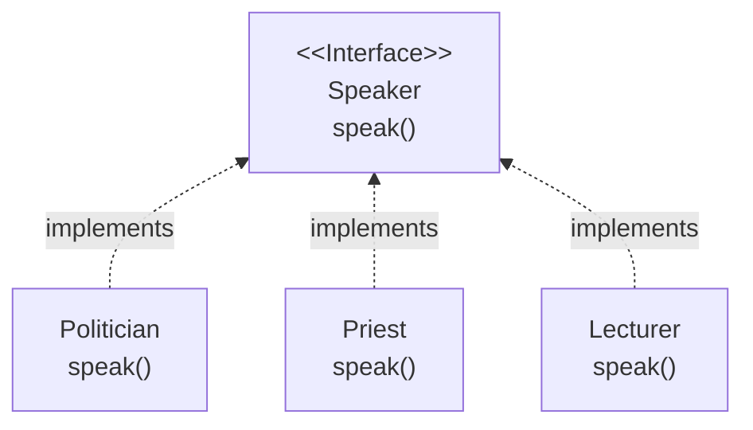

```java
interface Speaker {
    public void speak();
}

class Politician implements Speaker {
    public void speak() {
        System.out.println("Talk politics");
    }
}
class Priest implements Speaker {
    public void speak() {
        System.out.println("Religious Talks");
    }
}
class Lecturer implements Speaker {
    public void speak() {
        System.out.println("Talks Object Oriented Design and Programming!");
    }
}

class SpeakerTest {                         // driver added for a complete answer
    public static void main(String args[]) {
        Speaker s;                          // interface reference
        s = new Politician(); s.speak();
        s = new Priest();     s.speak();
        s = new Lecturer();   s.speak();
    }
}
/* Output:
Talk politics
Religious Talks
Talks Object Oriented Design and Programming!
*/
```

The implementing method **must be `public`**, because interface methods are public.

#### Extending interfaces
Like classes, interfaces can be extended. The sub-interface inherits all members of the super-interface:

```java
interface InterfaceName2 extends InterfaceName1 {
    // body of InterfaceName2
}
```

#### Inheritance and interface implementation together
A class can **extend another class while implementing one or more interfaces**. This looks like multiple inheritance:

```java
class ClassName extends SuperClass implements InterfaceName [, InterfaceName2, ...] {
    // body of class
}
```

#### Slide example: `Area` interface

```java
interface Area {
    final static float pi = 3.14F;
    float compute(float x, float y);
}

class Rectangle implements Area {
    public float compute(float x, float y) {
        return (x * y);
    }
}

class Circle implements Area {
    public float compute(float x, float y) {
        return (pi * x * x);
    }
}

class InterfaceTest {
    public static void main(String args[]) {
        Rectangle rect = new Rectangle();
        Circle cir = new Circle();
        Area area;                       // interface reference

        area = rect;
        System.out.println("Area of Rectangle=" + area.compute(10, 20));
        area = cir;
        System.out.println("Area of Circle=" + area.compute(10, 0));
    }
}
/* Output:
Area of Rectangle=200.0
Area of Circle=314.0
*/
```

!!! warning "Slide correction"
    The slide calls `area.compute(10)` with **one** argument, but `compute` takes two, so it does not compile. Pass a dummy second argument: `area.compute(10, 0)`. Also `Class Rectangle` should be `class Rectangle`.

#### Slide example: Student assessment (hybrid inheritance using an interface)

A university gives grace marks to students who take part in national games or the Olympics:
**final marks = exam marks + sports grace marks**.

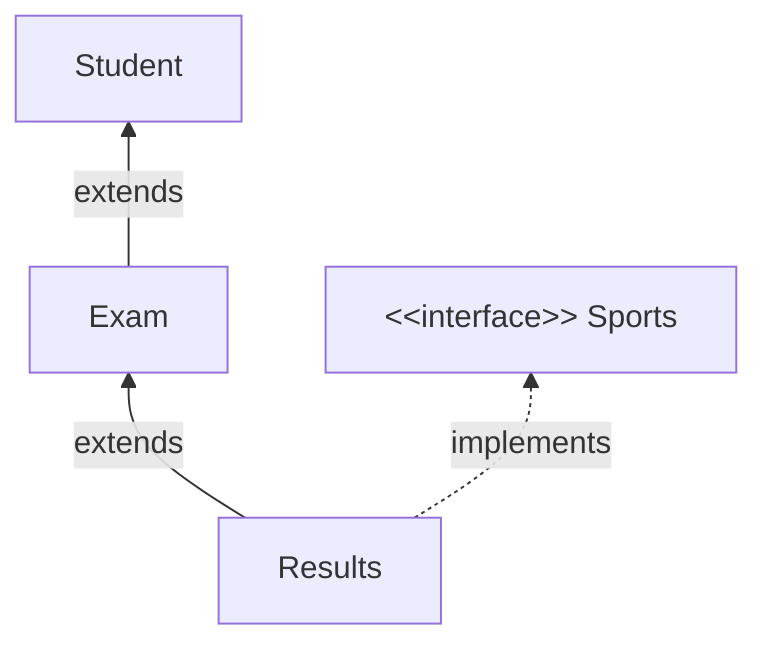

```java
class Student {
    int rollNumber;
    void getNumber(int n) { rollNumber = n; }
    void putNumber() { System.out.println("Roll No : " + rollNumber); }
}

class Exam extends Student {
    float part1, part2;                       // test 1 and test 2 marks
    void getMarks(float m1, float m2) { part1 = m1; part2 = m2; }
    void putMarks() {
        System.out.println("Marks obtained");
        System.out.println("Part 1 = " + part1);
        System.out.println("Part 2 = " + part2);
    }
}

interface Sports {
    float sportWt = 5.0F;                     // sports grace marks
    void putWt();
}

class Results extends Exam implements Sports {
    float total;
    public void putWt() {                     // implements the interface method
        System.out.println("Sports Wt = " + sportWt);
    }
    void display() {
        total = part1 + part2 + sportWt;
        putNumber();
        putMarks();
        putWt();
        System.out.println("Total score = " + total);
    }
}

class Hybrid {
    public static void main(String args[]) {
        Results s = new Results();
        s.getNumber(1234);
        s.getMarks(27.5F, 33.0F);
        s.display();
    }
}
/* Output:
Roll No : 1234
Marks obtained
Part 1 = 27.5
Part 2 = 33.0
Sports Wt = 5.0
Total score = 65.5
*/
```

(The slide only gives the class skeleton; this is the full Balagurusamy version of the same design.)

#### Interfaces and software engineering (slide)

- Like abstract classes, interfaces provide **templates of behaviour** that other classes are expected to implement.
- They **separate the design hierarchy from the implementation hierarchy**, so designers can enforce a standard syntax for programmers implementing different classes.
- They pass **method descriptions, not implementation**.
- Java allows only one superclass; interfaces allow **class mixing**.

#### Beyond the slides (Java 8 and later)
Modern Java also allows `default` methods (with a body) and `static` methods in interfaces (Java 8), and `private` methods (Java 9). An interface with exactly one abstract method is a **functional interface** (e.g. `Runnable`); one with no methods is a **marker interface** (e.g. `Serializable`, `Cloneable`). For the exam, the slide definition ("only constants and abstract methods") is the expected answer; mention the Java 8 additions as an extra point.

### 6.5 Abstract class vs Interface

| Abstract class | Interface |
|---|---|
| Keyword `abstract class`, extended with `extends` | Keyword `interface`, implemented with `implements` |
| Can have abstract **and concrete** methods | Only abstract methods (plus `default`/`static` from Java 8) |
| Can have any instance variables | Only constants (`public static final`) |
| Can have **constructors** | **No** constructors |
| A class can extend **only one** | A class can implement **many** (multiple inheritance) |
| Methods can have any access modifier | Methods are `public` |
| Used when classes share **common code and state** | Used to define a **common behaviour/contract** across unrelated classes (`Speaker`) |

### Short Questions: Chapter 6

**Q1. What are the uses of the `final` keyword?**

**Ans.** `final` variable → constant; `final` method → cannot be overridden; `final` class → cannot be extended.

**Q2. What is an abstract class? Can it be instantiated?**

**Ans.** A conceptual class declared with `abstract` that may contain abstract methods and must be extended. It cannot be instantiated, e.g. `new Shape()` is illegal.

**Q3. Can an abstract class have a constructor?**

**Ans.** Yes (called via `super()` from subclasses). But abstract constructors and abstract static methods cannot be declared.

**Q4. What happens if a subclass does not implement all abstract methods?**

**Ans.** The subclass itself becomes abstract and cannot be instantiated.

**Q5. Why can `final` and `abstract` not be used together?**

**Ans.** `abstract` requires the class/method to be extended/overridden, while `final` forbids that.

**Q6. What is dynamic method dispatch?**

**Ans.** The mechanism by which a call to an overridden method is resolved at run time, based on the type of object referred to. It implements run-time polymorphism.

**Q7. What is an interface?**

**Ans.** A kind of class that contains only constants (final variables) and abstract methods. A class implements it using `implements` and supplies the method bodies.

**Q8. How does Java achieve multiple inheritance?**

**Ans.** Through interfaces: a class can extend one class and implement any number of interfaces.

**Q9. Can an interface extend another interface?**

**Ans.** Yes, using `extends`: `interface B extends A { }`.

**Q10. Why must interface methods be declared `public` in the implementing class?**

**Ans.** Interface methods are implicitly public, and an implementation cannot reduce visibility.

### Long Questions: Chapter 6

**Q1. Explain the `final` keyword for variables, methods and classes with examples. (6 marks)**

**Ans.** 6.1: final members (`marks`, `display()`), final class `Person` with the error example, the table.

**Q2. What is an abstract class? Write its syntax, properties and a program. (8 marks)**

**Ans.** Definition (conceptual class, cannot be instantiated) → syntax → `Shape/Circle/Rectangle` → four properties.

**Q3. What is dynamic method dispatch? Explain with a program. (8 marks)**

**Ans.** Definition → `A/B/C callme()` program and output → key points.

**Q4. What is an interface? How does it help to achieve multiple inheritance? Explain with an example. (10 marks)**

**Ans.** Definition → define/implement/extend syntax → `Speaker` or `Area` program → `class extends implements` form → student assessment design → comparison table.

**Q5. Differentiate between abstract class and interface. (5 marks)**

**Ans.** The table in 6.5.

---

## Chapter 7: Access Modifiers (Java's Access Protection System) and Arrays

### 7.1 Importance of access modifiers

- Access modifiers help implement **encapsulation** in OOP.
- Encapsulation **hides data and behaviour**.
- Access modifiers affect accessibility at **two levels**: the **class**, and its **members** (methods and instance variables).

A **package** groups related classes/interfaces (`package com.college.util;` as the first statement, `import java.util.*;` to use one). `java.lang` is imported automatically. Packages matter here because several access levels depend on "same package" vs "other package".

### 7.2 The access modifiers (as taught in the slides)

1. `public`
2. friendly (default)
3. `private`
4. `protected`
5. `private protected`

**Visibility of fields in a class (slide table)**

| Access location ↓ / Modifier → | `public` | `protected` | friendly (default) | `private protected` | `private` |
|---|:---:|:---:|:---:|:---:|:---:|
| Same class | Yes | Yes | Yes | Yes | Yes |
| Subclass in same package | Yes | Yes | Yes | Yes | No |
| Other classes in same package | Yes | Yes | Yes | No | No |
| Subclass in other package | Yes | Yes | No | Yes | No |
| Non-subclasses in other package | Yes | No | No | No | No |

#### `public`
A variable or method declared `public` has the **widest possible visibility** and is accessible **from everywhere**: all subclasses and non-subclasses of all packages.

#### friendly (default)
When **no access specifier** is given, the member gets a limited form of public access called **friendly** or **default**. Difference from `public`: `public` makes fields visible in all classes regardless of package, while **friendly makes them visible only in the same package**.

#### `private`
- `private` fields enjoy the **highest degree of protection**.
- They are accessible **only within their own class**.
- They **cannot be inherited** by subclasses, so they are not accessible in subclasses.
- A method declared `private` **behaves like a `final` method**: it cannot be overridden in a subclass.

#### `protected`
- Its visibility lies **between public and friendly**.
- Visible to **all classes and subclasses in the same package** and also to **subclasses in other packages**.
- **Non-subclasses in other packages cannot** access a protected member.

#### `private protected`
- Declared with both keywords together: `private protected int codeNumber;`
- Visibility is **between `protected` and `private`**: accessible by **all subclasses** (in the same package and in other packages) but **not** by non-subclasses, even in the same package.

!!! warning "Exam note on `private protected`"
    `private protected` existed only in the very first release of Java (1.0) and was removed. A modern compiler rejects it. Write it in the exam because the syllabus slides teach it, but you may add one line: *"This combination is no longer supported in current versions of Java."* In current Java there are only **four** levels: `private` < default < `protected` < `public`.

```java
class Demo {
    private int a = 1;
    int b = 2;               // friendly / default
    protected int c = 3;
    public int d = 4;

    private void secret() { }
    public void open() { secret(); }   // private is reachable inside the class
}
```

- A **top-level class** can only be `public` or default.
- Other (non-access) modifiers: `static`, `final`, `abstract`, `synchronized`, `volatile`, `transient`, `native`.

### 7.3 Arrays: introduction

- An **array is a group of contiguous or related data items that share a common name**.
- Used when programs must handle **large amounts of data**.
- Each value is stored at a specific position called the **index** or **subscript**. The base index is **0**.
- Using **one name** for a collection and selecting an item by its number lets us write **concise and efficient programs**, e.g. a loop with the index as the control variable can read the whole array, calculate, and print results.

```text
index:   0    1    2    3    4    5    6
value: [69] [61] [70] [89] [23] [10] [ 9]
```

Arrays must be **declared** and **created** before use. Creating an array involves three steps:

1. Declare the array.
2. Create storage area in primary memory.
3. Put values into the array.

#### Step 1: Declaration

```java
type arrayname[];     // Form 1:  int students[];
type[] arrayname;     // Form 2:  int[] students;
```

We **do not specify the size** in the declaration.

#### Step 2: Creation (memory allocation with `new`)

```java
arrayname = new type[size];        // students = new int[7];
type arrayname[] = new type[size]; // int students[] = new int[7];  (declare + create)
```

#### Step 3: Initialisation

```java
arrayname[index] = value;
students[0] = 50;
students[1] = 40;
```

Like C, Java subscripts start at **0** and end at **size − 1**. **Unlike C, Java protects arrays from overruns and underruns**: accessing beyond the boundaries generates an error (`ArrayIndexOutOfBoundsException`).

#### Array length
Arrays are **fixed length**; the length is specified at creation time. Every Java array stores its allocated size in a variable named **`length`**:

```java
int x = students.length;    // x = 7
int y = students[1];        // y = 40  (accessed using the index)
```

Default values after `new`: numeric `0`, `boolean` `false`, `char` `'\u0000'`, references `null`.

#### Slide program: `StudentArray`

```java
// StudentArray.java: store integers in arrays and access
public class StudentArray {
    public static void main(String[] args) {
        int students[] = new int[7];
        System.out.println("Array Length = " + students.length);
        for (int i = 0; i < students.length; i++)
            students[i] = 2 * i;
        System.out.println("Values Stored in Array:");
        for (int i = 0; i < students.length; i++)
            System.out.println(students[i]);
    }
}
/* Output:
Array Length = 7
Values Stored in Array:
0
2
4
6
8
10
12
*/
```

!!! warning "Slide correction"
    The slide has `students = System.out.println(...)`, which does not compile. Only the `System.out.println(...)` part should be there.

#### Initialising at declaration

```java
type arrayname[] = {list of values};
int[] students = {55, 69, 70, 30, 80};    // length 5, no 'new' needed
```

```java
public class StudentArray2 {
    public static void main(String[] args) {
        int[] students = {55, 69, 70, 30, 80};
        System.out.println("Array Length = " + students.length);   // 5
        System.out.println("Values Stored in Array:");
        for (int i = 0; i < students.length; i++)
            System.out.println(students[i]);
        // the enhanced for loop also works: for (int x : students) ...
    }
}
```

**Program: largest and sum**

```java
public class ArrDemo {
    public static void main(String[] args) {
        int[] a = {5, 12, 8, 20, 3};
        int max = a[0], sum = 0;
        for (int x : a) { if (x > max) max = x; sum += x; }
        System.out.println("Max = " + max + ", Sum = " + sum);   // Max = 20, Sum = 48
    }
}
```

**Program: bubble sort**

```java
int[] a = {5, 2, 9, 1};
for (int i = 0; i < a.length - 1; i++)
    for (int j = 0; j < a.length - 1 - i; j++)
        if (a[j] > a[j + 1]) { int t = a[j]; a[j] = a[j + 1]; a[j + 1] = t; }
// a = {1, 2, 5, 9}
```

### 7.4 Two-dimensional arrays

A 2-D array stores data recorded in a **table** (rows and columns). Slide example: items sold by four salesgirls (4 rows × 3 columns = 12 items).

| Sold by | Item1 | Item2 | Item3 |
|---|---|---|---|
| Salesgirl #1 | 10 | 15 | 30 |
| Salesgirl #2 | 14 | 30 | 33 |
| Salesgirl #3 | 200 | 32 | 1 |
| Salesgirl #4 | 10 | 200 | 4 |

```java
int myArray[][];                       // declaration
myArray = new int[4][3];               // creation
int myArray2[][] = new int[4][3];      // or both together
int myArray3[][] = new int[4][];       // only the number of rows given

myArray[0][0] = 10;                    // single value
int tableA[][] = {{10, 15, 30}, {14, 30, 33}};   // multiple values
```

!!! warning "Slide correction"
    The slide also shows `int tableA[2][3] = {{...}};`. In Java the size **cannot** be written inside the brackets of a declaration. Write `int tableA[][] = {{10, 15, 30}, {14, 30, 33}};`.

```java
int[][] x = { {1, 2, 3}, {4, 5, 6} };
System.out.println(x[1][2]);        // 6
System.out.println(x.length);       // 2 (rows)
System.out.println(x[0].length);    // 3 (columns)
```

#### Variable size (jagged) arrays
Java treats multidimensional arrays as **"arrays of arrays"**, so each row can have a different length:

```java
int a[][] = new int[3][];
a[0] = new int[3];
a[1] = new int[2];
a[2] = new int[4];
```

#### Slide exercise: add two matrices

```java
public class MatrixAdd {
    public static void main(String[] args) {
        int a[][] = {{1, 2, 3}, {4, 5, 6}};          // 2 x 3
        int b[][] = {{6, 5, 4}, {3, 2, 1}};          // 2 x 3
        int c[][] = new int[2][3];                    // to store the sum

        for (int i = 0; i < 2; i++)
            for (int j = 0; j < 3; j++)
                c[i][j] = a[i][j] + b[i][j];

        for (int i = 0; i < 2; i++) {
            for (int j = 0; j < 3; j++)
                System.out.print(c[i][j] + " ");
            System.out.println();
        }
    }
}
/* Output:
7 7 7
7 7 7
*/
```

**Matrix multiplication (2 × 2)**

```java
int[][] A = {{1, 2}, {3, 4}}, B = {{2, 0}, {1, 2}}, C = new int[2][2];
for (int i = 0; i < 2; i++)
    for (int j = 0; j < 2; j++)
        for (int k = 0; k < 2; k++)
            C[i][j] += A[i][k] * B[k][j];
// C = {{4, 4}, {10, 8}}
```

### 7.5 Arrays of objects

Arrays can store objects (actually, **references** to objects):

```java
Circle[] circleArray;
circleArray = new Circle[25];   // creates 25 references, NOT 25 Circle objects
```

The objects must be created separately:

```java
Circle circleArray[] = new Circle[25];
for (int r = 0; r < 25; r++)
    circleArray[r] = new Circle(r);      // create circle objects and store them
```

#### Slide program: `ObjectArray`

```java
class Account {
    int a;
    int b;
    public void setData(int c, int d) {
        a = c;
        b = d;
    }
    public void showData() {
        System.out.println("Value of a =" + a);
        System.out.println("Value of b =" + b);
    }
}

class ObjectArray {
    public static void main(String args[]) {
        Account obj[] = new Account[2];
        obj[0] = new Account();          // these two lines are commented out on the slide
        obj[1] = new Account();
        obj[0].setData(1, 2);
        obj[1].setData(3, 4);
        System.out.println("For Array Element 0");
        obj[0].showData();
        System.out.println("For Array Element 1");
        obj[1].showData();
    }
}
/* Output:
For Array Element 0
Value of a =1
Value of b =2
For Array Element 1
Value of a =3
Value of b =4
*/
```

!!! danger "Classic exam trap (from the slide)"
    On the slide, the lines `obj[0] = new Account();` and `obj[1] = new Account();` are **commented out**. Then `obj[0]` is `null`, and `obj[0].setData(1,2)` throws **`NullPointerException`**. `new Account[2]` creates only an array of 2 **null references**, not 2 objects.

### 7.6 More on arrays

**Passing and returning arrays**

```java
static int[] doubleAll(int[] a) {
    int[] r = new int[a.length];
    for (int i = 0; i < a.length; i++) r[i] = a[i] * 2;
    return r;
}
```

**Copying arrays**

```java
int[] src = {1, 2, 3};
int[] copy1 = src.clone();
int[] copy2 = java.util.Arrays.copyOf(src, 5);        // {1,2,3,0,0}
int[] copy3 = new int[3];
System.arraycopy(src, 0, copy3, 0, 3);
int[] alias = src;                                    // NOT a copy, same object
```

**The `java.util.Arrays` class:** `toString(a)`, `deepToString(a2d)`, `sort(a)`, `binarySearch(a, key)` (sorted array), `fill(a, v)`, `equals(a, b)`, `copyOf(a, n)`.

**Varargs:** `static int sum(int... nums)` accepts any number of `int`s (`sum(1,2,3)` → 6).

**Common exceptions:** `ArrayIndexOutOfBoundsException` (bad index), `NegativeArraySizeException` (`new int[-1]`), `NullPointerException` (array or element is `null`), `ArrayStoreException` (incompatible type stored).

### 7.7 Vector (dynamic array, from the college slides)

- **`Vector` implements a dynamic array**: it grows automatically.
- Vectors can hold **objects of any type and any number**.
- It is in the **`java.util`** package.
- It differs from an array in two ways: (1) **Vector is synchronized**; (2) it has many methods that are not part of the collection framework.

**Declaring vectors (constructors)**

| Constructor | Meaning |
|---|---|
| `Vector list = new Vector();` | Default vector with initial size (capacity) **10** |
| `Vector list = new Vector(int size);` | Initial capacity specified by `size` |
| `Vector list = new Vector(int size, int incr);` | Initial capacity `size`, grows by `incr` each time it is full |

- A vector can be declared **without specifying any size**, and can hold an unknown number of items.
- Even when a size is given, it can be exceeded: more items can be put in.
- **In contrast, an array must always have its size specified.**

**Vector methods**

| Method | Description |
|---|---|
| `void addElement(Object element)` | Adds `element` to the vector |
| `int capacity()` | Returns the capacity |
| `boolean contains(Object element)` | `true` if `element` is in the vector |
| `void copyInto(Object array[])` | Copies the elements into `array` |
| `Object elementAt(int index)` | Element at `index` |
| `Object firstElement()` | First element |
| `Object lastElement()` | Last element |
| `void insertElementAt(Object element, int index)` | Adds `element` at `index` |
| `boolean isEmpty()` | `true` if the vector is empty |
| `void removeAllElements()` | Empties the vector (size becomes 0) |
| `void removeElementAt(int index)` | Removes the element at `index` |
| `void setElementAt(Object element, int index)` | Assigns `element` at `index` |
| `void setSize(int size)` | Sets the number of elements; elements are lost if smaller, `null`s added if larger |
| `int size()` | Number of elements currently in the vector |

**Slide program: `VectorDemo`**

```java
import java.util.*;

public class VectorDemo {
    public static void main(String args[]) {
        // initial size is 3, increment is 2
        Vector v = new Vector(3, 2);
        System.out.println("Initial size: " + v.size());
        System.out.println("Initial capacity: " + v.capacity());

        v.addElement(new Integer(1));
        v.addElement(new Integer(2));
        v.addElement(new Integer(3));
        v.addElement(new Integer(4));
        System.out.println("Capacity after four additions: " + v.capacity());

        v.addElement(new Double(5.45));
        System.out.println("Current capacity: " + v.capacity());
        v.addElement(new Double(6.08));
        v.addElement(new Integer(7));
        System.out.println("Current capacity: " + v.capacity());
        v.addElement(new Float(9.4));
        v.addElement(new Integer(10));
        System.out.println("Current capacity: " + v.capacity());
        v.addElement(new Integer(11));
        v.addElement(new Integer(12));

        System.out.println("First element: " + (Integer) v.firstElement());
        System.out.println("Last element: " + (Integer) v.lastElement());
        if (v.contains(new Integer(3)))
            System.out.println("Vector contains 3.");

        // enumerate the elements in the vector
        Enumeration vEnum = v.elements();
        System.out.println("\nElements in vector:");
        while (vEnum.hasMoreElements())
            System.out.print(vEnum.nextElement() + " ");
        System.out.println();
    }
}
/* Output:
Initial size: 0
Initial capacity: 3
Capacity after four additions: 5
Current capacity: 5
Current capacity: 7
Current capacity: 9
First element: 1
Last element: 12
Vector contains 3.

Elements in vector:
1 2 3 4 5.45 6.08 7 9.4 10 11 12
*/
```

**How the capacity grows:** starts at 3; the 4th element makes it 3 + 2 = 5; the 6th makes it 7; the 8th makes it 9; the 10th would make it 11. (Without an increment, a Vector **doubles** its capacity.)

!!! note
    `new Integer(1)`, `new Double(5.45)` work but are deprecated in newer Java (write `Integer.valueOf(1)` or simply `v.addElement(1)` with autoboxing). The compiler also warns about "unchecked" operations because the Vector is not generic (`Vector<Object>`). Both are only warnings; the program runs.

**Array vs Vector**

| Array | Vector |
|---|---|
| Fixed size, must be specified | Grows dynamically, size optional |
| Can hold primitives and objects | Holds only objects (primitives are wrapped) |
| Not synchronized | Synchronized |
| `length` field | `size()` and `capacity()` methods |

### Short Questions: Chapter 7

**Q1. Name the access modifiers taught in the syllabus.**

**Ans.** `public`, friendly (default), `private`, `protected`, `private protected`.

**Q2. What is the difference between `public` and friendly access?**

**Ans.** `public` members are visible in all classes of all packages; friendly (default) members are visible only within the same package.

**Q3. Difference between `protected` and default access?**

**Ans.** Default: same package only. `protected`: same package **and** subclasses in other packages.

**Q4. Why does a `private` method behave like a `final` method?**

**Ans.** A private method is not inherited, so it cannot be overridden in a subclass.

**Q5. What is `private protected` access?**

**Ans.** Visibility between `protected` and `private`: accessible to all subclasses (any package) but not to non-subclasses. (Not supported in current Java.)

**Q6. What is an array? What are the steps to create one?**

**Ans.** A group of contiguous related data items sharing a common name. Steps: declare, create (allocate with `new`), initialise.

**Q7. How does Java's array differ from C's regarding bounds?**

**Ans.** Java checks bounds; an access outside 0..length−1 throws `ArrayIndexOutOfBoundsException`, whereas C does not check.

**Q8. What is a variable size array?**

**Ans.** A 2-D array whose rows have different lengths, possible because Java treats it as an array of arrays.

**Q9. What does `Circle c[] = new Circle[25];` create?**

**Ans.** An array of 25 `null` references; no `Circle` objects are created yet.

**Q10. What is a Vector? How does it differ from an array?**

**Ans.** A synchronized dynamic array in `java.util` that can hold any number of objects. An array has a fixed size that must be specified.

**Q11. Difference between `size()` and `capacity()` of a Vector?**

**Ans.** `size()` is the number of elements stored; `capacity()` is the space allocated.

### Long Questions: Chapter 7

**Q1. Explain Java's access protection system with the visibility table. (8 marks)**

**Ans.** Importance (encapsulation, two levels) → the five modifiers, 2-3 lines each → the slide table → `Demo` example.

**Q2. Explain one-dimensional and two-dimensional arrays: declaration, creation and initialisation, with programs. (8 marks)**

**Ans.** Definition → three steps with syntax → `length` → `StudentArray` → salesgirl table and 2-D syntax → variable size arrays.

**Q3. Write a program to add two matrices. (5 marks)**

**Ans.** `MatrixAdd` in 7.4.

**Q4. How are arrays of objects created? Explain with a program. (6 marks)**

**Ans.** `Circle` array syntax → `ObjectArray` program → the `NullPointerException` trap.

**Q5. What is a Vector? Explain its constructors and methods with a program. (8 marks)**

**Ans.** 7.7: definition, constructors table, methods table, `VectorDemo` and output, array vs vector.

**Q6. Write a program to sort an array in ascending order and search an element using linear search.**

```java
public class SortSearch {
    public static void main(String[] args) {
        int[] a = {42, 7, 19, 3, 25};
        for (int i = 0; i < a.length - 1; i++)
            for (int j = 0; j < a.length - 1 - i; j++)
                if (a[j] > a[j + 1]) { int t = a[j]; a[j] = a[j + 1]; a[j + 1] = t; }
        System.out.println(java.util.Arrays.toString(a));   // [3, 7, 19, 25, 42]

        int key = 19, pos = -1;
        for (int i = 0; i < a.length; i++) if (a[i] == key) { pos = i; break; }
        System.out.println(pos >= 0 ? "Found at index " + pos : "Not found");  // Found at index 2
    }
}
```

---

## Chapter 8: Wrapper Classes

### 8.1 Wrapper classes for converting simple types

A **wrapper class** wraps (converts) a value of a **simple (primitive) type into an object**. All wrapper classes are in `java.lang`. They are `final` and their objects are **immutable**.

| Simple type | Wrapper class |
|---|---|
| `boolean` | `Boolean` |
| `byte` | `Byte` |
| `char` | `Character` |
| `double` | `Double` |
| `float` | `Float` |
| `int` | `Integer` |
| `long` | `Long` |
| `short` | `Short` |

**Why do we need wrappers?**

1. Classes like `Vector` and the collections (`ArrayList<Integer>`) store **objects only**, not primitives.
2. They provide **utility methods** for conversions (String ↔ number) and constants (`MAX_VALUE`).
3. An object can be `null`; a primitive cannot.

### 8.2 The five conversions (college slides)

#### (1) Primitive number → object number, using constructor methods

| Constructor calling | Conversion action |
|---|---|
| `Integer IntVal = new Integer(i);` | Primitive integer to `Integer` object |
| `Float FloatVal = new Float(f);` | Primitive float to `Float` object |
| `Double DoubleVal = new Double(d);` | Primitive double to `Double` object |
| `Long LongVal = new Long(l);` | Primitive long to `Long` object |

(`i`, `f`, `d`, `l` are primitive values of type int, float, double, long; constants or variables.)

#### (2) Object number → primitive number, using `typeValue()` methods

| Method calling | Conversion action |
|---|---|
| `int i = IntVal.intValue();` | Object to primitive integer |
| `float f = FloatVal.floatValue();` | Object to primitive float |
| `double d = DoubleVal.doubleValue();` | Object to primitive double |
| `long l = LongVal.longValue();` | Object to primitive long |

#### (3) Number → String, using `toString()` methods

| Method calling | Conversion action |
|---|---|
| `str = Integer.toString(i);` | Primitive integer to String |
| `str = Float.toString(f);` | Primitive float to String |
| `str = Double.toString(d);` | Primitive double to String |
| `str = Long.toString(l);` | Primitive long to String |

#### (4) String → numeric object, using the static method `valueOf()`

| Method calling | Conversion action |
|---|---|
| `IntVal = Integer.valueOf(str);` | String to `Integer` object |
| `FloatVal = Float.valueOf(str);` | String to `Float` object |
| `DoubleVal = Double.valueOf(str);` | String to `Double` object |
| `LongVal = Long.valueOf(str);` | String to `Long` object |

These numeric objects can then be converted to primitives with the `typeValue()` methods.

#### (5) Numeric string → primitive number, using parsing methods

| Method calling | Conversion action |
|---|---|
| `int i = Integer.parseInt(str);` | String to primitive integer |
| `long l = Long.parseLong(str);` | String to primitive long |

(Similarly `Double.parseDouble(str)`, `Float.parseFloat(str)`.)

!!! warning "Slide correction and modern note"
    - The slide writes `Integer.toString()` with empty brackets; the value must be passed: `Integer.toString(i)`.
    - It also writes `Double = Double.valueOf(str);`; the left side must be a variable, e.g. `DoubleVal`.
    - The constructors `new Integer(i)` etc. are **deprecated** since Java 9. They still compile (with a warning), but the modern way is `Integer.valueOf(i)` or autoboxing.

#### Program using all five conversions

```java
public class WrapperConv {
    public static void main(String args[]) {
        int i = 25;
        Integer IntVal = new Integer(i);        // (1) primitive -> object  (or Integer.valueOf(i))
        int j = IntVal.intValue();              // (2) object -> primitive
        String str = Integer.toString(i);       // (3) number -> String
        Integer obj = Integer.valueOf("40");    // (4) String -> object
        int k = Integer.parseInt("60");         // (5) String -> primitive

        System.out.println("IntVal = " + IntVal);
        System.out.println("j = " + j);
        System.out.println("str length = " + str.length());
        System.out.println("obj + 1 = " + (obj.intValue() + 1));
        System.out.println("k * 2 = " + (k * 2));
    }
}
/* Output:
IntVal = 25
j = 25
str length = 2
obj + 1 = 41
k * 2 = 120
*/
```

### 8.3 Autoboxing and unboxing (Java 5+)

- **Autoboxing:** automatic conversion of a primitive to its wrapper object.
- **Unboxing:** automatic conversion of a wrapper object to its primitive.

```java
int a = 10;
Integer b = Integer.valueOf(a);   // manual boxing
Integer c = a;                    // autoboxing
int d = c;                        // auto-unboxing
int e = b.intValue();             // manual unboxing

Integer x = 5;
x++;                              // unbox, add, box again
```

!!! warning "Null pitfall"
    `Integer n = null; int m = n;` throws `NullPointerException` (unboxing `null`).

### 8.4 Other useful methods

```java
Integer.toBinaryString(10);       // "1010"
Integer.toHexString(255);         // "ff"
Integer.MAX_VALUE;                // 2147483647
Integer.MIN_VALUE;                // -2147483648
Integer.compare(5, 8);            // negative
Double.parseDouble("3.14");       // 3.14
Boolean.parseBoolean("true");     // true

Character.isDigit('7');           // true
Character.isLetter('a');          // true
Character.isUpperCase('A');       // true
Character.isWhitespace(' ');      // true
Character.toUpperCase('b');       // 'B'
```

`Integer.parseInt("abc")` throws **`NumberFormatException`** (see the `ComLineSum` program in Chapter 10).

### 8.5 `==` vs `equals()` on wrappers (the Integer cache)
Values from **-128 to 127** are cached for `Integer.valueOf()` and autoboxing, so `==` can be `true` for them but `false` outside that range.

```java
Integer a = 100, b = 100;
System.out.println(a == b);        // true  (same cached object)
Integer c = 1000, d = 1000;
System.out.println(c == d);        // false (different objects)
System.out.println(c.equals(d));   // true  (compares values)
```
**Rule:** compare wrapper objects with `equals()`.

### Short Questions: Chapter 8

**Q1. What is a wrapper class? Name the wrapper of `char` and `int`.**

**Ans.** A class that converts a primitive (simple) type into an object. `Character` and `Integer`.

**Q2. Why do we need wrapper classes?**

**Ans.** Classes like `Vector` and collections store only objects; wrappers also provide conversion methods and allow `null`.

**Q3. How do you convert a primitive `int` to an `Integer` object and back?**

**Ans.** `Integer IntVal = new Integer(i);` (or `Integer.valueOf(i)`), and `int i = IntVal.intValue();`

**Q4. Difference between `Integer.parseInt()` and `Integer.valueOf()`?**

**Ans.** `parseInt` converts a String to a primitive `int`; `valueOf` converts it to an `Integer` object.

**Q5. How do you convert a number to a String?**

**Ans.** `Integer.toString(i)` (or `String.valueOf(i)`).

**Q6. What is autoboxing and unboxing?**

**Ans.** Automatic conversion by the compiler of a primitive to its wrapper (`Integer x = 5;`) and of a wrapper to its primitive (`int y = x;`).

**Q7. What exception does `Integer.parseInt("12a")` throw?**

**Ans.** `NumberFormatException`.

**Q8. Output?** `Integer a = 127, b = 127; Integer c = 128, d = 128; System.out.println((a==b) + " " + (c==d));`

**Ans.** `true false` (the Integer cache covers -128 to 127).

### Long Questions: Chapter 8

**Q1. What are wrapper classes? Explain the different conversions between primitive numbers, number objects and strings with the methods used. (8 marks)**

**Ans.** Table of 8 wrappers → reasons → the five conversion tables in 8.2 → `WrapperConv` program.

**Q2. Explain autoboxing and unboxing with examples. (5 marks)**

**Ans.** 8.3, plus the null pitfall and the Integer cache in 8.5.

**Q3. Write a program that converts a string array of numbers to integers and finds their sum.**

```java
public class SumStr {
    public static void main(String[] args) {
        String[] s = {"10", "20", "30"};
        int sum = 0;
        for (String x : s) sum += Integer.parseInt(x);
        System.out.println("Sum = " + sum);    // Sum = 60
    }
}
```

---

## Chapter 9: String and StringBuffer Class

### 9.1 Introduction

String manipulation is the most common operation in Java programs. The simplest way to represent a string (a sequence of characters) is a **character array**:

```java
char place[] = new char[4];
place[0] = 'J'; place[1] = 'a'; place[2] = 'v'; place[3] = 'a';
```

Character arrays can report their length, but they are **too primitive**: they don't support common string operations such as copying a string or searching for a pattern. Recognising how important string handling is, **Java supports String as a fundamental data type at the language level**, and bookkeeping (such as the end of the string) is handled automatically.

**Java classes for string operations (slide):**

- **`String`** class
- **`StringBuffer`** class
- **`StringTokenizer`** class

### 9.2 The `String` class

The `String` class provides many operations: **constructors, utility, comparisons and conversions**. **String objects are read-only (immutable)**: once created, the content cannot change; every "modification" creates a **new** String.

#### Declaration and creation

```java
String stringName;
stringName = new String("string value");

String city;
city = new String("Bangalore");
String city = new String("Bangalore");     // combined

int len = city.length();                   // length() method: 9
```

#### Concatenation and string arrays

```java
String city  = "New" + "York";
String city1 = "Delhi";
String city2 = "New " + city1;             // "New Delhi"

String city[] = new String[5];             // array to hold five strings
city[0] = new String("Melbourne");
city[1] = new String("Sydney");
String megacities[] = {"Brisbane", "Sydney", "Melbourne", "Adelaide", "Perth"};
```

#### String constructors

| Constructor | Meaning | Example → result |
|---|---|---|
| `String()` | Empty string (no characters) | `new String()` → `""` |
| `String(char chars[])` | Initialised by a character array | `char chars[] = {'a','b','c'}; new String(chars)` → `"abc"` |
| `String(char chars[], int startIndex, int numChars)` | A sub-range of a char array | `{'a','b','c','d','e','f'}`, `new String(chars, 2, 3)` → `"cde"` |
| `String(String strObj)` | Same characters as another String | `new String(s1)` where `s1 = "Java"` → `"Java"` |
| `String(byte asciiChars[])` | Initialised from a byte (ASCII) array | see below |
| `String(byte asciiChars[], int startIndex, int numChars)` | Sub-range of a byte array | see below |

Java's `char` is **16-bit Unicode**, but strings on the internet are typically **arrays of 8-bit bytes** (ASCII). The byte constructors convert bytes to characters using the platform's default character encoding.

```java
class SubStringCons {
    public static void main(String args[]) {
        byte ascii[] = {65, 66, 67, 68, 69, 70};
        String s1 = new String(ascii);
        System.out.println("s1=" + s1);
        String s2 = new String(ascii, 2, 3);
        System.out.println("s2=" + s2);
    }
}
/* Output:
s1=ABCDEF
s2=CDE
*/
```

#### String literals

The easier way to create a String is a **string literal**. For each literal, Java automatically constructs a String object:

```java
String s1 = "abc";
System.out.println("abc".length());     // 3: a literal can be used wherever a String object can
```

Literals are stored in the **String constant pool** and reused: `String a = "Java", b = "Java";` refers to the **same** object.

#### Concatenation with `+` and `concat()`

```java
String age = "9";
String s = "He is " + age + " years old.";
System.out.println(s);          // He is 9 years old.

String s1 = "abc", s2 = "def";
String s3 = s1.concat(s2);      // s3 = "abcdef"
```

#### Character extraction: `charAt()`

```java
String s1 = "abc";
char c = s1.charAt(1);          // 'b'
```

#### Comparison: `equals()` and `equalsIgnoreCase()`

```java
class equalsDemo {
    public static void main(String args[]) {
        String s1 = "Hello";
        String s2 = "Hello";
        String s3 = "Good-bye";
        String s4 = "HELLO";
        System.out.println(s1 + " equals " + s2 + " -> " + s1.equals(s2));
        System.out.println(s1 + " equals " + s3 + " -> " + s1.equals(s3));
        System.out.println(s1 + " equals " + s4 + " -> " + s1.equals(s4));
        System.out.println(s1 + " equalsIgnoreCase " + s4 + " -> " + s1.equalsIgnoreCase(s4));
    }
}
/* Output:
Hello equals Hello -> true
Hello equals Good-bye -> false
Hello equals HELLO -> false
Hello equalsIgnoreCase HELLO -> true
*/
```

#### Commonly used String methods (slide list)

| Method call | Task performed |
|---|---|
| `s2 = s1.toUpperCase();` | Converts `s1` to all uppercase |
| `s2 = s1.toLowerCase();` | Converts `s1` to all lowercase |
| `s2 = s1.replace('x', 'y');` | Replaces all appearances of `x` with `y` |
| `s2 = s1.trim();` | Removes white spaces at the beginning and end of `s1` |
| `s1.equals(s2)` | `true` if `s1` equals `s2` |
| `s1.equalsIgnoreCase(s2)` | `true` if `s1` equals `s2`, ignoring the case of characters |
| `s1.length()` | Length of `s1` |
| `s1.charAt(n)` | The n-th character of `s1` |
| `s1.compareTo(s2)` | Negative if `s1 < s2`, positive if `s1 > s2`, 0 if equal |
| `s1.concat(s2)` | Concatenates `s1` and `s2` |
| `s1.substring(n)` | Substring starting from the n-th character |
| `s1.substring(n, m)` | Substring from the n-th character up to, **not including**, the m-th |
| `s1.toCharArray()` | Converts the string to a new character array |
| `String.valueOf(p)` | String representation of `p` (simple type or object) |
| `p.toString()` | String representation of object `p` |
| `s1.indexOf('x')` | Position of the first occurrence of `x` |
| `s1.indexOf('x', n)` | Position of `x` occurring after the n-th position |

Also useful: `lastIndexOf()`, `contains()`, `startsWith()`, `endsWith()`, `split()`, `isEmpty()`, `intern()`.

!!! warning "Slide correction"
    One slide line says `s1.equalsIgnoreCase(s2)` "converts the String s1 to all upper case". That description is a copy error. It **compares** `s1` and `s2` ignoring case and returns `true`/`false`.

#### Slide program: `StringDemo`

```java
// StringDemo.java: some operations on strings
class StringDemo {
    public static void main(String[] args) {
        String s = new String("Have a nice Day");
        System.out.println("String Length = " + s.length());
        System.out.println("Modified String = " + s.replace('n', 'N'));
        System.out.println("Converted to Uppercase = " + s.toUpperCase());
        System.out.println("Converted to Lowercase = " + s.toLowerCase());
    }
}
/* Output:
String Length = 15
Modified String = Have a Nice Day
Converted to Uppercase = HAVE A NICE DAY
Converted to Lowercase = have a nice day
*/
```

The original `s` is unchanged after these calls, because strings are immutable; each method returns a new String.

#### `equals()` vs `==`

- **`equals()`** compares the **characters inside** the String objects.
- **`==`** compares two **object references** to see whether they refer to the **same instance**.

```java
class A {
    public static void main(String args[]) {
        String s1 = "Hello";
        String s2 = new String(s1);
        System.out.println(s1 + " equals " + s2 + " -> " + s1.equals(s2));
        System.out.println(s1 + " == " + s2 + " -> " + (s1 == s2));
    }
}
/* Output:
Hello equals Hello -> true
Hello == Hello -> false
*/
```

```java
String a = "Java", b = "Java", c = new String("Java");
System.out.println(a == b);           // true  (same pool object)
System.out.println(a == c);           // false (c is a new heap object)
System.out.println(a.equals(c));      // true
System.out.println(a == c.intern());  // true  (intern() returns the pooled one)
```

#### Why are Strings immutable?
Security (used in passwords, file paths, class names), thread safety, string-pool sharing (saves memory), and caching of the hash code.

### 9.3 The `StringBuffer` class

`StringBuffer` is a **peer class of String**. While String creates strings of **fixed length**, `StringBuffer` creates strings of **flexible length that can be modified in both length and content**. Characters and substrings can be inserted in the middle or appended at the end, **in the same object**. It is **thread-safe** (synchronized).

#### Declaration and creation

```java
StringBuffer city;
city = new StringBuffer("Bangalore");
StringBuffer city = new StringBuffer("Bangalore");   // combined
int len = city.length();
```

#### Constructors

| Constructor | Meaning |
|---|---|
| `StringBuffer()` | Default; reserves room for **16 characters** without reallocation |
| `StringBuffer(int size)` | Explicitly sets the size (capacity) of the buffer |
| `StringBuffer(String str)` | Sets the initial contents and reserves room for **16 more** characters |

When full, the capacity grows to **(old capacity × 2) + 2**.

#### `length()`, `capacity()` and `ensureCapacity()`

- `int length()`: current length (number of characters).
- `int capacity()`: total allocated capacity.
- `void ensureCapacity(int capacity)`: pre-allocates room after construction. Useful if we know in advance that many strings will be appended.

```java
class StringBufferDemo {
    public static void main(String args[]) {
        StringBuffer sb = new StringBuffer("Hello");
        System.out.println("Buffer=" + sb);
        System.out.println("Length=" + sb.length());
        System.out.println("Capacity=" + sb.capacity());
    }
}
/* Output:
Buffer=Hello
Length=5
Capacity=21
*/
```

Capacity is 21 because 16 extra places are reserved in addition to the 5 characters.

#### `setLength()`, `charAt()` and `setCharAt()`

- `void setLength(int len)`: sets the length of the buffer (non-negative). Shorter → characters are lost; longer → null characters are added.
- `char charAt(int where)`: the character at index `where`.
- `void setCharAt(int where, char ch)`: sets the character at index `where` to `ch`.

```java
class SetCharDemo {
    public static void main(String args[]) {
        StringBuffer sb = new StringBuffer("Hello");
        System.out.println("Buffer before=" + sb);
        System.out.println("charAt(1)=" + sb.charAt(1));
        sb.setCharAt(1, 'i');
        sb.setLength(2);
        System.out.println("Buffer after=" + sb);
        System.out.println("charAt(1)=" + sb.charAt(1));
    }
}
/* Output:
Buffer before=Hello
charAt(1)=e
Buffer after=Hi
charAt(1)=i
*/
```

#### `getChars()`
`void getChars(int sourceStart, int sourceEnd, char target[], int targetStart)` copies the substring from `sourceStart` to `sourceEnd − 1` into the array `target`, starting at `targetStart`.

```java
StringBuffer sb = new StringBuffer("Programming");
char t[] = new char[4];
sb.getChars(3, 7, t, 0);
System.out.println(t);          // gram
```

#### `append()`
`append()` concatenates the string representation of **any type of data** to the end of the StringBuffer. It is overloaded: `append(String str)`, `append(int num)`, `append(Object obj)`, etc. It returns the same StringBuffer, so calls can be chained.

```java
class appendDemo {
    public static void main(String args[]) {
        String s;
        int a = 42;
        StringBuffer sb = new StringBuffer(40);
        s = sb.append("a=").append(a).append("!").toString();
        System.out.println(s);
    }
}
// Output: a=42!
```

`toString()` turns the modifiable StringBuffer back into a constant String.

#### `insert()`
`insert(int index, String str)`, `insert(int index, char ch)`, `insert(int index, Object obj)` insert at the given index.

```java
StringBuffer sb = new StringBuffer("I Java!");
sb.insert(2, "like ");
System.out.println(sb);         // I like Java!
```

#### `reverse()`

```java
StringBuffer sb = new StringBuffer("abcdef");
System.out.println("Before=" + sb);   // Before=abcdef
sb.reverse();
System.out.println("After=" + sb);    // After=fedcba
```

#### `delete()` and `deleteCharAt()`
`delete(int startIndex, int endIndex)` removes characters from `startIndex` to `endIndex − 1`. `deleteCharAt(int loc)` removes the character at `loc`.

```java
StringBuffer sb = new StringBuffer("This is a test.");
sb.delete(4, 7);
System.out.println("After delete=" + sb);          // After delete=This a test.
sb.deleteCharAt(0);
System.out.println("After deleteCharAt=" + sb);    // After deleteCharAt=his a test.
```

#### `replace()`
`replace(int startIndex, int endIndex, String str)` replaces the characters from `startIndex` to `endIndex − 1` with `str`.

```java
StringBuffer sb = new StringBuffer("This is a test.");
sb.replace(5, 7, "was");
System.out.println("After replace=" + sb);   // After replace=This was a test.
```

#### `substring()` and `subSequence()`
`substring(int startIndex)` returns the part from `startIndex` to the end; `substring(int startIndex, int endIndex)` returns `startIndex` to `endIndex − 1`. `subSequence(start, stop)` does the same and is required by the `CharSequence` interface that StringBuffer implements.

#### `indexOf()` and `lastIndexOf()`
`indexOf(String str)` / `indexOf(String str, int startIndex)` find the **first** occurrence; `lastIndexOf(String str)` / `lastIndexOf(String str, int startIndex)` find the **last** occurrence. All return **-1** if no match is found.

```java
class IndexDemo {
    public static void main(String args[]) {
        StringBuffer sb = new StringBuffer("one two one");
        int i;
        i = sb.indexOf("one");
        System.out.println("First index=" + i);
        i = sb.lastIndexOf("one");
        System.out.println("Last index=" + i);
    }
}
/* Output:
First index=0
Last index=8
*/
```

**Method summary**

| Method | Description |
|---|---|
| `append(x)` | Add to the end |
| `insert(i, x)` | Insert at an index |
| `delete(start, end)` / `deleteCharAt(i)` | Remove characters |
| `replace(start, end, str)` | Replace a range |
| `reverse()` | Reverse the content |
| `length()` / `capacity()` / `ensureCapacity(n)` | Size information |
| `charAt(i)` / `setCharAt(i, c)` / `setLength(n)` | Character access |
| `getChars(...)` | Copy into a char array |
| `substring(...)`, `indexOf(...)`, `lastIndexOf(...)` | Like String |
| `toString()` | Convert to String |

### 9.4 Difference between `String` and `StringBuffer` (slide)

- `String` creates strings of **fixed length**; `StringBuffer` creates strings of **flexible length** that can be modified in both length and content.
- `String` **cannot use `append()`**; `StringBuffer` uses `append()`.
- A `StringBuffer` is like a String but **can be modified at any time**; a String cannot.

| Feature | `String` | `StringBuffer` | `StringBuilder` |
|---|---|---|---|
| Mutability | **Immutable** (read-only) | Mutable | Mutable |
| Length | Fixed | Flexible | Flexible |
| Thread safety | Yes (immutable) | **Yes** (synchronized) | No |
| Speed for repeated changes | Slowest | Medium | **Fastest** |
| `append()`/`insert()` | Not available | Available | Available |
| `equals()` | Compares content | Does **not** compare content (uses `Object.equals`) | Same as StringBuffer |

`StringBuilder` (Java 5) has the same methods as `StringBuffer` but is **not synchronized**, so it is faster when there is only one thread.

### 9.5 `StringTokenizer` class (mentioned in the slides)

`java.util.StringTokenizer` breaks a string into **tokens** (words) separated by delimiters (space by default).

```java
import java.util.StringTokenizer;
class TokenDemo {
    public static void main(String args[]) {
        StringTokenizer st = new StringTokenizer("Java is fun");
        System.out.println("Tokens = " + st.countTokens());
        while (st.hasMoreTokens())
            System.out.println(st.nextToken());
    }
}
/* Output:
Tokens = 3
Java
is
fun
*/
```

`new StringTokenizer("a,b,c", ",")` uses `,` as the delimiter.

### 9.6 Classic programs

**Reverse a string / palindrome check**

```java
public class Palin {
    public static void main(String[] args) {
        String s = "madam";
        String rev = new StringBuffer(s).reverse().toString();
        System.out.println(s.equals(rev) ? "Palindrome" : "Not palindrome");  // Palindrome
    }
}
```

**Count vowels**

```java
String s = "Object Oriented";
int count = 0;
for (char c : s.toLowerCase().toCharArray())
    if ("aeiou".indexOf(c) != -1) count++;
System.out.println(count);    // 6
```

**Word count**

```java
String s = "java is fun";
System.out.println(s.trim().split("\\s+").length);   // 3
```

**Sort a list of names (uses `compareTo`)**

```java
String names[] = {"Madras", "Delhi", "Ahmedabad", "Calcutta", "Bombay"};
for (int i = 0; i < names.length; i++)
    for (int j = i + 1; j < names.length; j++)
        if (names[j].compareTo(names[i]) < 0) {
            String t = names[i]; names[i] = names[j]; names[j] = t;
        }
// Ahmedabad Bombay Calcutta Delhi Madras
```

### Short Questions: Chapter 9

**Q1. Why are character arrays not sufficient for string handling?**

**Ans.** They are too primitive and don't support common operations like copying or pattern searching, so Java provides the String class.

**Q2. Name the classes Java provides for string operations.**

**Ans.** `String`, `StringBuffer` and `StringTokenizer` (and `StringBuilder`).

**Q3. What is meant by "String objects are immutable"?**

**Ans.** Their content cannot be changed after creation; methods like `toUpperCase()` return a new String.

**Q4. What is a string literal?**

**Ans.** A sequence of characters in double quotes (`"abc"`). Java automatically creates a String object for it and stores it in the string pool.

**Q5. Difference between `==` and `equals()` for strings?**

**Ans.** `==` compares references (whether both refer to the same instance); `equals()` compares the characters.

**Q6. What does `compareTo()` return?**

**Ans.** Negative if the invoking string is smaller, positive if greater, 0 if equal.

**Q7. Output of `new String(new char[]{'a','b','c','d','e','f'}, 2, 3)`?**

**Ans.** `cde`.

**Q8. What is the default capacity of `StringBuffer`? What is the capacity of `new StringBuffer("Hello")`?**

**Ans.** 16; and 16 + 5 = 21.

**Q9. Difference between `length()` and `capacity()`?**

**Ans.** `length()` is the number of characters stored; `capacity()` is the total space allocated.

**Q10. Output?** `StringBuffer sb = new StringBuffer("This is a test."); sb.delete(4,7); System.out.println(sb);`

**Ans.** `This a test.`

**Q11. Difference between `StringBuffer` and `StringBuilder`?**

**Ans.** `StringBuffer` is synchronized (thread-safe, slower); `StringBuilder` is not (faster).

**Q12. Output?** `String s = "abc"; s.toUpperCase(); System.out.println(s);`

**Ans.** `abc`. The result was not assigned and strings are immutable.

### Long Questions: Chapter 9

**Q1. Explain the String class: its constructors and important methods with examples. (8 marks)**

**Ans.** Introduction (char array limits) → declaration/creation → constructors table and `SubStringCons` → literals, concatenation, `charAt`, `equals` → methods table → `StringDemo` with output.

**Q2. Explain the difference between `equals()` and `==` with a program. (5 marks)**

**Ans.** Definitions → class `A` program with output → the pool example.

**Q3. Explain the StringBuffer class with its constructors and methods. (10 marks)**

**Ans.** Definition → constructors → `length/capacity` demo → `setCharAt` demo → `append`, `insert`, `reverse`, `delete`, `replace`, `indexOf` examples with outputs.

**Q4. Differentiate String and StringBuffer. (5 marks)**

**Ans.** The three slide points + table in 9.4.

**Q5. Write a program to check whether a string is a palindrome and count its vowels.**

**Ans.** Combine the palindrome and vowel programs from 9.6.

---

## Chapter 10: Exception Handling (An OO Way of Handling Errors)

### 10.1 Introduction: types of errors

A program rarely runs successfully at its very first attempt. Mistakes made while developing or typing a program are categorised as:

| Error type | When | Effect |
|---|---|---|
| **Syntax errors** | Compile time | Compilation errors; the program is not compiled |
| **Semantic (logical) errors** | Run time | The program produces unexpected/wrong output |
| **Runtime errors** | Run time | Most often **abnormal termination** of the program, or even a system crash |

**Common runtime errors**

- Dividing a number by zero.
- Accessing an element that is out of the bounds of an array.
- Trying to store incompatible data elements.
- Using a negative value as an array size.
- Converting a string to a number when it is not a number (e.g. `"abc"` to int).
- File errors: opening a file for reading that does not exist or has no read permission; opening a read-only file in write/update mode.
- Corrupting memory (common with pointers in other languages).

### 10.2 Without error handling vs traditional error handling

**Example 1: without error handling**

```java
class NoErrorHandling {
    public static void main(String[] args) {
        int a, b;
        a = 7;
        b = 0;
        System.out.println("Result is " + a / b);
        System.out.println("Program reached this line");   // program does NOT reach here
    }
}
/* No compilation errors. At run time:
Exception in thread "main" java.lang.ArithmeticException: / by zero
        at NoErrorHandling.main(NoErrorHandling.java:6)
*/
```

**Example 2: traditional way (checking with `if`)**

```java
class WithErrorHandling {
    public static void main(String[] args) {
        int a, b;
        a = 7; b = 0;
        if (b != 0) {
            System.out.println("Result is " + a / b);
        } else {
            System.out.println("B is zero");
        }
        System.out.println("Program is complete");   // program reaches here
    }
}
/* Output:
B is zero
Program is complete
*/
```

Any program can find itself in unusual circumstances (**error conditions**). A good program should handle them **gracefully**. Java provides a mechanism for this: **exceptions**.

### 10.3 Exceptions

- An **exception** is a **condition that is caused by a runtime error** in the program.
- Exceptions provide a mechanism to **signal errors directly without using flags**.
- They allow errors to be **handled in one central part of the code** without cluttering it.

**How it works:** when the JVM encounters an error such as divide by zero, it **creates an exception object and throws it** as a notification. If the exception object is **not caught** and handled properly, the interpreter displays an error and **terminates** the program. If we want the program to continue, we must **catch the exception object** and take corrective action. This task is called **exception handling**.

#### Exception types (hierarchy)

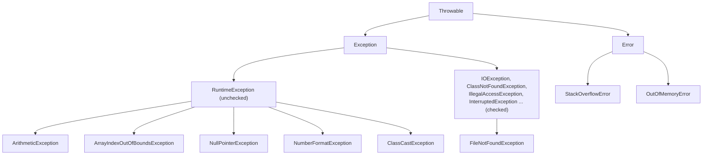

**Error vs Exception**

| Error | Exception |
|---|---|
| Serious problems beyond the program's control (`StackOverflowError`, `OutOfMemoryError`) | Conditions a program can catch and recover from |
| Not meant to be caught | Should be handled |
| Subclass of `Error` | Subclass of `Exception` |

#### Common Java exceptions (slide)

| Exception | Cause |
|---|---|
| `ArithmeticException` | Math errors such as division by zero |
| `ArrayIndexOutOfBoundsException` | Bad array index |
| `ArrayStoreException` | Storing the wrong type of data in an array |
| `FileNotFoundException` | Accessing a non-existent file |
| `IOException` | General I/O failure |
| `NullPointerException` | Referencing a null object |
| `OutOfMemoryError` | Not enough memory to allocate a new object |
| `SecurityException` | An applet tries an action not allowed by the browser's security settings |
| `StackOverflowError` | The system runs out of stack space |
| `StringIndexOutOfBoundsException` | Accessing a non-existent character position in a string |

(The slide writes "OutOfMemoryException" and "StackOverflowException"; the real Java names end in **Error**, because they are subclasses of `Error`.)

### 10.4 Keywords used in exception handling

| Keyword | Purpose (slide definition) |
|---|---|
| **`try`** | Contains program statements that should be checked for exceptions |
| **`catch`** | Contains statements that handle (explain the cause of) the exception generated |
| **`finally`** | Contains code that must be executed before the method returns, whether or not an exception occurred |
| **`throws`** | Lists the types of exceptions that a method might throw |
| **`throw`** | Used to throw an exception explicitly |

#### Exception handling mechanism

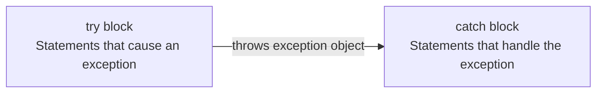

#### Syntax

```java
try {
    // statements that may cause an exception
}
catch (Exception-Type e) {
    // statements to process the exception
}
```

**Example 3: with exception handling**

```java
class WithExceptionHandling {
    public static void main(String[] args) {
        int a, b; float r;
        a = 7; b = 0;
        try {
            r = a / b;
            System.out.println("Result is " + r);
        }
        catch (Exception e) {
            System.out.println("Exception Caught");
        }
        System.out.println("Program reaches here");
    }
}
/* Output:
Exception Caught
Program reaches here
*/
```

**Example 4: displaying the description of the exception**

```java
catch (Exception e) {
    System.out.println("Exception " + e);
}
/* Output:
Exception java.lang.ArithmeticException: / by zero
Program reaches here
*/
```

Printing the exception object `e` calls its `toString()`, which gives the class name and the message.

**Example 5: sum of integers passed as command-line arguments**

```java
// ComLineSum.java: adding command line parameters
class ComLineSum {
    public static void main(String args[]) {
        int InvalidCount = 0;
        int number, sum = 0;
        for (int i = 0; i < args.length; i++) {
            try {
                number = Integer.parseInt(args[i]);
            }
            catch (NumberFormatException e) {
                InvalidCount++;
                System.out.println("Invalid Number: " + args[i]);
                continue;            // skip the remaining part of the loop
            }
            sum += number;
        }
        System.out.println("Number of Invalid Arguments = " + InvalidCount);
        System.out.println("Number of Valid Arguments = " + (args.length - InvalidCount));
        System.out.println("Sum of Valid Arguments = " + sum);
    }
}
```

```text
> java ComLineSum 1 2
Number of Invalid Arguments = 0
Number of Valid Arguments = 2
Sum of Valid Arguments = 3

> java ComLineSum 1 2 abc
Invalid Number: abc
Number of Invalid Arguments = 1
Number of Valid Arguments = 2
Sum of Valid Arguments = 3
```

### 10.5 Multiple catch statements

If a `try` block can raise more than one type of exception, multiple `catch` blocks can be defined. The **first** catch block whose type matches is executed.

```java
try {
    // statements
}
catch (Exception-Type1 e) { /* process exception 1 */ }
...
catch (Exception-TypeN e) { /* process exception N */ }
```

**Example 6**

```java
class MultiCatch {
    public static void main(String[] args) {
        try {
            int a = args.length;
            System.out.println("a=" + a);
            int b = 42 / a;
            int c[] = {1};
            c[42] = 99;
        } catch (ArithmeticException e) {
            System.out.println("Divide by 0: " + e);
        } catch (ArrayIndexOutOfBoundsException e) {
            System.out.println("Array Index Out Of Bounds: " + e);
        }
        System.out.println("Program reaches here");
    }
}
```

```text
> java MultiCatch
a=0
Divide by 0: java.lang.ArithmeticException: / by zero
Program reaches here

> java MultiCatch Test
a=1
Array Index Out Of Bounds: java.lang.ArrayIndexOutOfBoundsException: 42
Program reaches here
```

(Newer JVMs print the second message as `Index 42 out of bounds for length 1`.)

**Rule:** catch blocks must be ordered from **most specific to most general**. Putting `catch (Exception e)` before `catch (ArithmeticException e)` is a **compile error** (the second block is unreachable). Java 7 also allows a multi-catch: `catch (ArithmeticException | NullPointerException e)`.

### 10.6 Nested try statements

A `try` block can be inside another `try` block. Each time a `try` statement is entered, its context is **pushed on the stack**. If the inner `try` has no handler for a particular exception, the stack is **unwound** and the **next (outer) try's catch handlers are inspected**. This continues until one matches or all nested `try`s are exhausted (then the default handler terminates the program).

```java
class NestTry {
    public static void main(String[] args) {
        try {
            int a = args.length;
            System.out.println("a=" + a);
            int b = 42 / a;                 // a = 0 → ArithmeticException (outer catch)
            try {
                if (a == 1)
                    a = a / (a - a);        // division by zero → inner has no handler → outer
                if (a == 2) {
                    int c[] = {1};
                    c[42] = 99;             // handled by the inner catch
                }
            } catch (ArrayIndexOutOfBoundsException e) {
                System.out.println("Array Index Out Of Bounds: " + e);
            }
        } catch (ArithmeticException e) {
            System.out.println("Divide by 0: " + e);
        }
    }
}
```

```text
> java NestTry
a=0
Divide by 0: java.lang.ArithmeticException: / by zero

> java NestTry One
a=1
Divide by 0: java.lang.ArithmeticException: / by zero

> java NestTry One Two
a=2
Array Index Out Of Bounds: java.lang.ArrayIndexOutOfBoundsException: 42
```

!!! warning "Slide correction"
    The slide prints `a` **after** `int b = 42/a;`, so for zero arguments `a=0` would never be printed, although the slide output shows it. Here the print is moved before the division so the code matches the output. The slide also writes `if(a= =1)`; the operator is `==` with no space.

### 10.7 The `finally` block

Java supports another block, **`finally`**, that can handle any exception not caught by the previous `catch` statements. It is placed immediately after the `try` block or after the last `catch` block.

```java
try {
    // statements
}
catch (Exception-Type1 e) { ... }
...
finally {
    // always executed
}
```

When `finally` is defined, **it is executed regardless of whether or not an exception is thrown**. So it is used for housekeeping such as **closing files and releasing system resources**.

**Important points (slide)**

- A `finally` block must be associated with a `try` block; you cannot use `finally` without `try`.
- `finally` is **optional**; try-catch is enough for handling. But if present, it **always runs** after the try block.
- With no exception, `finally` runs after `try`. If an exception occurs, the `catch` runs first and then `finally`.
- An exception inside the `finally` block behaves like any other exception.
- The statements in `finally` execute **even if the try block contains `return`, `break` or `continue`**.
- `finally` does **not** run only if the JVM exits (`System.exit(0)`) or crashes first.

**Example 7: `FinallyDemo`**

```java
class FinallyDemo {
    public static void main(String args[]) {
        try {
            int num = 121 / 0;
            System.out.println(num);
        }
        catch (ArithmeticException e) {
            System.out.println("Number should not be divided by zero");
        }
        /* Finally block will always execute
         * even if there is no exception in try block */
        finally {
            System.out.println("This is finally block");
        }
        System.out.println("Out of try-catch-finally");
    }
}
/* Output:
Number should not be divided by zero
This is finally block
Out of try-catch-finally
*/
```

**Return-value trap:** `static int f() { try { return 1; } finally { return 2; } }` returns **2**.

### 10.8 The `throw` clause

So far, we have caught exceptions thrown by the Java run-time system. A program can also **throw an exception explicitly** using `throw`:

```java
throw ThrowableInstance;
// or
throw new Throwable_Subclass;
```

**Example 8: rethrowing without `finally`**

```java
class ThrowDemo1 {
    public static void main(String args[]) {
        int i = 10, j = 0;
        float r;
        try {
            r = i / j;
            System.out.println("Result is " + r);
        } catch (ArithmeticException e) {
            System.out.println("B is zero");
            throw e;                               // rethrow the same exception
        }
        System.out.println("Program is complete"); // NOT reached when the exception occurs
    }
}
/* Output:
B is zero
Exception in thread "main" java.lang.ArithmeticException: / by zero
        at ThrowDemo1.main(ThrowDemo1.java:6)
*/
```

**Example 9: rethrowing with `finally`**

```java
class ThrowDemo2 {
    public static void main(String[] args) {
        int i = 10, j = 0;
        float r;
        try {
            r = i / j;
            System.out.println("Result is " + r);
        }
        catch (ArithmeticException e) {
            System.out.println("B is zero");
            throw e;
        }
        finally {
            System.out.println("Program is complete");   // reached even though e is rethrown
        }
    }
}
/* Output:
B is zero
Program is complete
Exception in thread "main" java.lang.ArithmeticException: / by zero
        at ThrowDemo2.main(ThrowDemo2.java:6)
*/
```

**Creating an exception object:** `throw new NullPointerException("demo");`

- `new` constructs an instance of `NullPointerException`.
- All of Java's built-in runtime exceptions have at least **two constructors**: one with **no parameter** and one that takes a **String** describing the exception.
- That String is displayed when the object is printed with `print()`/`println()`, and can be obtained with **`getMessage()`** (defined by `Throwable`).

**Example 10: throw, catch and rethrow to the caller**

```java
class ThrowDemo3 {
    static void demoproc() {
        try {
            throw new NullPointerException("demo");
        } catch (NullPointerException e) {
            System.out.println("Caught in demoproc");
            throw e;                        // rethrow to the caller
        }
    }
    public static void main(String args[]) {
        try {
            demoproc();
        }
        catch (NullPointerException e) {
            System.out.println("Recaught=" + e);
        }
    }
}
/* Output:
Caught in demoproc
Recaught=java.lang.NullPointerException: demo
*/
```

### 10.9 The `throws` clause

If a method can cause an exception that it **does not handle**, it must say so, so that **callers can guard themselves** against that exception. This is done by a **`throws` clause** in the method declaration, which lists the exceptions the method might throw.

- It is **necessary for all exceptions except `Error`, `RuntimeException` and their subclasses** (i.e. it is needed for **checked** exceptions).

```java
type method-name(parameter-list) throws exception-list
{
    // body of the method
}
```

**Example 11**

```java
class ThrowsDemo {
    static void fun() throws IllegalAccessException {
        System.out.println("Inside fun().");
        throw new IllegalAccessException("demo");
    }
    public static void main(String args[]) {
        try {
            fun();
        }
        catch (IllegalAccessException e) {
            System.out.println("Caught in main=" + e);
        }
    }
}
/* Output:
Inside fun().
Caught in main=java.lang.IllegalAccessException: demo
*/
```

`IllegalAccessException` is a **checked** exception, so without `throws IllegalAccessException` in the declaration of `fun()` the program does not compile.

#### `throw` vs `throws`

| `throw` | `throws` |
|---|---|
| Actually **throws** an exception object | **Declares** exceptions a method might throw |
| Used **inside** a method body | Used in the method **declaration/signature** |
| Followed by an **instance** (`throw new X()` or `throw e`) | Followed by **class names**, comma-separated |
| Throws one exception at a time | Can list several |

#### `final` vs `finally` vs `finalize()`

| `final` | `finally` | `finalize()` |
|---|---|---|
| Keyword: constant / no overriding / no inheritance | Block that always executes after try/catch | Method called by the garbage collector before destroying an object |

### 10.10 User-defined exceptions

Java's built-in exceptions handle most common errors, but we often want **our own exception types** for situations specific to our application. We do this by **defining a subclass of `Exception`** (which is a subclass of `Throwable`). Useful inherited methods:

| Method | Purpose |
|---|---|
| `String getMessage()` | Returns a description of the exception |
| `void printStackTrace()` | Displays the stack trace |
| `String toString()` | Returns a String describing the exception; called by `println()` when printing a Throwable object |

**Problem statement (slide):** a `MyException` class has a constructor `MyException(int a) { detail = a; }`. A method throws this user-defined exception when a value is **greater than 1000**.

**Example 12: `MyException`**

```java
class MyException extends Exception {
    private int detail;
    MyException(int a) {
        detail = a;
    }
    public String toString() {
        return "MyException" + "[" + detail + "]";
    }
}

class MyExceptionDemo {
    static void compute(int a) throws MyException {
        System.out.println("Called compute(" + a + ")");
        if (a > 1000)
            throw new MyException(a);
        System.out.println("Normal exit");
    }
    public static void main(String args[]) {
        try {
            compute(1);
            compute(2000);
        } catch (MyException e) {
            System.out.println("Caught " + e);
        }
    }
}
/* Output:
Called compute(1)
Normal exit
Called compute(2000)
Caught MyException[2000]
*/
```

!!! warning "Slide correction"
    The slide calls `compute(20)` and shows `Caught MyException[20]`. But `20 > 1000` is false, so `compute(20)` would print `Normal exit` and no exception would be thrown. Use a value greater than 1000 (here `2000`) so the output really shows the user-defined exception.

**Another common exam program: `InsufficientFundsException`**

```java
class InsufficientFundsException extends Exception {
    InsufficientFundsException(String msg) { super(msg); }
}

class Account {
    double balance = 1000;
    void withdraw(double amt) throws InsufficientFundsException {
        if (amt > balance)
            throw new InsufficientFundsException("Insufficient balance: " + balance);
        balance -= amt;
        System.out.println("Withdrawn " + amt + ", left " + balance);
    }
}

public class Bank {
    public static void main(String[] args) {
        Account a = new Account();
        try {
            a.withdraw(400);
            a.withdraw(900);
        } catch (InsufficientFundsException e) {
            System.out.println("Error: " + e.getMessage());
        } finally {
            System.out.println("Transaction over");
        }
    }
}
/* Output:
Withdrawn 400.0, left 600.0
Error: Insufficient balance: 600.0
Transaction over
*/
```

### 10.11 Java's built-in exceptions: checked and unchecked

Inside `java.lang`, Java defines several exception classes. The most general are subclasses of **`RuntimeException`**. Because `java.lang` is imported automatically, these are always available and **need not be listed in a method's `throws` list**. They are called **unchecked exceptions**, because the compiler does not check whether a method handles or throws them.

Exceptions defined by `java.lang` that **must be included in a method's `throws` list** (if the method can generate them and doesn't handle them itself) are called **checked exceptions**.

**Unchecked runtime exceptions**

| Exception | Meaning |
|---|---|
| `ArithmeticException` | Arithmetic error, such as divide-by-zero |
| `ArrayIndexOutOfBoundsException` | Array index is out of bounds |
| `ArrayStoreException` | Assignment to an array element of an incompatible type |
| `ClassCastException` | Invalid cast |
| `IllegalArgumentException` | Illegal argument used to invoke a method |
| `IllegalMonitorStateException` | Illegal monitor operation, such as waiting on an unlocked thread |
| `IllegalStateException` | Environment or application is in an incorrect state |
| `IllegalThreadStateException` | Requested operation not compatible with the current thread state |
| `IndexOutOfBoundsException` | Some type of index is out of bounds |
| `NegativeArraySizeException` | Array created with a negative size |
| `NullPointerException` | Invalid use of a null reference |
| `NumberFormatException` | Invalid conversion of a string to a numeric format |
| `SecurityException` | Attempt to violate security |
| `StringIndexOutOfBoundsException` | Attempt to index outside the bounds of a string |
| `UnsupportedOperationException` | An unsupported operation was encountered |

**Checked exceptions defined in `java.lang`**

| Exception | Meaning |
|---|---|
| `ClassNotFoundException` | Class not found |
| `CloneNotSupportedException` | Attempt to clone an object that does not implement `Cloneable` |
| `IllegalAccessException` | Access to a class is denied |
| `InstantiationException` | Attempt to create an object of an abstract class or interface |
| `InterruptedException` | One thread has been interrupted by another thread |
| `NoSuchFieldException` | A requested field does not exist |
| `NoSuchMethodException` | A requested method does not exist |

(`IOException` and `FileNotFoundException`, used in Chapter 11, are checked exceptions from `java.io`.)

| Checked | Unchecked |
|---|---|
| Checked by the **compiler** | Not checked by the compiler |
| Must be **caught or declared** with `throws` | Handling is optional |
| Subclasses of `Exception` except `RuntimeException` | `RuntimeException` and its subclasses (and `Error`) |

### 10.12 What happens when an exception occurs (summary flow)

- The **try block** contains code that could have exceptions/errors.
- **Catch block(s)** specify code to handle the various types of exceptions. The **first block with an appropriate type** is invoked.
- If no "local" catch is found, the exception **propagates up the method call stack**, all the way to `main()`; if still unhandled, the default handler prints the stack trace and terminates the program.
- Any execution of try (normal completion or via a catch) then transfers control to the **finally** block.

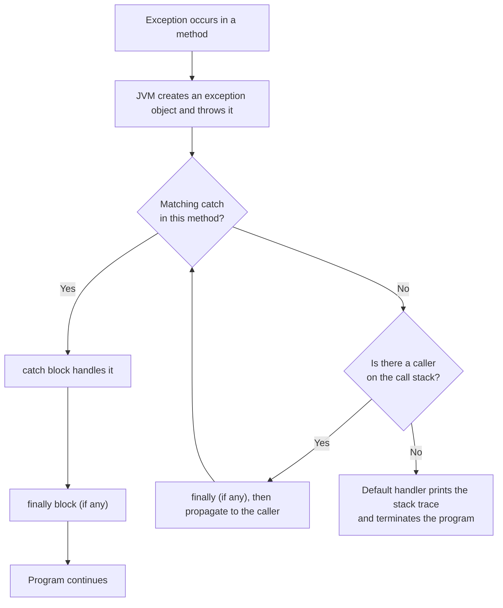

**try-with-resources (Java 7, extra):** resources declared in `try (...)` are closed automatically.

```java
try (BufferedReader br = new BufferedReader(new FileReader("a.txt"))) {
    System.out.println(br.readLine());
} catch (IOException e) {
    e.printStackTrace();
}
```

**Overriding rule:** an overriding method may throw no exception, the same exception, or a narrower checked exception, but **not a new or broader checked exception**.

### Short Questions: Chapter 10

**Q1. What are the types of errors in a program?**

**Ans.** Syntax errors (compile time), semantic/logical errors (wrong output) and runtime errors (abnormal termination).

**Q2. What is an exception?**

**Ans.** A condition caused by a runtime error in the program. The JVM creates an exception object and throws it.

**Q3. What is exception handling?**

**Ans.** Catching the exception object thrown by an error condition and taking corrective action so the program can continue.

**Q4. What is the superclass of all exceptions?**

**Ans.** `java.lang.Throwable` (with subclasses `Exception` and `Error`).

**Q5. Differentiate checked and unchecked exceptions.**

**Ans.** Checked exceptions must be listed in a method's `throws` clause if not handled (e.g. `IllegalAccessException`, `IOException`). Unchecked exceptions (subclasses of `RuntimeException`) need not be (e.g. `ArithmeticException`).

**Q6. Can there be multiple catch blocks for one try? In what order?**

**Ans.** Yes; from the most specific to the most general.

**Q7. What is a nested try block?**

**Ans.** A try inside another try. If the inner try has no matching catch, the outer try's handlers are checked.

**Q8. When is the `finally` block executed? When is it not?**

**Ans.** Always, whether or not an exception occurs, even with `return`/`break`/`continue` in try. It is skipped only if the JVM exits (`System.exit()`) or crashes.

**Q9. Difference between `throw` and `throws`?**

**Ans.** `throw` explicitly throws an exception object inside a method; `throws` in a method declaration lists exceptions the method may throw.

**Q10. How do you create a user-defined exception?**

**Ans.** Define a subclass of `Exception` (optionally overriding `toString()`), and throw it with `throw new MyException(...)`.

**Q11. What does `getMessage()` return?**

**Ans.** The description string passed to the exception's constructor.

**Q12. What is the output?**

```java
try { System.out.println("A"); throw new RuntimeException(); }
catch (Exception e) { System.out.println("B"); }
finally { System.out.println("C"); }
System.out.println("D");
```

**Ans.** `A B C D`.

### Long Questions: Chapter 10

**Q1. What is an exception? Explain the exception hierarchy and types of exceptions in Java. (8 marks)**

**Ans.** Error types (10.1) → definition and mechanism (10.3) → hierarchy diagram → checked/unchecked tables (10.11).

**Q2. Explain `try`, `catch`, `finally`, `throw` and `throws` with suitable programs. (10 marks)**

**Ans.** Keyword table → syntax → `WithExceptionHandling` → `FinallyDemo` → `ThrowDemo2` → `ThrowsDemo` → `throw` vs `throws` table.

**Q3. Explain multiple catch and nested try statements with programs. (8 marks)**

**Ans.** 10.5 and 10.6 with outputs for each command-line case.

**Q4. What are user-defined exceptions? Write a program to create and use one. (8 marks)**

**Ans.** Definition and `getMessage/printStackTrace/toString` → `MyException` program and output (or `InsufficientFundsException`).

**Q5. Write a program to find the sum of integers given as command-line arguments, ignoring invalid ones. (6 marks)**

**Ans.** `ComLineSum` with both sample outputs.

**Q6. Compare error handling without exceptions, with `if` checks, and with try-catch. (6 marks)**

**Ans.** Examples 1, 2 and 3 with their outputs, and the three advantages of exceptions from 10.3.

---

## Chapter 11: Input and Output (Files)

### 11.1 Introduction: why files?

So far we have used **variables and arrays** to store data inside programs. This has limitations:

- The data is **lost** when a variable goes out of scope or the program terminates: data in main memory is temporary.
- It is **difficult to handle large volumes** of data.

We overcome this by storing data on **secondary storage devices** (hard disks, etc.) using **files**. Such data is called **persistent data**.

**File processing:** storing and manipulating data using files.

- Reading/writing can be done at the level of **bytes, characters or fields**, depending on the application.
- Java can also read and write **class objects directly**. Reading and writing objects is called **object serialisation**.

For comparison, file I/O in C uses `FILE *fp; fp = fopen("In.file", "r"); fscanf(fp, ...); fprintf(fp, ...); fread(..., fp); fwrite(..., fp);`. Java instead uses **streams**.

### 11.2 I/O and data movement

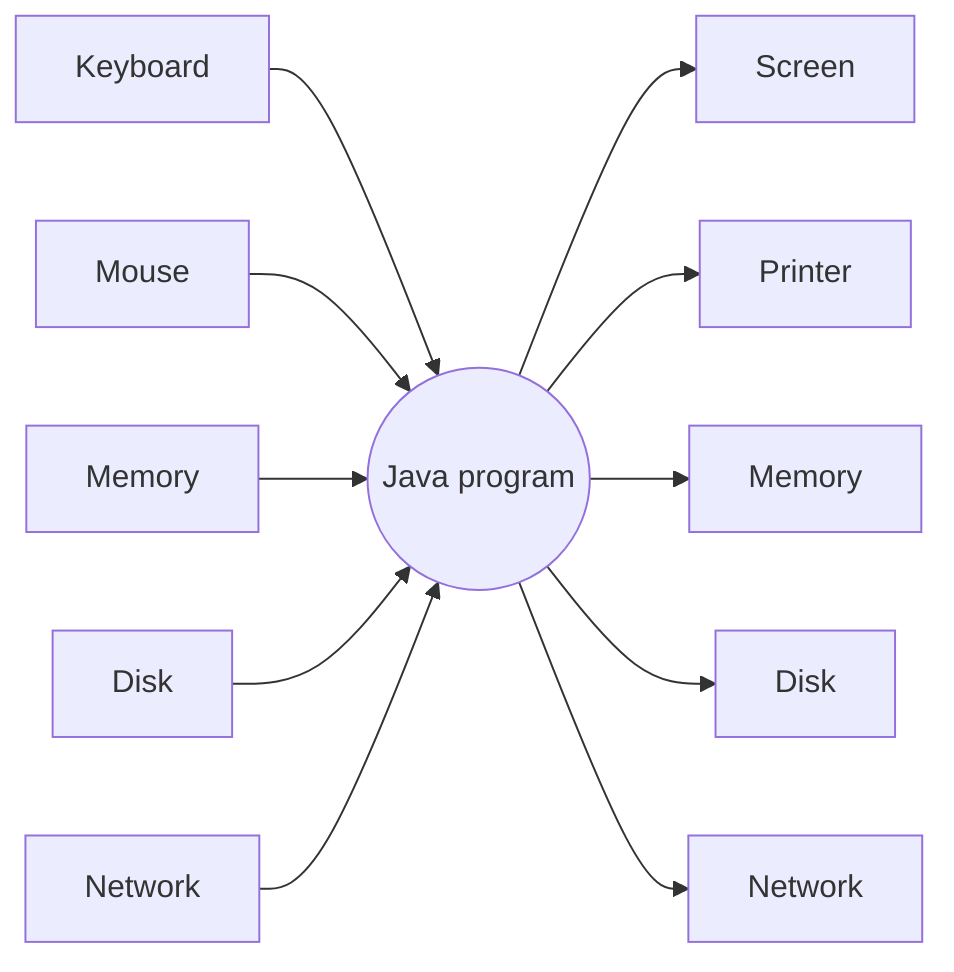

- **Input:** data flowing **into** a program may come from the keyboard, mouse, memory, disk, network, or another program.
- **Output:** data flowing **out of** a program may go to the screen, printer, memory, disk, network, or another program.
- Input and output share common properties: **unidirectional movement of data**, as a **sequence of bytes or characters**, with **sequential access**.

### 11.3 Streams

- Java uses the concept of **streams** to represent the **ordered sequence of data**, a common characteristic shared by all I/O devices.
- Streams present a **uniform, easy-to-use, object-oriented interface** between the program and I/O devices.
- A **stream is a path along which data flows**, like a river or a pipe along which water flows (source → valve → pipe → destination).
- Sending data from one stream to another (**one pipe feeding into another**) makes streams a powerful tool for file processing. Connected streams can also act as **filters**.

**Stream types**

| Input stream | Output stream |
|---|---|
| **Reads** data from a source into the program | **Writes** data from the program to a destination |
| Source → Input Stream → Program | Program → Output Stream → Destination |

### 11.4 Java stream classes

- I/O classes are defined in the **`java.io`** package.
- I/O in Java is defined in terms of streams; a stream is a sequence of data of **no particular length**.
- Java stream classes are divided into **two groups**, based on the data type they operate on:

| Byte streams | Character streams |
|---|---|
| Operate on **8-bit (1 byte)** data | Operate on **16-bit (2 byte) Unicode** characters |
| **Input streams / Output streams** | **Readers / Writers** |
| Base classes `InputStream`, `OutputStream` | Base classes `Reader`, `Writer` |
| Used for binary data (images, audio, any file) | Used for text |

**Classification of Java stream classes**

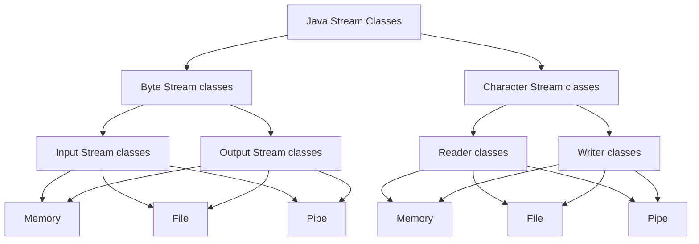

Each group has classes for three kinds of sources/destinations: **memory, file and pipe**.

### 11.5 Byte input streams

```text
InputStream (abstract)
 ├── FileInputStream
 ├── ObjectInputStream
 ├── SequenceInputStream
 ├── ByteArrayInputStream
 ├── PipedInputStream
 └── FilterInputStream
       ├── PushbackInputStream
       ├── DataInputStream
       └── BufferedInputStream
```

**Byte input stream operations (methods of `InputStream`)**

| Method | Purpose |
|---|---|
| `public abstract int read()` | Reads a byte and returns it as an integer 0-255; returns **-1** at end of stream |
| `public int read(byte[] buf, int offset, int count)` | Reads bytes into `buf` starting at `offset`; `count` is the maximum read |
| `public int read(byte[] buf)` | Same as above with offset = 0 and count = `buf.length` |
| `public long skip(long count)` | Skips `count` bytes |
| `public int available()` | Returns the number of bytes that can be read |
| `public void close()` | Closes the stream |

**Example: count the total number of bytes in a file**

```java
import java.io.*;

class CountBytes {
    public static void main(String[] args)
            throws FileNotFoundException, IOException {
        FileInputStream in;
        in = new FileInputStream("InFile.txt");
        int total = 0;
        while (in.read() != -1)        // -1 means end of file
            total++;
        in.close();
        System.out.println(total + " bytes");
    }
}
```

**What happens if the file does not exist?** `main` declares the exceptions with `throws` but there is no handler, so the JVM throws the exception and **terminates** the program:

```text
Exception in thread "main" java.io.FileNotFoundException: InFile.txt (No such file or directory)
        at java.io.FileInputStream.open(Native Method)
        at java.io.FileInputStream.<init>(FileInputStream.java:64)
        at CountBytes.main(CountBytes.java:7)
```

The fix is to catch it:

```java
try {
    FileInputStream in = new FileInputStream("InFile.txt");
    ...
} catch (FileNotFoundException e) {
    System.out.println("File not found");
} catch (IOException e) {
    System.out.println("I/O error");
}
```

### 11.6 Byte output streams

```text
OutputStream (abstract)
 ├── FileOutputStream
 ├── ObjectOutputStream
 ├── ByteArrayOutputStream
 ├── PipedOutputStream
 └── FilterOutputStream
       ├── PrintStream
       ├── DataOutputStream
       └── BufferedOutputStream
```

(The slide also lists a "SequenceOutputStream"; there is no such class in `java.io`. `SequenceInputStream` exists only on the input side.)

**Byte output stream operations (methods of `OutputStream`)**

| Method | Purpose |
|---|---|
| `public abstract void write(int b)` | Writes `b` as a byte |
| `public void write(byte[] buf, int offset, int count)` | Writes `count` bytes starting from `offset` in `buf` |
| `public void write(byte[] buf)` | Same as above with offset = 0 and count = `buf.length` |
| `public void flush()` | Flushes the stream (forces buffered bytes out) |
| `public void close()` | Closes the stream |

**Example: read from standard input and write to standard output**

```java
import java.io.*;

class ReadWrite {
    public static void main(String[] args) throws IOException {
        int b;
        while ((b = System.in.read()) != -1) {
            System.out.write(b);
        }
        System.out.flush();
    }
}
```

`System.in` is an `InputStream` and `System.out` is a `PrintStream` (an `OutputStream`), so byte-level `read()`/`write()` work on them. (Press Ctrl+D on Linux or Ctrl+Z on Windows to send end-of-input.)

!!! warning "Slide correction"
    The slide writes `main(string[] args)` (lowercase `string`) and misses the closing brace of the class. It must be `String[] args`.

**Writing bytes to a file**

```java
import java.io.*;
public class ByteWrite {
    public static void main(String[] args) {
        try (FileOutputStream fos = new FileOutputStream("out.txt")) {
            fos.write(65);                          // writes 'A'
            fos.write("Hello Java".getBytes());     // writes a byte array
        } catch (IOException e) { e.printStackTrace(); }
    }
}
```

`new FileOutputStream("out.txt", true)` opens in **append mode**; the default **overwrites** the file.

**Program: copy one file into another (byte streams)**

```java
import java.io.*;
public class CopyFile {
    public static void main(String[] args) {
        try (FileInputStream in = new FileInputStream("src.txt");
             FileOutputStream out = new FileOutputStream("dest.txt")) {
            int b;
            while ((b = in.read()) != -1) out.write(b);
            System.out.println("Copied");
        } catch (IOException e) {
            System.out.println("Error: " + e.getMessage());
        }
    }
}
```

### 11.7 Standard streams (`System` class)

| Stream | Type | Purpose |
|---|---|---|
| `System.in` | `InputStream` | Standard input (keyboard) |
| `System.out` | `PrintStream` | Standard output (console) |
| `System.err` | `PrintStream` | Standard error output |

**Reading a line from the console with `BufferedReader`** (alternative to `Scanner`, Chapter 2)

```java
import java.io.*;
public class ConsoleRead {
    public static void main(String[] args) throws IOException {
        BufferedReader br = new BufferedReader(new InputStreamReader(System.in));
        System.out.print("Enter your name: ");
        String name = br.readLine();
        System.out.println("Hello, " + name);
    }
}
```

### 11.8 Character streams

```text
Reader                           Writer
 ├── BufferedReader               ├── BufferedWriter
 ├── InputStreamReader            ├── OutputStreamWriter
 │     └── FileReader             │     └── FileWriter
 ├── CharArrayReader              ├── CharArrayWriter
 ├── PipedReader                  ├── PipedWriter
 └── StringReader                 ├── PrintWriter
                                  └── StringWriter
```

**Write text: `FileWriter` / `BufferedWriter` / `PrintWriter`**

```java
import java.io.*;
public class TextWrite {
    public static void main(String[] args) {
        try (BufferedWriter bw = new BufferedWriter(new FileWriter("notes.txt"))) {
            bw.write("Line one");
            bw.newLine();
            bw.write("Line two");
        } catch (IOException e) { e.printStackTrace(); }

        try (PrintWriter pw = new PrintWriter(new FileWriter("p.txt", true))) {  // append
            pw.println("Hello");
            pw.printf("%d %s%n", 10, "text");
        } catch (IOException e) { e.printStackTrace(); }
    }
}
```

**Read text: `FileReader` / `BufferedReader` / `Scanner`**

```java
import java.io.*;
import java.util.Scanner;
public class TextRead {
    public static void main(String[] args) throws IOException {
        try (BufferedReader br = new BufferedReader(new FileReader("notes.txt"))) {
            String line;
            while ((line = br.readLine()) != null)       // null means end of file
                System.out.println(line);
        }
        try (Scanner sc = new Scanner(new File("notes.txt"))) {
            while (sc.hasNextLine()) System.out.println(sc.nextLine());
        }
    }
}
```

**Program: count characters, words and lines of a file**

```java
import java.io.*;
public class WC {
    public static void main(String[] args) throws IOException {
        int lines = 0, words = 0, chars = 0;
        try (BufferedReader br = new BufferedReader(new FileReader("notes.txt"))) {
            String line;
            while ((line = br.readLine()) != null) {
                lines++;
                chars += line.length();
                if (!line.trim().isEmpty()) words += line.trim().split("\\s+").length;
            }
        }
        System.out.println(lines + " lines, " + words + " words, " + chars + " chars");
    }
}
```

**Why buffered streams?** A plain `FileReader.read()` goes to the disk for every read. A `Buffered...` wrapper reads/writes a **block** into memory, so there are **fewer disk accesses** and it is much faster. `BufferedReader` also adds `readLine()`.

### 11.9 The `File` class
Represents a **file or directory path** and its properties. It does **not** read or write the content.

```java
import java.io.File;
public class FileInfo {
    public static void main(String[] args) throws Exception {
        File f = new File("data.txt");
        System.out.println(f.exists());          // true/false
        System.out.println(f.getName());
        System.out.println(f.getAbsolutePath());
        System.out.println(f.length());          // size in bytes
        System.out.println(f.isFile() + " " + f.isDirectory());
        System.out.println(f.canRead() + " " + f.canWrite());
        f.createNewFile();                       // creates the file if absent
    }
}
```
Key methods: `exists()`, `createNewFile()`, `delete()`, `getName()`, `getPath()`, `getAbsolutePath()`, `length()`, `isFile()`, `isDirectory()`, `list()`, `mkdir()`, `renameTo()`, `canRead()`, `canWrite()`.

### 11.10 Data streams: primitive values in binary

`DataOutputStream`/`DataInputStream` (filter streams) read and write primitive types.

```java
import java.io.*;
public class DataDemo {
    public static void main(String[] args) throws IOException {
        try (DataOutputStream dos = new DataOutputStream(new FileOutputStream("d.bin"))) {
            dos.writeInt(101);
            dos.writeDouble(55.5);
            dos.writeUTF("Asha");
        }
        try (DataInputStream dis = new DataInputStream(new FileInputStream("d.bin"))) {
            System.out.println(dis.readInt());      // 101  (read in the SAME order as written)
            System.out.println(dis.readDouble());   // 55.5
            System.out.println(dis.readUTF());      // Asha
        }
    }
}
```

### 11.11 Object serialisation
**Serialisation** converts an object's state into a byte stream to save it in a file (or send it over a network); **deserialisation** is the reverse. It uses `ObjectOutputStream`/`ObjectInputStream`. The class must implement the marker interface **`Serializable`**. **`transient`** (and `static`) fields are **not** saved.

```java
import java.io.*;

class Student implements Serializable {
    int roll;
    String name;
    transient String password;              // not saved
    Student(int r, String n, String p) { roll = r; name = n; password = p; }
}

public class SerialDemo {
    public static void main(String[] args) throws Exception {
        Student s = new Student(1, "Asha", "secret");
        try (ObjectOutputStream oos = new ObjectOutputStream(new FileOutputStream("s.ser"))) {
            oos.writeObject(s);
        }
        try (ObjectInputStream ois = new ObjectInputStream(new FileInputStream("s.ser"))) {
            Student r = (Student) ois.readObject();
            System.out.println(r.roll + " " + r.name + " " + r.password);   // 1 Asha null
        }
    }
}
```

### 11.12 `RandomAccessFile`
Reads and writes at **any position** (not only sequentially) using a **file pointer**. Modes: `"r"` and `"rw"`. Methods: `seek(pos)`, `getFilePointer()`, `length()`, `read()`, `write()`.

```java
import java.io.*;
public class RAF {
    public static void main(String[] args) throws IOException {
        try (RandomAccessFile raf = new RandomAccessFile("r.txt", "rw")) {
            raf.writeBytes("ABCDEFGH");
            raf.seek(3);                              // move to the 4th byte
            System.out.println((char) raf.read());   // D
        }
    }
}
```

### 11.13 Summary (slide)

- Streams provide a **uniform interface** for managing I/O in Java, **irrespective of the device type**.
- Java supports classes for input and output streams in the **`java.io`** package.
- **Exceptions** support the handling and propagation of errors during file operations (`FileNotFoundException`, `IOException`, `EOFException` are checked, so they need `try-catch` or `throws`). Always close streams (try-with-resources).

### Short Questions: Chapter 11

**Q1. What are the limitations of storing data in variables and arrays?**

**Ans.** Data is lost when the variable goes out of scope or the program ends (main memory is temporary), and large volumes of data are hard to handle.

**Q2. What is persistent data? What is file processing?**

**Ans.** Data stored in files on secondary storage, which survives after the program ends. Storing and manipulating data using files is file processing.

**Q3. What is a stream?**

**Ans.** An ordered sequence of data; a path along which data flows from a source to a destination, like water in a pipe.

**Q4. What are the two types of stream classes?**

**Ans.** Byte stream classes (8-bit; InputStream/OutputStream) and character stream classes (16-bit Unicode; Reader/Writer).

**Q5. Name four byte input stream classes.**

**Ans.** `FileInputStream`, `DataInputStream`, `BufferedInputStream`, `ObjectInputStream` (also `ByteArrayInputStream`, `PipedInputStream`, `SequenceInputStream`, `PushbackInputStream`).

**Q6. What does `read()` return at the end of the file?**

**Ans.** `-1` (and `readLine()` returns `null`).

**Q7. What is the use of `flush()`?**

**Ans.** It forces any buffered output bytes to be written out immediately.

**Q8. What happens if `FileInputStream` opens a file that does not exist?**

**Ans.** It throws `FileNotFoundException`; if not caught, the JVM prints the stack trace and terminates the program.

**Q9. What are `System.in`, `System.out` and `System.err`?**

**Ans.** Standard input (keyboard), standard output (console) and standard error streams.

**Q10. What is serialisation? What is `transient`?**

**Ans.** Reading/writing objects directly as a byte stream. `transient` excludes a field from serialisation.

**Q11. How do we append to an existing file?**

**Ans.** Pass `true` as the second argument: `new FileOutputStream("a.txt", true)` or `new FileWriter("a.txt", true)`.

### Long Questions: Chapter 11

**Q1. What is a stream? Explain the classification of Java stream classes with a diagram. (8 marks)**

**Ans.** Need for files → stream concept (pipe analogy, input/output stream) → byte vs character table → classification tree → byte input/output hierarchies.

**Q2. Explain the byte input and output stream operations. Write a program to count the number of bytes in a file. (8 marks)**

**Ans.** The two operation tables → `CountBytes` → what happens if the file does not exist.

**Q3. Write a program to read data from the keyboard and write it to the screen using byte streams. (5 marks)**

**Ans.** `ReadWrite` in 11.6.

**Q4. Write a program to copy the contents of one file into another. (6 marks)**

**Ans.** `CopyFile` in 11.6, explaining the `-1` end-of-file condition.

**Q5. Write a program to read a text file line by line and display it, handling exceptions. (6 marks)**

**Ans.** `TextRead` with `BufferedReader` and a `FileNotFoundException` catch.

**Q6. Explain serialisation with a program. (6 marks)**

**Ans.** Definition → `Serializable` and `transient` → `SerialDemo` and output.

---

## Appendix A: Output Prediction Practice

**A1.**

```java
class A { void f() { System.out.println("A"); } }
class B extends A { void f() { System.out.println("B"); } }
public class T { public static void main(String[] a) { A x = new B(); x.f(); } }
```

**Ans.** `B` (dynamic method dispatch).

**A2.**

```java
class P { static void s() { System.out.println("P"); } }
class Q extends P { static void s() { System.out.println("Q"); } }
// P x = new Q(); x.s();
```

**Ans.** `P` (static methods are hidden, bound by the reference type).

**A3.**

```java
class T {
    static { System.out.println("S"); }
    { System.out.println("I"); }
    T() { System.out.println("C"); }
    public static void main(String[] a) { new T(); new T(); }
}
```

**Ans.** `S I C I C`.

**A4.**

```java
String s1 = "hi", s2 = "hi", s3 = new String("hi");
System.out.println((s1 == s2) + " " + (s1 == s3) + " " + s1.equals(s3));
```

**Ans.** `true false true`.

**A5.**

```java
StringBuffer sb = new StringBuffer("Hello");
sb.setCharAt(1, 'i');
sb.setLength(2);
System.out.println(sb + " " + sb.length() + " " + sb.capacity());
```

**Ans.** `Hi 2 21`.

**A6.**

```java
System.out.println(10 + 20 + "Java" + 10 + 20);
```

**Ans.** `30Java1020`.

**A7.**

```java
class A { A(int x) { } }
class B extends A { }
```

**Ans.** Compile error. `B`'s implicit `super()` finds no no-arg constructor in `A`.

**A8.**

```java
final class Person { }
class Student extends Person { }
```

**Ans.** Compile error: cannot inherit from final `Person`.

**A9.**

```java
abstract class Shape { abstract double area(); }
// Shape s = new Shape();
```

**Ans.** Compile error: `Shape` is abstract and cannot be instantiated.

**A10.**

```java
Account obj[] = new Account[2];
obj[0].setData(1, 2);
```

**Ans.** `NullPointerException` at run time: `obj[0]` is `null` (no object was created).

**A11.**

```java
try { int[] a = new int[2]; a[2] = 1; }
catch (Exception e) { System.out.println("E"); }
catch (ArrayIndexOutOfBoundsException e) { System.out.println("A"); }
```

**Ans.** Compile error: the specific catch is unreachable after the general `Exception` catch.

**A12.**

```java
try { int x = 5 / 0; }
catch (ArithmeticException e) { System.out.println("B is zero"); throw e; }
finally { System.out.println("Program is complete"); }
```

**Ans.** `B is zero`, `Program is complete`, then the program terminates with `java.lang.ArithmeticException: / by zero`.

**A13.**

```java
StringBuffer sb = new StringBuffer("This is a test.");
sb.replace(5, 7, "was");
System.out.println(sb);
```

**Ans.** `This was a test.`

**A14.**

```java
Integer a = 10, b = 10;
System.out.println(a.equals(b) + " " + (a == b));
```

**Ans.** `true true` (10 is within the cache range).

**A15.**

```java
static int f() { try { return 1; } finally { System.out.println("F"); } }
// System.out.println(f());
```

**Ans.** `F` then `1`.

**A16.**

```java
Vector v = new Vector(3, 2);
for (int i = 1; i <= 4; i++) v.addElement(i);
System.out.println(v.size() + " " + v.capacity());
```

**Ans.** `4 5`.

---

## Appendix B: Frequently Asked Written Questions (Question Bank)

**Theory (short):** define class/object · encapsulation vs abstraction · JDK vs JRE vs JVM · bytecode · `Scanner` methods · `static` keyword · constructor types · forms of inheritance · two forms of `super` · `this` vs `super` · uses of `final` · properties of abstract classes · dynamic method dispatch · interface definition · abstract class vs interface · overloading vs overriding · visibility of the five access modifiers · steps to create an array · variable size arrays · Vector vs array · wrapper class conversions · autoboxing · String constructors · `equals()` vs `==` · `String` vs `StringBuffer` · `length()` vs `capacity()` · types of errors · checked vs unchecked exceptions · `throw` vs `throws` · `finally` · byte vs character streams · persistent data · `read()` returning -1 · serialisation · `transient`.

**Theory (long):** OOP features · Java features and JVM architecture · constructors · static members · forms of inheritance with diagrams · `super` keyword with rules · method overriding · `final`/abstract classes · dynamic method dispatch · interfaces and multiple inheritance · access protection table · 1-D and 2-D arrays · Vector · wrapper classes · String and StringBuffer methods · exception handling mechanism and keywords · multiple catch and nested try · user-defined exceptions · stream classification · byte stream operations · file programs · serialisation.

**Programs most likely to appear (slide programs in bold)**

1. Class with constructor and display method, with two objects.
2. Constructor overloading; static counter of objects.
3. **`Room`/`Room1` single inheritance with `super`.**
4. **`A`/`B` `display()` method overriding.**
5. **`person`/`student` inheritance with private/protected/public members.**
6. **`Shape`/`Circle`/`Rectangle` abstract class.**
7. **`A`/`B`/`C` `callme()` dynamic method dispatch.**
8. **`Speaker` or `Area` interface; `Student/Exam/Sports/Results` hybrid.**
9. **`StudentArray`; matrix addition; `ObjectArray`.** Sorting/searching arrays.
10. **`VectorDemo`.**
11. Wrapper conversions (five tables).
12. **`StringDemo`, `equalsDemo`, StringBuffer demos (`append`, `insert`, `delete`, `replace`, `indexOf`).** Palindrome, vowel count.
13. **`ComLineSum`; multiple catch; `NestTry`; `FinallyDemo`; `ThrowDemo`; `ThrowsDemo`; `MyException`.**
14. **`CountBytes`; `ReadWrite`.** File copy; read text file; count words/lines.

---

## Appendix C: One-Page Quick Revision

**OOP pillars:** Abstraction · Encapsulation · Inheritance · Polymorphism.

**Java flow:** `.java` → `javac` → `.class` (bytecode) → JVM → output. JDK ⊃ JRE ⊃ JVM.

**Scanner:** `java.util` · `new Scanner(System.in)` · `nextInt()`, `nextDouble()`, `next()` (word), `nextLine()` (line).

**Constructor:** same name as class, no return type, auto-called, not inherited, `this()`/`super()` first statement.

**Overload vs Override:** same class / parent-child · different arguments / same arguments and return type · compile-time / run-time.

**static:** class-level · accessed by class name · static method can't use `this` or instance members · static block runs before `main`.

**Inheritance:** base/super/parent → derived/sub/child · `extends` · forms: single, multiple, hierarchical, multi-level, hybrid · Java classes: single, multi-level, hierarchical · multiple via interfaces.

**super:** (1) `super(args)` calls the parent constructor, only in a subclass constructor, first statement, matching parameters; (2) `super.member` accesses hidden members.

**final:** variable (constant) · method (no override) · class (no extend).

**abstract:** conceptual class · cannot instantiate · abstract methods must be defined in the subclass · no abstract constructors/static methods · incomplete subclass is also abstract.

**Dynamic method dispatch:** overridden method call resolved at run time by the **object** type → run-time polymorphism.

**interface:** only constants and abstract methods · `implements` · many interfaces, one class · interface `extends` interface · `class X extends Y implements I1, I2`.

**Access (slides):** public > protected > friendly (default) > private protected > private. private = own class only, behaves like final for methods.

**Arrays:** declare → create (`new`) → initialise · index from 0 · `length` · bounds checked · 2-D = array of arrays · variable size rows · object arrays hold `null` until objects are created.

**Vector:** `java.util` · dynamic, synchronized · `new Vector(size, incr)` · `addElement`, `elementAt`, `size()`, `capacity()`.

**Wrappers:** 8 classes · `new Integer(i)` / `intValue()` / `Integer.toString(i)` / `Integer.valueOf(str)` / `Integer.parseInt(str)` · autoboxing · cache -128..127.

**Strings:** immutable · literals in pool · `==` (reference) vs `equals` (content) · constructors (char[], sub-range, String, byte[]) · `StringBuffer`: mutable, synchronized, capacity 16 (+ length), `append/insert/reverse/delete/replace/setCharAt/setLength` · `StringTokenizer` splits into tokens.

**Exceptions:** syntax/semantic/runtime errors · `Throwable → Exception (→ RuntimeException) / Error` · `try, catch, finally, throw, throws` · specific catch before general · nested try unwinds outward · `finally` always runs (except `System.exit`) · `throws` needed for checked exceptions · custom: `class MyException extends Exception`.

**I/O:** persistent data in files · stream = path of data · `java.io` · byte (8-bit, InputStream/OutputStream) vs character (16-bit, Reader/Writer) · `read()` returns -1 at EOF · `write()`, `flush()`, `close()` · `FileNotFoundException` · serialisation (`Serializable`, `transient`).

---

*End of study guide. Good luck for CA-1 and CA-2!*