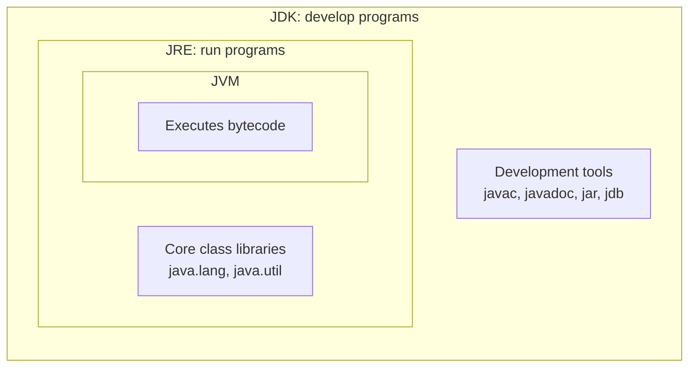
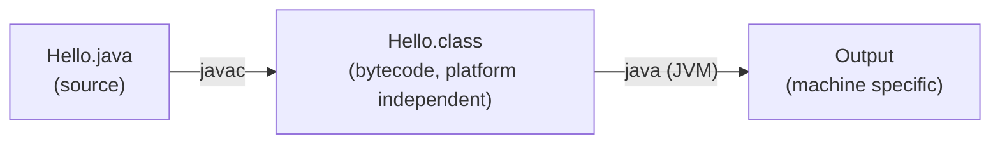
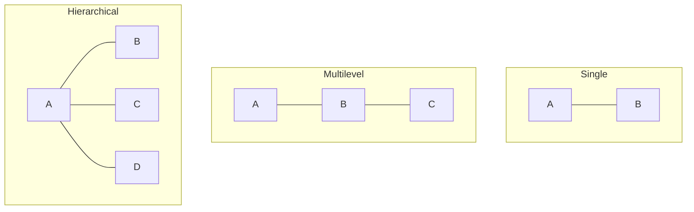
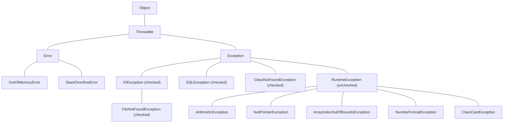
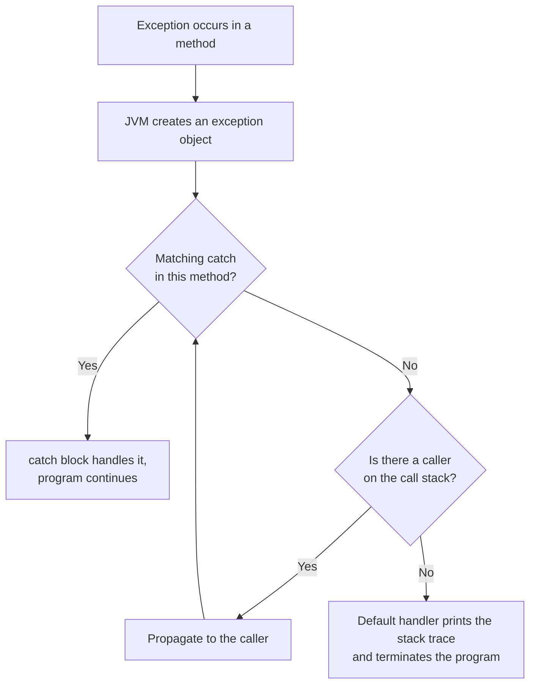

# Object Oriented Programming (Java) `PCC-CS-503`

**Written-exam study guide: CA-1 and CA-2 (CSE, 3rd Year, 5th Semester)**

This guide covers everything announced for **CA-1** and **CA-2**. Every chapter has the same shape: **Theory → Code examples → Short questions → Long questions**. Answers are written the way you should write them in a written exam (definition, points, code, diagram/output).

!!! note "Syllabus map"

    | Chapter | Topic | CA-1 | CA-2 |
    |---|---|:---:|:---:|
    | 1 | Object Oriented Concepts | ✔ | ✔ |
    | 2 | Introduction to Java Language | ✔ | ✔ |
    | 3 | Classes and Objects in Java | ✔ | ✔ |
    | 4 | Constructors, Overloading and static members | ✔ | ✔ |
    | 5 | Inheritance (single, hierarchical, multilevel; `super`; overriding) | ✔ | ✔ |
    | 6 | `final`, Abstract Class, Dynamic Method Dispatch, Interface | | ✔ |
    | 7 | Access Modifiers, Arrays | | ✔ |
    | 8 | Wrapper Classes | | ✔ |
    | 9 | String and StringBuffer | | ✔ |
    | 10 | Exception Handling | | ✔ |
    | 11 | Input and Output (Files) | | ✔ |

    The CA-2 notice lists "8. Wrapper Class" and then "10. String and StringBuffer", so number 9 is skipped in the notice. This guide numbers the chapters continuously, so Chapter 9 is String and StringBuffer.

!!! tip "Exam strategy for a written paper"

    - **Short questions (2-3 marks):** a definition plus one point or a tiny example. 3-4 lines.
    - **Long questions (5-10 marks):** definition → explanation in points → program → output → diagram or table if possible.
    - Always **write the program with correct syntax** (semicolons, `public static void main(String[] args)`, class name matching).
    - "Differentiate between…" questions: **always draw a table**.
    - "Write a program…" questions: write the code, then **show the output**.

---

## Chapter 1: Object Oriented Concepts

### 1.1 Programming paradigms

| Procedural (e.g. C) | Object Oriented (e.g. Java, C++) |
|---|---|
| Program = **functions** operating on data | Program = **objects** that contain data **and** methods |
| Top-down design | Bottom-up design |
| Data is global and exposed, so it is less secure | Data is hidden inside objects (encapsulation), so it is more secure |
| Adding new data types is difficult | Easy to extend through classes and inheritance |
| Little code reuse | Strong code reuse (inheritance, composition) |
| Focus on *"what to do"* (the steps) | Focus on *"who does it"* (the objects) |

### 1.2 Basic terminology

- **Object:** a real-world entity with **state** (data/attributes), **behaviour** (methods) and **identity** (a unique reference/address). Example: a `Car` with colour, speed (state) and `accelerate()`, `brake()` (behaviour).
- **Class:** a **blueprint/template** from which objects are created. It defines the state variables and methods. A class is a *logical* entity; an object is a *physical* (memory-occupying) entity.
- **Message passing:** objects communicate by calling each other's methods.

### 1.3 The four pillars of OOP

#### (a) Abstraction
Showing **only essential features** and hiding the implementation details.
Example: you press the brake pedal and the car stops, without knowing the hydraulics. In Java it is achieved with **abstract classes** and **interfaces**.

#### (b) Encapsulation
**Wrapping data and the methods that operate on it into a single unit (class)** and restricting direct access to the data (using `private` + getters/setters). It is **data hiding** plus **bundling**.

```java
class Account {
    private double balance;            // hidden data

    public double getBalance() { return balance; }
    public void deposit(double amt) {
        if (amt > 0) balance += amt;   // controlled access with validation
    }
}
```

**Benefits:** security, control over data validity, flexibility (internal changes do not affect users), maintainability.

#### (c) Inheritance
A class acquires the properties and behaviour of another class (**IS-A** relationship). Gives **code reuse** and **runtime polymorphism**.

```java
class Animal { void eat() { System.out.println("eating"); } }
class Dog extends Animal { void bark() { System.out.println("barking"); } }
```

#### (d) Polymorphism ("many forms")
One name, many behaviours.

| Compile-time (static) | Run-time (dynamic) |
|---|---|
| **Method overloading** | **Method overriding** |
| Resolved by the compiler (early binding) | Resolved by the JVM at run time (late binding) |
| Same class, different parameters | Parent and child class, same signature |

### 1.4 Other concepts

- **Dynamic binding:** linking a method call to its code at run time.
- **Coupling and cohesion:** good OO design has *low coupling* (classes depend little on each other) and *high cohesion* (a class does one well-defined job).
- **Association, aggregation, composition:** *HAS-A* relationships. Aggregation is a weak "has-a" (`Department` has `Teacher`s who can exist without it). Composition is a strong "has-a" (`House` has `Room`s that die with the house).

### 1.5 Advantages of OOP
Code reusability · modularity · security via data hiding · easy maintenance · easy modelling of real-world problems · extensibility · reduced complexity in large systems.

### Short Questions: Chapter 1

**Q1. Define class and object.**

**Ans.** A *class* is a user-defined blueprint that describes the data members and methods common to a group of similar entities. An *object* is an instance of a class that occupies memory and has state, behaviour and identity. E.g. `Student s = new Student();` creates the object `s`.

**Q2. What is encapsulation? How is it achieved in Java?**

**Ans.** Encapsulation binds data and methods into one unit and hides the data from outside. In Java, make the variables `private` and give `public` getter/setter methods.

**Q3. Differentiate abstraction and encapsulation.**

**Ans.**

| Abstraction | Encapsulation |
|---|---|
| Hides **implementation complexity** (design level) | Hides **data** by binding it with methods (implementation level) |
| Achieved by abstract classes/interfaces | Achieved by access modifiers (`private`) |
| Focus: *what* an object does | Focus: *how* the data is protected |

**Q4. What is polymorphism? Name its types.**

**Ans.** The ability of an entity to take many forms. Compile-time (method overloading) and run-time (method overriding).

**Q5. What is message passing?**

**Ans.** Communication between objects by invoking each other's methods, e.g. `account.deposit(500)`.

**Q6. Differentiate object-oriented and procedure-oriented programming.**

**Ans.** See the table in 1.1 (give at least 4 points).

### Long Questions: Chapter 1

**Q1. Explain the main features (pillars) of object-oriented programming with examples. (8 marks)**

**Ans.** Write: definition of OOP → each of the four pillars in 2-3 lines with a small Java snippet (use the snippets above) → advantages. Mention that Java's `interface`/`abstract` give abstraction, `private` + getters give encapsulation, `extends` gives inheritance, and overloading/overriding give polymorphism.

**Q2. Compare procedural and object-oriented paradigms. Why is OOP preferred for large systems? (6 marks)**

**Ans.** Table from 1.1, then: OOP gives modularity (each class is developed and tested independently), reuse (inheritance), security (encapsulation), and maintainability (change in one class does not break others).

---

## Chapter 2: Introduction to Java Language

### 2.1 History
Developed by **James Gosling** and team at **Sun Microsystems** (1991, initially called *Oak*, renamed **Java** in 1995). Sun was acquired by **Oracle** in 2010. Motto: **"Write Once, Run Anywhere" (WORA).**

### 2.2 Java characteristics (features)

| Feature | Meaning |
|---|---|
| **Simple** | Syntax similar to C/C++, but no pointers, no operator overloading, no multiple inheritance of classes |
| **Object-oriented** | Everything (except primitives) is an object, and code lives inside classes |
| **Platform independent** | Source → **bytecode** → runs on any OS with a JVM |
| **Architecture neutral / Portable** | Primitive sizes are fixed (`int` is always 4 bytes) |
| **Robust** | Strong type checking, exception handling, automatic garbage collection, no pointers |
| **Secure** | No explicit pointers, bytecode verifier, security manager and sandbox |
| **Multithreaded** | Built-in thread support |
| **Distributed** | Network support (RMI, sockets, URL) |
| **High performance** | JIT (Just-In-Time) compiler |
| **Dynamic** | Classes are loaded at run time as needed |
| **Interpreted + compiled** | Compiled to bytecode, then interpreted/JIT-compiled by the JVM |

### 2.3 JDK, JRE, JVM and Bytecode



JDK = JRE + development tools · JRE = JVM + core libraries · JVM = the engine that executes bytecode.

- **Bytecode:** the platform-independent, intermediate `.class` code produced by `javac`. It is **not** machine code. It is the instruction set of the JVM.
- **JVM (Java Virtual Machine):** an abstract machine that loads, verifies and executes bytecode. It is **platform dependent** (a different JVM for Windows, Linux, macOS), but bytecode stays the same, and this is what gives Java its portability. Parts: **Class Loader**, **Bytecode Verifier**, **Interpreter**, **JIT compiler**, **Garbage Collector**, memory areas (**Heap, Stack, Method Area, PC registers, Native Method Stack**).
- **JRE (Java Runtime Environment):** what you need to **run** Java programs (JVM + libraries).
- **JDK (Java Development Kit):** what you need to **develop** Java programs (JRE + compiler `javac` + tools).

**Compilation and execution flow**



### 2.4 Java applications
Standalone/desktop applications (Swing/JavaFX), web applications (Servlets/JSP/Spring), enterprise applications (Java EE), mobile applications (Android), embedded systems/IoT, big-data tools (Hadoop), games, scientific tools.

### 2.5 First program and its anatomy

```java
public class Hello {
    public static void main(String[] args) {
        System.out.println("Hello, Java!");
    }
}
```

| Part | Meaning |
|---|---|
| `public class Hello` | The class declaration. The file must be named **Hello.java** if the class is `public` |
| `public` | The JVM must be able to access `main` from outside |
| `static` | The JVM calls `main` **without creating an object** |
| `void` | `main` returns nothing to the JVM |
| `main` | Entry point of the program |
| `String[] args` | Command-line arguments |
| `System.out.println` | `System` is a class, `out` is a static `PrintStream` object, `println` is its method |

**Run:**

```text
javac Hello.java
java Hello
```

### 2.6 Basics: data types, variables, operators

**Primitive data types (8):**

| Type | Size | Default | Example |
|---|---|---|---|
| `byte` | 1 byte | 0 | `byte b = 10;` |
| `short` | 2 bytes | 0 | |
| `int` | 4 bytes | 0 | `int a = 5;` |
| `long` | 8 bytes | 0L | `long l = 100L;` |
| `float` | 4 bytes | 0.0f | `float f = 1.5f;` |
| `double` | 8 bytes | 0.0d | `double d = 2.5;` |
| `char` | 2 bytes (Unicode) | `'\u0000'` | `char c = 'A';` |
| `boolean` | JVM dependent (1 bit of information) | false | `boolean ok = true;` |

**Non-primitive (reference) types:** classes, interfaces, arrays, `String`.

**Type casting**

- *Widening (implicit, automatic):* `byte → short → int → long → float → double`. Example: `int i = 5; double d = i;`
- *Narrowing (explicit):* `double d = 9.7; int i = (int) d;` → `9` (data may be lost).

**Operators:** arithmetic (`+ - * / %`), relational, logical (`&& || !`), bitwise (`& | ^ ~ << >> >>>`), assignment, ternary `?:`, `instanceof`, increment/decrement.

**Control statements:** `if/else`, `switch`, `for`, `while`, `do-while`, `break`, `continue`, enhanced `for-each`.

**Variable types:** *local* (inside a method, no default value, must be initialised), *instance* (non-static, inside a class, one copy per object), *static/class* (one copy per class).

**Input using Scanner**

```java
import java.util.Scanner;
public class Input {
    public static void main(String[] args) {
        Scanner sc = new Scanner(System.in);
        System.out.print("Enter a number: ");
        int n = sc.nextInt();
        System.out.println("Square = " + n * n);
        sc.close();
    }
}
```

**Command-line arguments**

```java
public class CLA {
    public static void main(String[] args) {
        System.out.println("Count = " + args.length);
        for (String s : args) System.out.println(s);
    }
}
// java CLA hello 10  → Count = 2, hello, 10
```

### 2.7 Java vs C++

| Java | C++ |
|---|---|
| Platform independent (bytecode) | Platform dependent (machine code) |
| No pointers | Supports pointers |
| No multiple inheritance of classes (uses interfaces) | Supports multiple inheritance |
| Automatic garbage collection | Manual (`delete`) |
| No operator overloading | Supports it |
| No `goto`, no preprocessor, no header files | Has them |
| Everything lives inside classes | Can have global functions |

### 2.8 Naming conventions
Classes: `PascalCase` (`StudentRecord`) · methods/variables: `camelCase` (`getName`) · constants: `UPPER_CASE` (`MAX_SIZE`) · packages: lowercase (`java.util`).

### Short Questions: Chapter 2

**Q1. Why is Java called platform independent?**

**Ans.** The compiler converts source code into bytecode, not machine code. Bytecode can run on any machine that has a JVM, so the same `.class` file works on every platform.

**Q2. Differentiate JDK, JRE and JVM.**

**Ans.** JVM executes bytecode. JRE = JVM + libraries (to run programs). JDK = JRE + development tools like `javac` (to develop programs).

**Q3. What is bytecode?**

**Ans.** The intermediate, platform-neutral instruction set generated by the Java compiler and stored in a `.class` file. The JVM interprets or JIT-compiles it.

**Q4. Why is `main` declared `public static void`?**

**Ans.** `public` so the JVM can call it from outside; `static` so it can be called without creating an object; `void` because it returns nothing to the JVM.

**Q5. Is Java a purely object-oriented language? Why?**

**Ans.** No. It has 8 primitive data types that are not objects, and `static` members that belong to the class and not to an object.

**Q6. What is JIT compiler?**

**Ans.** A part of the JVM that compiles frequently executed bytecode into native machine code at run time to improve performance.

**Q7. Does Java support pointers?**

**Ans.** No, for security and simplicity. It uses references instead.

**Q8. What is the role of the garbage collector?**

**Ans.** It automatically frees heap memory occupied by objects that are no longer reachable.

### Long Questions: Chapter 2

**Q1. Explain the features of Java. (6 marks)**

**Ans.** Use the table in 2.2. Write at least 8 features, with one line of explanation each.

**Q2. Explain the architecture of the JVM and the process of executing a Java program. Distinguish JDK, JRE and JVM. (8 marks)**

**Ans.** Draw the flow `Source → javac → bytecode → Class Loader → Bytecode Verifier → Interpreter/JIT → Output`. Explain the JVM components (class loader, verifier, execution engine, runtime memory areas, GC). Then give the JDK ⊃ JRE ⊃ JVM relationship.

**Q3. Explain the structure of a simple Java program and explain each keyword of `public static void main(String[] args)`. (5 marks)**

**Ans.** Use the program and table in 2.5.

---

## Chapter 3: Classes and Objects in Java

### 3.1 Declaring a class

```java
class Student {
    // instance variables (state)
    int roll;
    String name;

    // method (behaviour)
    void display() {
        System.out.println(roll + " " + name);
    }
}
```

General form: `[access] class ClassName [extends Super] [implements Interfaces] { fields; constructors; methods; blocks }`

### 3.2 Creating objects (instances)

```java
Student s1 = new Student();   // declaration + instantiation + initialisation
s1.roll = 1;
s1.name = "Asha";
s1.display();
```

`Student s1;` only **declares a reference**. `new Student()` allocates memory on the **heap** and calls the constructor. The reference `s1` (on the stack) holds the address of the object.

```text
Stack            Heap
s1 ──────────►  [ roll=1 | name="Asha" ]
```

**Other ways to create objects:** `new` keyword, `clone()`, deserialisation, `Class.forName("X").newInstance()` (reflection).

**Multiple references:** `Student s2 = s1;` both refer to the **same** object. Changes through `s2` are visible through `s1`.

### 3.3 Methods

```java
returnType methodName(parameterList) { body; return value; }
```

```java
class Calc {
    int add(int a, int b) { return a + b; }
}
```

### 3.4 The `this` keyword
A reference to the **current object**. Uses:

1. Differentiate instance variable from a parameter with the same name.
2. Call another method of the current class.
3. Call another constructor: `this(...)` (constructor chaining, see Chapter 4).
4. Pass the current object as an argument.
5. Return the current object (method chaining).

```java
class Box {
    int w;
    Box(int w) { this.w = w; }          // this.w = field, w = parameter
    Box setW(int w) { this.w = w; return this; }
}
```

### 3.5 Argument passing: Java is *always pass-by-value*

- **Primitives:** a **copy of the value** is passed, so changes inside the method do not affect the caller.
- **Objects:** a **copy of the reference** is passed. The method can **modify the object's contents** (visible to the caller), but **reassigning** the parameter to a new object does not change the caller's reference.

```java
class Test {
    static void change(int x)      { x = 100; }                 // no effect
    static void change(int[] a)    { a[0] = 100; }              // visible
    static void reassign(int[] a)  { a = new int[]{9, 9}; }     // no effect on caller

    public static void main(String[] args) {
        int n = 5;       change(n);        System.out.println(n);       // 5
        int[] arr = {1}; change(arr);      System.out.println(arr[0]);  // 100
        reassign(arr);                     System.out.println(arr[0]);  // 100
    }
}
```

### 3.6 Returning objects

```java
class Point {
    int x, y;
    Point(int x, int y) { this.x = x; this.y = y; }
    Point add(Point p) { return new Point(x + p.x, y + p.y); }
}
```

### 3.7 Inner classes (nested classes)

A class defined **inside another class**. Reasons: logical grouping, better encapsulation, more readable code.

| Type | Declared | Key points |
|---|---|---|
| **Member (non-static) inner class** | Inside a class, outside methods | Needs an outer object: `Outer.Inner in = outer.new Inner();` Can access **all** members of the outer class (even `private`) |
| **Static nested class** | Inside a class with `static` | No outer object needed: `Outer.Nested n = new Outer.Nested();` Can access only **static** members of the outer class directly |
| **Local inner class** | Inside a method | Visible only inside that method. Can use `final`/effectively final local variables |
| **Anonymous inner class** | Declared and instantiated in one expression, with no name | Used to override a method or implement an interface instantly |

```java
class Outer {
    private int data = 10;

    class Inner {                       // member inner class
        void show() { System.out.println("data = " + data); }
    }

    static class Nested {               // static nested class
        void show() { System.out.println("static nested"); }
    }

    void method() {
        class Local {                   // local inner class
            void show() { System.out.println("local, data = " + data); }
        }
        new Local().show();
    }
}

public class InnerDemo {
    public static void main(String[] args) {
        Outer o = new Outer();
        Outer.Inner in = o.new Inner();
        in.show();                              // data = 10
        new Outer.Nested().show();              // static nested
        o.method();                             // local, data = 10

        Runnable r = new Runnable() {           // anonymous inner class
            public void run() { System.out.println("anonymous"); }
        };
        r.run();
    }
}
```

### 3.8 Garbage collection and `finalize()`
Objects with **no references** are eligible for GC. `System.gc()` only *requests* collection. `finalize()` (deprecated in recent versions) was called by the GC just before destroying an object. An object becomes eligible when you set its reference to `null`, reassign the reference, or when it was created inside a method that has finished (an anonymous object).

### Short Questions: Chapter 3

**Q1. Difference between class and object?**

**Ans.** Class = blueprint (logical, no memory for instance data until objects are created). Object = instance of a class (physical, occupies heap memory).

**Q2. What is the use of the `new` operator?**

**Ans.** It allocates memory for an object on the heap, calls the constructor and returns the reference.

**Q3. What is the `this` keyword? Give two uses.**

**Ans.** A reference to the current object. Uses: resolve the name conflict between a field and a parameter (`this.x = x`); call another constructor with `this(...)`.

**Q4. Is Java pass-by-value or pass-by-reference?**

**Ans.** Always pass-by-value. For objects, the value passed is a copy of the reference.

**Q5. What is an inner class? Why use it?**

**Ans.** A class declared inside another class. It groups related classes, increases encapsulation, and has direct access to the outer class's members.

**Q6. How do you create an object of a member inner class from `main`?**

**Ans.** `Outer.Inner obj = new Outer().new Inner();`

**Q7. What is an anonymous class?**

**Ans.** An inner class without a name, declared and instantiated in a single expression, used to implement an interface or extend a class once.

### Long Questions: Chapter 3

**Q1. What is a class? Explain how a class is declared and objects are created, with a program. (6 marks)**

**Ans.** Definition → syntax → a `Student` or `Rectangle` class with fields, a method and `main` creating two objects → the stack/heap diagram.

**Q2. Explain argument passing in Java with examples for primitives and objects. (6 marks)**

**Ans.** Use the program in 3.5 and explain each of the three outputs (5, 100, 100).

**Q3. Explain the types of inner classes with examples. (8 marks)**

**Ans.** Use the table and program in 3.7.

---

## Chapter 4: Constructors, Overloading and static Members

### 4.1 Constructors

A **constructor** is a special member that **initialises an object** when it is created.

**Rules:** the name is the **same as the class** name · **no return type** (not even `void`) · called **automatically** with `new` · cannot be `static`, `final` or `abstract` · can be overloaded.

#### Types

**1. Default constructor.** If you write **no** constructor, the compiler supplies a no-argument constructor that initialises fields to defaults (0, null, false).

**2. No-argument (user-defined) constructor**

```java
class A { A() { System.out.println("created"); } }
```

**3. Parameterised constructor**

```java
class Student {
    int roll; String name;
    Student(int roll, String name) { this.roll = roll; this.name = name; }
}
Student s = new Student(1, "Ravi");
```

**4. Copy constructor** (Java has no built-in one, so you write it)

```java
Student(Student s) { this.roll = s.roll; this.name = s.name; }
```

!!! warning "Common trap"
    If you write **any** constructor (e.g. a parameterised one), the compiler does **not** add a default one. `new Student()` then gives a compile error unless you also write a no-arg constructor.

#### Constructor chaining with `this()`

```java
class Rect {
    int l, b;
    Rect()            { this(1, 1); }                 // calls the 2-arg constructor
    Rect(int s)       { this(s, s); }
    Rect(int l, int b){ this.l = l; this.b = b; }
}
```
`this(...)` must be the **first statement** in the constructor.

#### Constructor vs method

| Constructor | Method |
|---|---|
| Initialises an object | Defines behaviour |
| Same name as class | Any name |
| No return type | Must have a return type |
| Called implicitly by `new` | Called explicitly |
| Compiler provides a default | Not provided |

### 4.2 Method overloading (compile-time polymorphism)

Several methods in the **same class** with the **same name but different parameter lists** (different number, type or order). The **return type alone cannot** distinguish overloaded methods.

```java
class Calc {
    int add(int a, int b)           { return a + b; }
    int add(int a, int b, int c)    { return a + b + c; }
    double add(double a, double b)  { return a + b; }
}
```

**Resolution with type promotion:** if no exact match exists, Java widens the argument (`byte → short → int → long → float → double`).

```java
class P {
    static void f(int x)    { System.out.println("int"); }
    static void f(double x) { System.out.println("double"); }
    public static void main(String[] a) {
        f(5);       // int
        f(5.5);     // double
        f('A');     // int   (char is promoted to int)
        f(5L);      // double (long promoted to float/double, no f(long))
    }
}
```

**Constructor overloading** works the same way (see the `Rect` example).

### 4.3 The `static` keyword

`static` members belong to the **class**, not to any object. They are loaded once when the class is loaded.

#### (a) Static variable
One shared copy for all objects (a memory-efficient common property).

```java
class Student {
    int roll;
    static String college = "KGEC";     // shared
    static int count = 0;
    Student() { count++; roll = count; }
}
```

#### (b) Static method

- Called with the class name: `ClassName.method()`.
- Can access **only static** members directly.
- Cannot use `this` or `super`.

```java
class MathUtil {
    static int square(int n) { return n * n; }
}
// MathUtil.square(5)
```

#### (c) Static block
Runs **once**, when the class is loaded, **before `main`** and before any object is created. It is used to initialise static data.

```java
class T {
    static int x;
    static { x = 10; System.out.println("static block"); }
    public static void main(String[] a) { System.out.println("main " + x); }
}
// Output: static block
//         main 10
```

#### (d) Instance initialiser block
Runs **every time an object is created**, **before the constructor body**.

```java
class U {
    { System.out.println("init block"); }
    U() { System.out.println("constructor"); }
    public static void main(String[] a) { new U(); new U(); }
}
// init block, constructor, init block, constructor
```

#### Order of initialisation
static variables/blocks (once, top to bottom) → instance variables/blocks (each object, top to bottom) → constructor body.

#### Why is `main` static?
So the JVM can invoke it without creating an object.

#### Can we override a static method?
No. A static method with the same signature in the subclass **hides** the parent's (method hiding). It is resolved at compile time.

#### Static vs instance

| Static | Instance |
|---|---|
| One copy per class | One copy per object |
| Accessed via class name | Accessed via an object |
| Loaded at class loading | Created at object creation |
| Cannot access instance members directly | Can access both |

### Short Questions: Chapter 4

**Q1. What is a constructor? Can it be private?**

**Ans.** A special method that initialises an object, named like the class with no return type. Yes, it can be private (used in Singleton pattern or to block instantiation).

**Q2. What happens if there is no constructor in a class?**

**Ans.** The compiler inserts a default no-argument constructor.

**Q3. Can a constructor be overloaded? Can it be inherited?**

**Ans.** It can be overloaded. Constructors are **not** inherited by subclasses.

**Q4. What is method overloading? Can we overload by return type?**

**Ans.** Same method name with different parameter lists in one class. No, the return type alone is not enough (compile-time ambiguity).

**Q5. Why can a static method not use non-static members?**

**Ans.** Static methods run without any object, so there is no `this` and no instance data exists to refer to.

**Q6. What is a static block? When does it run?**

**Ans.** A block marked `static` used to initialise static data. It runs once when the class is loaded, before `main`.

**Q7. What is constructor chaining?**

**Ans.** Calling one constructor from another using `this(...)` (same class) or `super(...)` (parent class).

**Q8. Output?**

```java
class A { static int x = 5; int y = 5; }
// new A().x++ ; new A().y++ ; then print new A().x + " " + new A().y
```

**Ans.** `6 5`. `x` is shared (incremented once), `y` is per-object.

### Long Questions: Chapter 4

**Q1. What is a constructor? Explain its types with examples. How does it differ from a method? (8 marks)**

**Ans.** Definition and rules → default, parameterised, copy (with code) → constructor chaining with `this()` → comparison table.

**Q2. Explain method overloading with a program. How does Java resolve an overloaded call? (6 marks)**

**Ans.** Definition → the `Calc` program → type-promotion example `f(int)/f(double)` → mention that overloading is compile-time polymorphism.

**Q3. Explain the `static` keyword: variables, methods and blocks, with a program. (8 marks)**

**Ans.** Use 4.3 (a)-(c) and the `Student.count` program to show shared state. State the restrictions on static methods.

**Q4. Write a program to count the number of objects created for a class.**

```java
class Counter {
    static int count = 0;
    Counter() { count++; }
    static int getCount() { return count; }
    public static void main(String[] args) {
        new Counter(); new Counter(); new Counter();
        System.out.println("Objects: " + Counter.getCount());   // 3
    }
}
```

---

## Chapter 5: Inheritance

### 5.1 Concept

**Inheritance** is the mechanism by which one class (**subclass/child/derived**) acquires the fields and methods of another class (**superclass/parent/base**). Keyword: **`extends`**. It models an **IS-A** relationship. Uses: **code reusability** and **runtime polymorphism** (through overriding).

```java
class Animal {
    String name;
    void eat() { System.out.println(name + " is eating"); }
}
class Dog extends Animal {
    void bark() { System.out.println("Woof"); }
}
public class Test {
    public static void main(String[] args) {
        Dog d = new Dog();
        d.name = "Tommy";
        d.eat();    // inherited
        d.bark();
    }
}
```

### 5.2 Types of inheritance



The parent is on top and the child below it (`B extends A`).

| Type | Description | Supported by classes? |
|---|---|:---:|
| **Single** | One child extends one parent (`B extends A`) | Yes |
| **Multilevel** | A chain (`C extends B`, `B extends A`) | Yes |
| **Hierarchical** | Many children extend one parent (`B extends A`, `C extends A`) | Yes |
| **Multiple** | One child with two parents | **No** (via classes), only via **interfaces** |
| **Hybrid** | Combination of the above | Only through interfaces |

#### Examples

```java
// Single
class A { void a() { System.out.println("A"); } }
class B extends A { void b() { System.out.println("B"); } }

// Multilevel
class Grand { void g() { System.out.println("grand"); } }
class Parent extends Grand { void p() { System.out.println("parent"); } }
class Child extends Parent { void c() { System.out.println("child"); } }
// Child obj can call g(), p(), c()

// Hierarchical
class Shape { void draw() { System.out.println("drawing"); } }
class Circle extends Shape { }
class Square extends Shape { }
```

#### Why does Java not support multiple inheritance with classes?
Because of the **diamond problem**. If `C` extends both `A` and `B`, and both define `show()`, then `C` cannot decide which `show()` it inherits, which causes ambiguity. Java avoids it by allowing a class to extend only **one** class, but to **implement many interfaces** (Chapter 6).

### 5.3 The `super` keyword

Refers to the **immediate parent class**. Three uses:

**1. Access the parent's field (when hidden by a child field)**

```java
class A { int x = 10; }
class B extends A {
    int x = 20;
    void show() {
        System.out.println(x);        // 20
        System.out.println(super.x);  // 10
    }
}
```

**2. Call the parent's method (when overridden)**

```java
class A { void show() { System.out.println("A.show"); } }
class B extends A {
    void show() { super.show(); System.out.println("B.show"); }
}
```

**3. Call the parent's constructor**: `super(args);` must be the **first statement** of the child's constructor.

```java
class Person {
    String name;
    Person(String name) { this.name = name; }
}
class Student extends Person {
    int roll;
    Student(String name, int roll) {
        super(name);          // must be first
        this.roll = roll;
    }
}
```

#### Constructor call order
When a child object is created, the **parent constructor runs first**, then the child's. If you don't write `super(...)`, the compiler inserts a hidden `super();` (the parent must therefore have a no-arg constructor, or you get a compile error).

```java
class A { A() { System.out.println("A"); } }
class B extends A { B() { System.out.println("B"); } }
class C extends B { C() { System.out.println("C"); } }
// new C();  →  A  B  C
```

### 5.4 Method overriding (runtime polymorphism)

A subclass provides its **own implementation** of a method already defined in its superclass, with the **same name, same parameters and a compatible return type**.

```java
class Bank { double rate() { return 0; } }
class SBI  extends Bank { @Override double rate() { return 6.5; } }
class HDFC extends Bank { @Override double rate() { return 7.1; } }
```

**Rules of overriding**

1. Same method name and same parameter list.
2. The return type must be the same or a **covariant** (subclass) type.
3. The access level cannot be **more restrictive** (`public` can't become `protected`).
4. The overriding method cannot throw **new or broader checked exceptions**.
5. `final`, `static` and `private` methods **cannot be overridden**. (Static: hidden. Private: not visible.)
6. Constructors cannot be overridden.
7. Use `@Override` so the compiler checks you really are overriding.

#### Overloading vs Overriding

| Overloading | Overriding |
|---|---|
| Same class | Parent–child classes |
| Different parameters | Same parameters |
| Compile-time polymorphism | Runtime polymorphism |
| Return type can differ | Same or covariant |
| Access modifier no restriction | Cannot reduce visibility |
| Can be `static` | Cannot be `static` (hiding) |

### 5.5 The `Object` class
The root of all classes in Java (`java.lang.Object`). Every class extends it implicitly. Important methods: `toString()`, `equals()`, `hashCode()`, `getClass()`, `clone()`, `finalize()`, `wait()/notify()`.

### 5.6 Important points

- A subclass **inherits** public/protected (and default, within the same package) members, but **not constructors** and **not private members** (they exist in the object but are inaccessible directly).
- A superclass reference can hold a subclass object (**upcasting**). The reverse needs an explicit cast (**downcasting**).
- Composition (**HAS-A**) is often preferable to inheritance when there is no true IS-A relationship.

### Short Questions: Chapter 5

**Q1. What is inheritance? What are its advantages?**

**Ans.** Acquiring the properties and methods of an existing class in a new class using `extends`. Advantages: code reuse, extensibility, runtime polymorphism, less redundancy.

**Q2. List the types of inheritance supported by Java classes.**

**Ans.** Single, multilevel and hierarchical. Multiple and hybrid are only possible through interfaces.

**Q3. Why is multiple inheritance not supported in Java?**

**Ans.** To avoid the diamond problem (ambiguity when two parents provide the same method). Interfaces are used instead.

**Q4. What are the uses of `super`?**

**Ans.** (1) Access the parent's hidden field, (2) invoke the parent's overridden method, (3) invoke the parent's constructor.

**Q5. Are constructors inherited?**

**Ans.** No. But a child constructor calls the parent constructor through `super()`.

**Q6. Difference between `this` and `super`?**

**Ans.**

| `this` | `super` |
|---|---|
| Refers to the current class object | Refers to the parent class object |
| `this()` calls a constructor of the same class | `super()` calls the parent constructor |
| Accesses current-class members | Accesses hidden/overridden parent members |

**Q7. Can we override a `private` or `static` method?**

**Ans.** No. A private method is not visible to the subclass. A static method is *hidden*, not overridden.

**Q8. What is the output?**

```java
class A { A() { System.out.println("A"); } }
class B extends A { B() { System.out.println("B"); } }
public class M { public static void main(String[] a) { new B(); } }
```

**Ans.** `A` then `B` (the parent constructor runs first).

### Long Questions: Chapter 5

**Q1. What is inheritance? Explain single, multilevel and hierarchical inheritance with programs. (8 marks)**

**Ans.** Definition + `extends` syntax → the three diagrams → the three code samples in 5.2 → note that multiple inheritance is not supported by classes.

**Q2. Explain the `super` keyword with examples. (6 marks)**

**Ans.** The three uses with the three short programs in 5.3, plus the constructor order example.

**Q3. What is method overriding? State its rules and differentiate it from overloading. (6 marks)**

**Ans.** Definition → `Bank/SBI/HDFC` example → the rules list → the comparison table.

**Q4. Write a program to demonstrate multilevel inheritance with constructors and show the order of execution. (6 marks)**

```java
class Person {
    String name;
    Person(String n) { name = n; System.out.println("Person constructor"); }
}
class Employee extends Person {
    int id;
    Employee(String n, int id) { super(n); this.id = id; System.out.println("Employee constructor"); }
}
class Manager extends Employee {
    double bonus;
    Manager(String n, int id, double b) {
        super(n, id); bonus = b; System.out.println("Manager constructor");
    }
    void show() { System.out.println(name + " " + id + " " + bonus); }
}
public class Org {
    public static void main(String[] args) {
        new Manager("Rita", 101, 5000.0).show();
    }
}
/* Output:
Person constructor
Employee constructor
Manager constructor
Rita 101 5000.0
*/
```

---

## Chapter 6: `final` Keyword, Abstract Class, Dynamic Method Dispatch and Interface

### 6.1 The `final` keyword

| Applied to | Effect |
|---|---|
| **Variable** | Becomes a **constant**: it can be assigned only once. A `static final` variable is a class constant (`static final double PI = 3.14;`) |
| **Method** | **Cannot be overridden** in a subclass |
| **Class** | **Cannot be extended** (e.g. `String`, `Integer`) |
| **Parameter** | Cannot be reassigned inside the method |

```java
class A {
    final int MAX = 100;                 // constant
    final void show() { System.out.println("A"); }
}
class B extends A {
    // void show() { }   // ERROR: cannot override final method
}
final class C { }
// class D extends C { }                 // ERROR: cannot inherit from final class
```

- A **blank final** variable (declared but not initialised) must be initialised in **every constructor** (or in an initialiser block).
- A `final` reference variable cannot point to another object, but the **object's contents can still change**.

```java
final int[] arr = {1, 2};
arr[0] = 9;          // allowed
// arr = new int[3]; // ERROR
```

### 6.2 Abstract classes

An **abstract class** is declared with `abstract` and may contain **abstract methods** (no body) and **concrete methods**. It **cannot be instantiated**. It exists to be extended.

```java
abstract class Shape {
    String color;
    Shape(String c) { color = c; }           // constructors allowed
    abstract double area();                  // abstract method: no body
    void showColor() { System.out.println("Colour: " + color); }  // concrete
}

class Circle extends Shape {
    double r;
    Circle(String c, double r) { super(c); this.r = r; }
    double area() { return Math.PI * r * r; }
}

class Rectangle extends Shape {
    double l, b;
    Rectangle(String c, double l, double b) { super(c); this.l = l; this.b = b; }
    double area() { return l * b; }
}

public class AbsDemo {
    public static void main(String[] args) {
        // Shape s = new Shape("red");       // ERROR
        Shape s1 = new Circle("Red", 2);
        Shape s2 = new Rectangle("Blue", 3, 4);
        System.out.println(s1.area());       // 12.566...
        System.out.println(s2.area());       // 12.0
        s2.showColor();                      // Colour: Blue
    }
}
```

**Rules**

1. A class with **at least one** abstract method **must** be declared `abstract`.
2. An abstract class can have **constructors, fields, static methods, final methods** and concrete methods.
3. A subclass must **implement all** abstract methods, otherwise it must also be declared abstract.
4. `abstract` cannot be combined with `final`, `private` or `static` for methods (they conflict with overriding).
5. We cannot create an object of an abstract class, but we **can create a reference** of it.

### 6.3 Dynamic Method Dispatch (runtime polymorphism)

A mechanism by which a call to an **overridden method is resolved at run time**, based on the **actual object type** and not on the reference type. It works through **upcasting** (a superclass reference pointing to a subclass object).

```java
class Animal { void sound() { System.out.println("Some sound"); } }
class Dog extends Animal { void sound() { System.out.println("Bark"); } }
class Cat extends Animal { void sound() { System.out.println("Meow"); } }

public class DMD {
    public static void main(String[] args) {
        Animal a;              // superclass reference
        a = new Dog();  a.sound();   // Bark
        a = new Cat();  a.sound();   // Meow
        a = new Animal(); a.sound(); // Some sound
    }
}
```

**Key points**

- Which method runs depends on the **object**, not the reference variable.
- The reference can only access members **declared in the superclass** (a subclass-only method such as `bark()` is not accessible without a cast).
- **Only methods are dispatched dynamically; fields are not.** Field access depends on the reference type.

```java
class P { int x = 1; void show() { System.out.println("P"); } }
class Q extends P { int x = 2; void show() { System.out.println("Q"); } }
// P ref = new Q();
// ref.show()  → Q    (dynamic)
// ref.x       → 1    (static, based on the reference type)
```

- `static`, `private` and `final` methods are bound at compile time (**static/early binding**).

#### `instanceof` and downcasting

```java
Animal a = new Dog();
if (a instanceof Dog) {
    Dog d = (Dog) a;      // safe downcast
    d.bark();
}
```
A wrong cast throws `ClassCastException` at run time.

### 6.4 Interfaces

An **interface** is a **100% abstraction contract**: it specifies *what* a class must do and not *how*. Keyword: `interface`. A class **implements** it using `implements`.

```java
interface Drawable {
    int SIDES = 4;          // implicitly public static final (constant)
    void draw();            // implicitly public abstract
}

class Rectangle implements Drawable {
    public void draw() { System.out.println("Drawing rectangle"); }  // must be public
}
```

**Features**

- Variables are implicitly `public static final`.
- Methods are implicitly `public abstract` (until Java 8).
- **No constructors**, cannot be instantiated.
- A class can implement **multiple** interfaces, which gives **multiple inheritance of type**.
- An interface can **extend** one or more interfaces.
- From **Java 8**: `default` methods (with a body) and `static` methods are allowed. From **Java 9**: `private` methods.
- An interface with exactly one abstract method is a **functional interface** (used with lambdas, e.g. `Runnable`).
- An interface with no methods is a **marker interface** (e.g. `Serializable`, `Cloneable`).

#### Multiple inheritance through interfaces

```java
interface Printable { void print(); }
interface Showable  { void show(); }

class Doc implements Printable, Showable {
    public void print() { System.out.println("print"); }
    public void show()  { System.out.println("show"); }
}
```

#### Interface extending interface

```java
interface A { void a(); }
interface B extends A { void b(); }
class C implements B {
    public void a() { System.out.println("a"); }
    public void b() { System.out.println("b"); }
}
```

#### Default method and the diamond problem

```java
interface X { default void hello() { System.out.println("X"); } }
interface Y { default void hello() { System.out.println("Y"); } }

class Z implements X, Y {
    public void hello() {            // must override to resolve the conflict
        X.super.hello();             // choose X's version (or Y.super.hello())
    }
}
```

#### Interface as a type (runtime polymorphism)

```java
interface Payment { void pay(double amt); }
class Card implements Payment { public void pay(double a) { System.out.println("Card " + a); } }
class UPI  implements Payment { public void pay(double a) { System.out.println("UPI " + a); } }

Payment p = new UPI();
p.pay(500);       // UPI 500.0
```

### 6.5 Abstract class vs Interface

| Abstract class | Interface |
|---|---|
| Keyword `abstract class`, extended with `extends` | Keyword `interface`, implemented with `implements` |
| Can have abstract **and concrete** methods | Abstract methods (plus `default`/`static`/`private` from Java 8/9) |
| Can have instance variables (any kind) | Only `public static final` constants |
| Can have **constructors** | **No** constructors |
| A class can extend **only one** | A class can implement **many** |
| Methods can have any access modifier | Methods are public |
| Used when classes share **common code and state** (IS-A) | Used to define a **capability/contract** across unrelated classes |
| Partial abstraction (0-100%) | Full abstraction (before Java 8) |

### Short Questions: Chapter 6

**Q1. What are the uses of the `final` keyword?**

**Ans.** `final` variable → constant; `final` method → cannot be overridden; `final` class → cannot be inherited.

**Q2. Can an abstract class have a constructor? Can it be instantiated?**

**Ans.** Yes, it can have a constructor (called via `super()` from subclasses), but it cannot be instantiated directly.

**Q3. What is an abstract method?**

**Ans.** A method declared with the `abstract` keyword and without a body. Subclasses must provide the implementation.

**Q4. What is dynamic method dispatch?**

**Ans.** Resolving a call to an overridden method at run time based on the actual object type referred to by a superclass reference.

**Q5. Why can `final` and `abstract` not be used together?**

**Ans.** `abstract` needs the class/method to be extended/overridden, while `final` forbids that. They contradict each other.

**Q6. What is an interface? Can an interface have a constructor?**

**Ans.** A reference type that defines a contract of abstract methods and constants. No, it cannot have a constructor.

**Q7. How does Java achieve multiple inheritance?**

**Ans.** Through interfaces: a class can implement any number of interfaces.

**Q8. What is a marker interface? Give an example.**

**Ans.** An interface with no methods that tags a class with a capability, e.g. `Serializable`, `Cloneable`.

**Q9. What is a functional interface?**

**Ans.** An interface with exactly one abstract method, e.g. `Runnable`; it can be implemented with a lambda expression.

**Q10. Can we declare the `main` method as `final`?**

**Ans.** Yes. It still works as the entry point.

### Long Questions: Chapter 6

**Q1. Explain the `final` keyword with all its uses and examples. (6 marks)**

**Ans.** Table in 6.1 + the code showing errors for overriding and extending.

**Q2. What is an abstract class? Explain with a program and write its rules. (8 marks)**

**Ans.** Definition → `Shape/Circle/Rectangle` program with output → rules list.

**Q3. Explain dynamic method dispatch with an example. How does it support runtime polymorphism? (8 marks)**

**Ans.** Definition → `Animal/Dog/Cat` program and output → key points (reference type vs object type, fields are not dynamic, only overridden methods).

**Q4. What is an interface? How does it differ from an abstract class? Explain multiple inheritance using interfaces. (10 marks)**

**Ans.** Definition and syntax → features → multiple inheritance program → comparison table → default-method conflict resolution.

**Q5. Write a program to show an interface implemented by two classes and polymorphic use.**

```java
interface Vehicle {
    void start();
    default void stop() { System.out.println("Vehicle stopped"); }
}
class Car  implements Vehicle { public void start() { System.out.println("Car starts with a key"); } }
class Bike implements Vehicle { public void start() { System.out.println("Bike starts with a kick"); } }

public class Garage {
    public static void main(String[] args) {
        Vehicle[] list = { new Car(), new Bike() };
        for (Vehicle v : list) { v.start(); v.stop(); }
    }
}
/* Output:
Car starts with a key
Vehicle stopped
Bike starts with a kick
Vehicle stopped
*/
```

---

## Chapter 7: Access Modifiers and Arrays

### 7.1 Packages (needed to understand access)
A **package** groups related classes/interfaces and avoids name conflicts. Declared as the first statement: `package com.college.util;`. Imported with `import java.util.Scanner;` or `import java.util.*;`. `java.lang` is imported automatically.

### 7.2 Access modifiers (visibility)

| Modifier | Same class | Same package | Subclass in **different** package | Other packages |
|---|:---:|:---:|:---:|:---:|
| `private` | ✔ | ✘ | ✘ | ✘ |
| *default* (no keyword) | ✔ | ✔ | ✘ | ✘ |
| `protected` | ✔ | ✔ | ✔ (through inheritance) | ✘ |
| `public` | ✔ | ✔ | ✔ | ✔ |

- **private:** most restrictive. Used for data hiding.
- **default (package-private):** visible within the package only.
- **protected:** package + subclasses (even in other packages, accessed through inheritance).
- **public:** visible everywhere.
- A **top-level class** can be only `public` or default. Members can have all four.
- Other (non-access) modifiers: `static`, `final`, `abstract`, `synchronized`, `volatile`, `transient`, `native`.

```java
class Demo {
    private int a = 1;
    int b = 2;               // default
    protected int c = 3;
    public int d = 4;

    private void secret() { }
    public void open() { secret(); }   // private reachable inside the class
}
```

### 7.3 Arrays

An **array** is a fixed-size, **homogeneous** collection of elements stored in **contiguous memory**, accessed by a zero-based **index**. In Java, arrays are **objects** (created with `new`, stored on the heap) and have a `length` **field**.

#### One-dimensional arrays

```java
int[] a;                        // declaration (preferred style)
a = new int[5];                 // allocation, default values 0
int[] b = {10, 20, 30};         // declaration + initialisation
int[] c = new int[]{1, 2, 3};

b[0] = 99;
System.out.println(b.length);   // 3 (a field, not a method)

for (int i = 0; i < b.length; i++) System.out.println(b[i]);
for (int x : b) System.out.println(x);   // for-each loop
```

Default values: numeric `0`, `boolean` `false`, `char` `'\u0000'`, references `null`.

**Program: largest and sum**

```java
public class ArrDemo {
    public static void main(String[] args) {
        int[] a = {5, 12, 8, 20, 3};
        int max = a[0], sum = 0;
        for (int x : a) { if (x > max) max = x; sum += x; }
        System.out.println("Max = " + max + ", Sum = " + sum);   // Max = 20, Sum = 48
    }
}
```

**Program: bubble sort**

```java
int[] a = {5, 2, 9, 1};
for (int i = 0; i < a.length - 1; i++)
    for (int j = 0; j < a.length - 1 - i; j++)
        if (a[j] > a[j + 1]) { int t = a[j]; a[j] = a[j + 1]; a[j + 1] = t; }
// a = {1, 2, 5, 9}
```

#### Two-dimensional arrays

```java
int[][] m = new int[2][3];
int[][] x = { {1, 2, 3}, {4, 5, 6} };
System.out.println(x[1][2]);        // 6
System.out.println(x.length);       // 2 (rows)
System.out.println(x[0].length);    // 3 (columns)

for (int i = 0; i < x.length; i++) {
    for (int j = 0; j < x[i].length; j++) System.out.print(x[i][j] + " ");
    System.out.println();
}
```

**Matrix addition**

```java
int[][] A = {{1, 2}, {3, 4}}, B = {{5, 6}, {7, 8}}, C = new int[2][2];
for (int i = 0; i < 2; i++)
    for (int j = 0; j < 2; j++) C[i][j] = A[i][j] + B[i][j];
// C = {{6, 8}, {10, 12}}
```

#### Jagged array (rows of different lengths)

```java
int[][] j = new int[3][];
j[0] = new int[1]; j[1] = new int[2]; j[2] = new int[3];
```

#### Array of objects

```java
Student[] arr = new Student[3];     // creates 3 null references, not objects!
for (int i = 0; i < arr.length; i++) arr[i] = new Student();
```

#### Passing and returning arrays

```java
static int[] doubleAll(int[] a) {
    int[] r = new int[a.length];
    for (int i = 0; i < a.length; i++) r[i] = a[i] * 2;
    return r;
}
```

#### Copying arrays

```java
int[] src = {1, 2, 3};
int[] copy1 = src.clone();
int[] copy2 = java.util.Arrays.copyOf(src, 5);        // {1,2,3,0,0}
int[] copy3 = new int[3];
System.arraycopy(src, 0, copy3, 0, 3);
int[] alias = src;                                    // NOT a copy, same object
```

#### The `java.util.Arrays` utility class

| Method | Purpose |
|---|---|
| `Arrays.toString(a)` | String form `[1, 2, 3]` |
| `Arrays.deepToString(a2d)` | String form for 2-D arrays |
| `Arrays.sort(a)` | Sort ascending |
| `Arrays.binarySearch(a, key)` | Search a **sorted** array |
| `Arrays.fill(a, v)` | Fill with a value |
| `Arrays.equals(a, b)` | Element-wise comparison |
| `Arrays.copyOf(a, n)` / `copyOfRange(a, s, e)` | Copy |

#### Variable arguments (varargs)

```java
static int sum(int... nums) { int s = 0; for (int n : nums) s += n; return s; }
// sum(1,2,3) → 6, sum() → 0
```

#### Common exceptions

- `ArrayIndexOutOfBoundsException`: index < 0 or ≥ length.
- `NegativeArraySizeException`: `new int[-1]`.
- `NullPointerException`: using an array that was never allocated.
- `ArrayStoreException`: storing an incompatible type in an `Object[]`-typed array.

### Short Questions: Chapter 7

**Q1. List the access modifiers in Java in the order of increasing visibility.**

**Ans.** `private` < default < `protected` < `public`.

**Q2. What is the difference between `protected` and default access?**

**Ans.** Default is accessible only within the same package. `protected` is accessible within the package **and** by subclasses in other packages.

**Q3. Can a top-level class be `private` or `protected`?**

**Ans.** No, only `public` or default.

**Q4. What is an array? How is it declared in Java?**

**Ans.** A fixed-size collection of same-type elements. `int[] a = new int[10];`

**Q5. Difference between `length` and `length()`?**

**Ans.** `length` is a field of arrays; `length()` is a method of `String`.

**Q6. Are arrays objects in Java?**

**Ans.** Yes. They are created with `new`, live on the heap, and inherit from `Object`.

**Q7. What is a jagged array?**

**Ans.** A 2-D array whose rows have different lengths.

**Q8. What is the default value of the elements of `new String[3]`?**

**Ans.** `null`.

**Q9. What is the output?** `int[] a = new int[3]; System.out.println(a[3]);`

**Ans.** Throws `ArrayIndexOutOfBoundsException` (valid indices are 0-2).

### Long Questions: Chapter 7

**Q1. Explain the access modifiers of Java with a table and example. (6 marks)**

**Ans.** Use the table in 7.2 and the `Demo` class. Mention packages.

**Q2. Explain one-dimensional and two-dimensional arrays with programs. (8 marks)**

**Ans.** Declaration/creation/initialisation → the max-sum and matrix programs → mention `length` and default values.

**Q3. Write a program to sort an array in ascending order and search for an element using linear search.**

```java
import java.util.Scanner;
public class SortSearch {
    public static void main(String[] args) {
        int[] a = {42, 7, 19, 3, 25};
        // bubble sort
        for (int i = 0; i < a.length - 1; i++)
            for (int j = 0; j < a.length - 1 - i; j++)
                if (a[j] > a[j + 1]) { int t = a[j]; a[j] = a[j + 1]; a[j + 1] = t; }
        System.out.println(java.util.Arrays.toString(a));   // [3, 7, 19, 25, 42]

        int key = 19, pos = -1;
        for (int i = 0; i < a.length; i++) if (a[i] == key) { pos = i; break; }
        System.out.println(pos >= 0 ? "Found at index " + pos : "Not found");  // Found at index 2
    }
}
```

**Q4. Write a program to multiply two 2×2 matrices.**

```java
int[][] A = {{1, 2}, {3, 4}}, B = {{2, 0}, {1, 2}}, C = new int[2][2];
for (int i = 0; i < 2; i++)
    for (int j = 0; j < 2; j++)
        for (int k = 0; k < 2; k++)
            C[i][j] += A[i][k] * B[k][j];
// C = {{4, 4}, {10, 8}}
```

---

## Chapter 8: Wrapper Classes

### 8.1 Concept

A **wrapper class** provides an **object representation of a primitive** type. All live in `java.lang`. They are **immutable** and `final`.

| Primitive | Wrapper |
|---|---|
| `byte` | `Byte` |
| `short` | `Short` |
| `int` | `Integer` |
| `long` | `Long` |
| `float` | `Float` |
| `double` | `Double` |
| `char` | `Character` |
| `boolean` | `Boolean` |

**Why do we need wrappers?**

1. Collections (`ArrayList<Integer>`) and generics store **objects only**, not primitives.
2. Provide **utility methods** (parsing, conversion, comparison, constants).
3. Allow `null` as a value.
4. Needed for synchronisation, serialisation and reflection that work with objects.

### 8.2 Autoboxing and unboxing (Java 5+)

- **Boxing:** primitive → wrapper object (manual or automatic).
- **Unboxing:** wrapper object → primitive.

```java
int a = 10;
Integer b = Integer.valueOf(a);   // manual boxing
Integer c = a;                    // autoboxing
int d = c;                        // auto-unboxing
int e = b.intValue();             // manual unboxing

Integer x = 5;
x++;                              // unbox, add, box again
```

!!! warning "Null pitfall"
    `Integer n = null; int m = n;` throws `NullPointerException` (unboxing `null`).

### 8.3 Important methods

**Integer (similar methods exist in the other numeric wrappers)**

```java
Integer.parseInt("123");          // 123  (String → int)
Integer.valueOf("123");           // Integer object
Integer.toString(45);             // "45"
Integer.toBinaryString(10);       // "1010"
Integer.toHexString(255);         // "ff"
Integer.compare(5, 8);            // negative
Integer.MAX_VALUE;                // 2147483647
Integer.MIN_VALUE;                // -2147483648

Integer i = 100;
i.intValue(); i.doubleValue();    // value conversions
i.compareTo(50);                  // positive (1)
i.equals(100);                    // true
```

**Double:** `Double.parseDouble("3.14")`, `isNaN()`, `Double.MAX_VALUE`.

**Boolean:** `Boolean.parseBoolean("true")`.

**Character**

```java
Character.isDigit('7');       // true
Character.isLetter('a');      // true
Character.isLetterOrDigit('_'); // false
Character.isUpperCase('A');   // true
Character.isWhitespace(' ');  // true
Character.toUpperCase('b');   // 'B'
Character.toLowerCase('B');   // 'b'
```

### 8.4 `==` vs `equals()` on wrappers (the Integer cache)
Values between **-128 and 127** are cached for `Integer.valueOf()` / autoboxing, so `==` can be `true` for them but `false` outside that range.

```java
Integer a = 100, b = 100;
System.out.println(a == b);        // true  (cached object)
Integer c = 1000, d = 1000;
System.out.println(c == d);        // false (different objects)
System.out.println(c.equals(d));   // true  (compares values)
```
**Rule:** always compare wrapper objects with `equals()`.

### 8.5 Program: String ↔ numbers

```java
public class WrapDemo {
    public static void main(String[] args) {
        String s = "250";
        int n = Integer.parseInt(s);
        double d = Double.parseDouble("2.5");
        System.out.println(n + d);                 // 252.5
        String back = String.valueOf(n);           // "250"
        System.out.println(back.length());         // 3
    }
}
```
`Integer.parseInt("abc")` throws `NumberFormatException`.

### Short Questions: Chapter 8

**Q1. What is a wrapper class? Name the wrapper of `char`.**

**Ans.** A class that wraps a primitive in an object. The wrapper of `char` is `Character`.

**Q2. What is autoboxing and unboxing?**

**Ans.** Automatic conversion of a primitive to its wrapper (`Integer x = 5;`) and of a wrapper to its primitive (`int y = x;`) by the compiler.

**Q3. Why do we need wrapper classes?**

**Ans.** Collections/generics need objects; wrappers provide utility methods and allow `null`.

**Q4. Difference between `Integer.parseInt()` and `Integer.valueOf()`?**

**Ans.** `parseInt` returns a primitive `int`; `valueOf` returns an `Integer` object.

**Q5. What exception is thrown by `Integer.parseInt("12a")`?**

**Ans.** `NumberFormatException`.

**Q6. Output?** `Integer a = 127, b = 127; Integer c = 128, d = 128; System.out.println((a==b) + " " + (c==d));`

**Ans.** `true false` (the Integer cache covers -128 to 127).

**Q7. Are wrapper objects mutable?**

**Ans.** No, they are immutable.

### Long Questions: Chapter 8

**Q1. What are wrapper classes? Explain boxing, unboxing, and the commonly used methods with examples. (6 marks)**

**Ans.** Table of 8 wrappers → reasons → 8.2 code → 8.3 methods list.

**Q2. Write a program that converts a string array of numbers to integers and finds their sum.**

```java
public class SumStr {
    public static void main(String[] args) {
        String[] s = {"10", "20", "30"};
        int sum = 0;
        for (String x : s) sum += Integer.parseInt(x);
        System.out.println("Sum = " + sum);    // Sum = 60
    }
}
```

---

## Chapter 9: String and StringBuffer Class

### 9.1 The `String` class

A `String` is a sequence of characters, implemented as an **object** of `java.lang.String`. Strings are **immutable**: once created, the content cannot change. Every "modification" creates a **new** String object.

#### Creating strings

```java
String s1 = "Hello";                  // string literal → String Constant Pool
String s2 = "Hello";                  // reuses the same pooled object
String s3 = new String("Hello");      // new object on the heap
char[] ch = {'J', 'a', 'v', 'a'};
String s4 = new String(ch);
```

#### String constant pool and `==` vs `equals()`

```java
String a = "Java", b = "Java";
String c = new String("Java");
System.out.println(a == b);           // true  (same pool object)
System.out.println(a == c);           // false (different objects)
System.out.println(a.equals(c));      // true  (same content)
System.out.println(a == c.intern());  // true  (intern() returns the pooled one)
```
`==` compares **references**; `equals()` compares **content**.

#### Why are Strings immutable?
Security (used in passwords, file paths, class names), thread safety, string-pool sharing (memory saving), caching of the hash code (good HashMap keys).

#### Important `String` methods

| Method | Description | Example → Result |
|---|---|---|
| `length()` | Number of characters | `"Java".length()` → 4 |
| `charAt(i)` | Char at index | `"Java".charAt(1)` → `a` |
| `substring(b)` / `substring(b, e)` | Part of string (`e` excluded) | `"Hello".substring(1,4)` → `ell` |
| `indexOf(x)` / `lastIndexOf(x)` | First/last position (-1 if absent) | `"banana".indexOf('n')` → 2 |
| `equals(s)` | Case-sensitive content check | |
| `equalsIgnoreCase(s)` | Case-insensitive check | |
| `compareTo(s)` | Lexicographic difference (0 if equal) | `"a".compareTo("c")` → -2 |
| `concat(s)` or `+` | Join | `"a".concat("b")` → `ab` |
| `toUpperCase()` / `toLowerCase()` | Case change | |
| `trim()` | Remove leading/trailing spaces | |
| `replace(old, new)` | Replace chars/sequences | `"aab".replace('a','x')` → `xxb` |
| `contains(s)` | True if substring present | |
| `startsWith(s)` / `endsWith(s)` | Prefix/suffix check | |
| `split(regex)` | Break into a `String[]` | `"a,b,c".split(",")` → {a, b, c} |
| `toCharArray()` | String → `char[]` | |
| `isEmpty()` | True if length is 0 | |
| `String.valueOf(x)` | Any value → String | |
| `String.format(...)` | Formatted string | |
| `intern()` | Pooled reference | |

```java
public class StrDemo {
    public static void main(String[] args) {
        String s = "  Object Oriented  ";
        System.out.println(s.trim().length());          // 15
        System.out.println(s.trim().toUpperCase());     // OBJECT ORIENTED
        System.out.println(s.indexOf("Oriented"));      // 9
        String t = s.trim();
        System.out.println(t.substring(0, 6));          // Object
        String[] words = t.split(" ");
        System.out.println(words.length);               // 2
        s.concat("x");                                  // result discarded
        System.out.println(s.length());                 // 19 (s unchanged: immutable!)
    }
}
```

### 9.2 `StringBuffer` class

`StringBuffer` is a **mutable** sequence of characters. Its content can change **in the same object**, so there is no new object for each change. It is **thread-safe** (synchronised methods), and therefore slower than `StringBuilder`.

**Constructors**

```java
StringBuffer sb1 = new StringBuffer();          // empty, capacity 16
StringBuffer sb2 = new StringBuffer(50);        // capacity 50
StringBuffer sb3 = new StringBuffer("Hello");   // capacity = 16 + 5 = 21
```
When full, capacity grows to **(oldCapacity × 2) + 2**.

#### Important methods

| Method | Description |
|---|---|
| `append(x)` | Add to the end (overloaded for all types) |
| `insert(i, x)` | Insert at an index |
| `delete(start, end)` | Remove characters (`end` excluded) |
| `deleteCharAt(i)` | Remove one character |
| `replace(start, end, str)` | Replace a range |
| `reverse()` | Reverse the content |
| `length()` | Number of characters |
| `capacity()` | Current capacity |
| `ensureCapacity(n)` | Guarantee a minimum capacity |
| `charAt(i)` / `setCharAt(i, c)` | Get/set a character |
| `setLength(n)` | Truncate or pad |
| `substring(...)`, `indexOf(...)` | Like `String` |
| `toString()` | Convert to `String` |

```java
public class SBDemo {
    public static void main(String[] args) {
        StringBuffer sb = new StringBuffer("Hello");
        sb.append(" World");          // Hello World
        sb.insert(5, ",");            // Hello, World
        sb.replace(0, 5, "Hi");       // Hi, World
        sb.delete(2, 3);              // Hi World
        sb.reverse();                 // dlroW iH
        System.out.println(sb);       // dlroW iH
        System.out.println(sb.length() + " " + sb.capacity());   // 8 21
    }
}
```
(`new StringBuffer("Hello")` has capacity 21, and it stays 21 because the length never exceeded it.)

### 9.3 `StringBuilder`
Same API as `StringBuffer`, but **not synchronised**, so it is faster. Use it when there are no multiple threads.

### 9.4 String vs StringBuffer vs StringBuilder

| Feature | `String` | `StringBuffer` | `StringBuilder` |
|---|---|---|---|
| Mutability | **Immutable** | Mutable | Mutable |
| Thread safety | Yes (immutable) | **Yes** (synchronised) | No |
| Speed | Slowest for repeated changes | Medium | **Fastest** |
| Storage | Constant pool / heap | Heap | Heap |
| `equals()` | Compares content | Does **not** compare content (inherits `Object.equals`) | Same as StringBuffer |
| Since | 1.0 | 1.0 | 1.5 |

### 9.5 Classic programs

**Reverse a string**

```java
String s = "Java";
String r = new StringBuffer(s).reverse().toString();   // "avaJ"
```

**Palindrome check**

```java
public class Palin {
    public static void main(String[] args) {
        String s = "madam";
        String rev = new StringBuffer(s).reverse().toString();
        System.out.println(s.equals(rev) ? "Palindrome" : "Not palindrome");  // Palindrome
    }
}
```

**Count vowels**

```java
String s = "Object Oriented";
int count = 0;
for (char c : s.toLowerCase().toCharArray())
    if ("aeiou".indexOf(c) != -1) count++;
System.out.println(count);    // 6
```

**Word count**

```java
String s = "java is fun";
System.out.println(s.trim().split("\\s+").length);   // 3
```

**Sort characters of a string**

```java
char[] c = "program".toCharArray();
java.util.Arrays.sort(c);
System.out.println(new String(c));    // agmoprr
```

### Short Questions: Chapter 9

**Q1. Why is `String` immutable in Java?**

**Ans.** For security, thread safety, string-pool sharing and hash code caching.

**Q2. Difference between `==` and `equals()` for strings?**

**Ans.** `==` compares references (memory addresses); `equals()` compares the character content.

**Q3. How many objects are created: `String s = new String("abc");`?**

**Ans.** Up to **two**: one in the string pool (the literal `"abc"`, if not already there) and one on the heap (by `new`).

**Q4. What is the String constant pool?**

**Ans.** A special area in the heap where string literals are stored and reused to save memory.

**Q5. What is the default capacity of `StringBuffer`?**

**Ans.** 16 characters.

**Q6. Difference between `StringBuffer` and `StringBuilder`?**

**Ans.** `StringBuffer` is synchronised (thread-safe, slower); `StringBuilder` is not (faster, not thread-safe).

**Q7. What is the output?** `String s = "abc"; s.toUpperCase(); System.out.println(s);`

**Ans.** `abc`. The result of `toUpperCase()` was not assigned, and strings are immutable.

**Q8. What does `compareTo()` return?**

**Ans.** `0` if equal, a negative number if the invoking string is lexicographically smaller, a positive number if greater.

**Q9. Output?** `System.out.println("Java".substring(1, 3));`

**Ans.** `av` (indices 1 and 2; the end index is excluded).

### Long Questions: Chapter 9

**Q1. Explain the `String` class and its important methods with examples. (8 marks)**

**Ans.** Immutability, pool, creation → methods table with sample outputs → `StrDemo` program.

**Q2. Compare `String`, `StringBuffer` and `StringBuilder`. Explain `StringBuffer` methods with a program. (8 marks)**

**Ans.** Table in 9.4 → methods table and `SBDemo` program in 9.2.

**Q3. Write a program to check whether a string is a palindrome and count its vowels.**

**Ans.** Combine the palindrome and vowel programs from 9.5.

---

## Chapter 10: Exception Handling

### 10.1 Concept

An **exception** is an **abnormal event during program execution** that disrupts the normal flow of instructions (e.g. divide by zero, file not found, array index out of range). **Exception handling** is a mechanism to handle such run-time errors gracefully so that the program does not crash and the normal flow can be maintained.

**Error vs Exception**

| Error | Exception |
|---|---|
| Serious problems, usually beyond the program's control (`OutOfMemoryError`, `StackOverflowError`) | Conditions a program can catch and recover from |
| Not meant to be caught | Should be handled |
| Subclass of `Error` | Subclass of `Exception` |

### 10.2 Exception hierarchy



`Error` and everything under `RuntimeException` are **unchecked**. All other `Exception` subclasses are **checked**.

### 10.3 Types of exceptions

| Checked | Unchecked |
|---|---|
| Checked by the **compiler** at compile time | Not checked at compile time (occur at run time) |
| Must be **caught or declared** (`throws`) | Handling is optional |
| Subclasses of `Exception` (except `RuntimeException`) | Subclasses of `RuntimeException` (and `Error`) |
| `IOException`, `SQLException`, `FileNotFoundException`, `ClassNotFoundException`, `InterruptedException` | `ArithmeticException`, `NullPointerException`, `ArrayIndexOutOfBoundsException`, `NumberFormatException`, `ClassCastException` |

### 10.4 Five keywords: `try`, `catch`, `finally`, `throw`, `throws`

#### try–catch

```java
public class Demo1 {
    public static void main(String[] args) {
        try {
            int a = 10 / 0;                  // ArithmeticException
            System.out.println("not printed");
        } catch (ArithmeticException e) {
            System.out.println("Error: " + e.getMessage());   // Error: / by zero
        }
        System.out.println("program continues");
    }
}
```

#### Multiple catch blocks

```java
try {
    int[] a = new int[3];
    a[5] = 10;
    String s = null; s.length();
} catch (ArrayIndexOutOfBoundsException e) {
    System.out.println("Array index problem");
} catch (NullPointerException e) {
    System.out.println("Null problem");
} catch (Exception e) {                  // generic handler LAST
    System.out.println("Other problem");
}
```
**Rule:** catch blocks must be ordered from **most specific to most general**. A superclass catch placed before a subclass catch gives a **compile error** (unreachable code). Java 7 also allows `catch (A | B e)` (multi-catch).

#### finally
Executes **always**, whether or not an exception occurs or is caught. It is used for **clean-up** (closing files, connections).

```java
try {
    System.out.println("in try");
    int x = 5 / 0;
} catch (ArithmeticException e) {
    System.out.println("caught");
} finally {
    System.out.println("finally always runs");
}
// in try / caught / finally always runs
```
`finally` does **not** run only if the JVM exits (`System.exit(0)`) or crashes before it.

**Return-value trap:** if `finally` has a `return`, it overrides the one in `try`.

```java
static int f() { try { return 1; } finally { return 2; } }   // returns 2
```

#### Nested try

```java
try {
    try { int a = 5 / 0; }
    catch (ArrayIndexOutOfBoundsException e) { System.out.println("inner"); } // not matching
    System.out.println("skipped");
} catch (ArithmeticException e) {
    System.out.println("outer caught");   // outer handles it
}
```

#### throw (explicitly throw an exception)

```java
static void checkAge(int age) {
    if (age < 18) throw new ArithmeticException("Not eligible to vote");
    System.out.println("Eligible");
}
```

#### throws (declare that a method may throw)

```java
import java.io.*;
class T {
    static void read() throws IOException {
        throw new IOException("disk error");
    }
    public static void main(String[] args) {
        try { read(); }
        catch (IOException e) { System.out.println("Caught: " + e.getMessage()); }
    }
}
```

#### throw vs throws

| `throw` | `throws` |
|---|---|
| Actually **throws** an exception object | **Declares** exceptions a method might throw |
| Used **inside** a method body | Used in the method **signature** |
| Followed by an **instance** (`new X()`) | Followed by **class names** (can be several, comma-separated) |
| Throws one exception at a time | Can declare multiple |

#### final vs finally vs finalize

| `final` | `finally` | `finalize()` |
|---|---|---|
| Keyword for constants, no overriding, no inheritance | Block that always executes after try/catch | Method called by the GC before destroying an object |

### 10.5 User-defined (custom) exceptions

Create by extending `Exception` (checked) or `RuntimeException` (unchecked).

```java
class InsufficientFundsException extends Exception {
    InsufficientFundsException(String msg) { super(msg); }
}

class Account {
    double balance = 1000;
    void withdraw(double amt) throws InsufficientFundsException {
        if (amt > balance)
            throw new InsufficientFundsException("Insufficient balance: " + balance);
        balance -= amt;
        System.out.println("Withdrawn " + amt + ", left " + balance);
    }
}

public class Bank {
    public static void main(String[] args) {
        Account a = new Account();
        try {
            a.withdraw(400);
            a.withdraw(900);
        } catch (InsufficientFundsException e) {
            System.out.println("Error: " + e.getMessage());
        } finally {
            System.out.println("Transaction over");
        }
    }
}
/* Output:
Withdrawn 400.0, left 600.0
Error: Insufficient balance: 600.0
Transaction over
*/
```

### 10.6 try-with-resources (Java 7)
Resources implementing `AutoCloseable` are **closed automatically**, so no explicit `finally` is needed.

```java
try (BufferedReader br = new BufferedReader(new FileReader("a.txt"))) {
    System.out.println(br.readLine());
} catch (IOException e) {
    e.printStackTrace();
}
```

### 10.7 Useful `Throwable` methods
`getMessage()` · `toString()` · `printStackTrace()` · `getCause()`.

### 10.8 Rules for overriding with exceptions

- An overriding method may throw **no exception, the same exception, or a narrower (subclass)** checked exception.
- It cannot throw a **new or broader checked** exception than the parent's method.

### 10.9 What happens when an exception occurs (flow)
The JVM creates an **exception object** → the method where it occurs looks for a matching `catch` → if none, the exception **propagates up the call stack** to the caller → if no method handles it, the **default handler** prints the stack trace and **terminates** the program.



### Short Questions: Chapter 10

**Q1. What is an exception?**

**Ans.** An unwanted event at run time that disrupts the normal flow of the program.

**Q2. Differentiate checked and unchecked exceptions.**

**Ans.** Checked exceptions are verified by the compiler and must be handled or declared (`IOException`). Unchecked exceptions (`RuntimeException` subclasses) are not checked at compile time (`ArithmeticException`).

**Q3. What is the superclass of all exceptions?**

**Ans.** `java.lang.Throwable` (with the subclasses `Error` and `Exception`).

**Q4. When does `finally` not execute?**

**Ans.** When `System.exit()` is called, or the JVM crashes/the thread is killed before reaching it.

**Q5. Can we have a `try` block without `catch`?**

**Ans.** Yes, if it has a `finally` block (or in try-with-resources).

**Q6. Can there be multiple `catch` blocks for one `try`?**

**Ans.** Yes, ordered from specific to general.

**Q7. Difference between `throw` and `throws`?**

**Ans.** `throw` raises an exception explicitly inside a body; `throws` declares exceptions in the method signature.

**Q8. Name 4 common unchecked exceptions.**

**Ans.** `ArithmeticException`, `NullPointerException`, `ArrayIndexOutOfBoundsException`, `NumberFormatException`, `ClassCastException`.

**Q9. What is a custom exception? How is it created?**

**Ans.** A programmer-defined exception class created by extending `Exception` or `RuntimeException`.

**Q10. What is the output?**

```java
try { System.out.println("A"); throw new RuntimeException(); }
catch (Exception e) { System.out.println("B"); }
finally { System.out.println("C"); }
System.out.println("D");
```

**Ans.** `A B C D`.

### Long Questions: Chapter 10

**Q1. Explain the exception hierarchy and the types of exceptions in Java. (6 marks)**

**Ans.** Draw the hierarchy from 10.2 and explain checked/unchecked with examples.

**Q2. Explain `try`, `catch`, `finally`, `throw` and `throws` with a suitable program. (10 marks)**

**Ans.** Describe each (2 lines), show multiple catch + finally code from 10.4, the throws example, and the `throw` vs `throws` table.

**Q3. What are user-defined exceptions? Write a program to create and use one. (8 marks)**

**Ans.** Use the `InsufficientFundsException` program with its output.

**Q4. Write a program to handle `NumberFormatException` and `ArithmeticException` from user input.**

```java
import java.util.Scanner;
public class Safe {
    public static void main(String[] args) {
        Scanner sc = new Scanner(System.in);
        try {
            System.out.print("Numerator: ");   int a = Integer.parseInt(sc.nextLine());
            System.out.print("Denominator: "); int b = Integer.parseInt(sc.nextLine());
            System.out.println("Result = " + a / b);
        } catch (NumberFormatException e) {
            System.out.println("Please enter valid integers");
        } catch (ArithmeticException e) {
            System.out.println("Cannot divide by zero");
        } finally {
            sc.close();
        }
    }
}
```

---

## Chapter 11: Input and Output (Files)

### 11.1 The I/O stream concept

A **stream** is a **sequence of data** flowing from a source to a destination. Java I/O is in package **`java.io`**.

- **Input stream:** reads data **into** the program (keyboard, file, network).
- **Output stream:** writes data **out of** the program (screen, file).

**Two families of streams**

| Byte streams (8-bit) | Character streams (16-bit Unicode) |
|---|---|
| Base classes: `InputStream`, `OutputStream` | Base classes: `Reader`, `Writer` |
| For **binary data** (images, audio, any file) | For **text** data |
| `FileInputStream`, `FileOutputStream`, `BufferedInputStream`, `DataInputStream`, `ObjectInputStream` | `FileReader`, `FileWriter`, `BufferedReader`, `BufferedWriter`, `InputStreamReader`, `PrintWriter` |

```text
InputStream                       Reader
  ├── FileInputStream               ├── InputStreamReader ── FileReader
  ├── BufferedInputStream           └── BufferedReader
  ├── DataInputStream             Writer
  └── ObjectInputStream             ├── OutputStreamWriter ── FileWriter
OutputStream                        ├── BufferedWriter
  ├── FileOutputStream              └── PrintWriter
  ├── BufferedOutputStream
  ├── DataOutputStream
  └── ObjectOutputStream / PrintStream
```

### 11.2 Standard streams (`System` class)

| Stream | Type | Purpose |
|---|---|---|
| `System.in` | `InputStream` | Standard input (keyboard) |
| `System.out` | `PrintStream` | Standard output (console) |
| `System.err` | `PrintStream` | Standard error output |

**Reading from the console with `BufferedReader`**

```java
import java.io.*;
public class ConsoleRead {
    public static void main(String[] args) throws IOException {
        BufferedReader br = new BufferedReader(new InputStreamReader(System.in));
        System.out.print("Enter your name: ");
        String name = br.readLine();
        System.out.println("Hello, " + name);
    }
}
```

### 11.3 The `File` class
Represents a **file or directory path** (does not read/write the content).

```java
import java.io.File;
public class FileInfo {
    public static void main(String[] args) throws Exception {
        File f = new File("data.txt");
        System.out.println(f.exists());          // true/false
        System.out.println(f.getName());
        System.out.println(f.getAbsolutePath());
        System.out.println(f.length());          // size in bytes
        System.out.println(f.isFile() + " " + f.isDirectory());
        System.out.println(f.canRead() + " " + f.canWrite());
        f.createNewFile();                       // creates if absent
        // f.delete();   File dir = new File("mydir"); dir.mkdir(); dir.list();
    }
}
```
Key methods: `exists()`, `createNewFile()`, `delete()`, `getName()`, `getPath()`, `getAbsolutePath()`, `length()`, `isFile()`, `isDirectory()`, `list()`, `listFiles()`, `mkdir()`, `mkdirs()`, `renameTo()`, `canRead()`, `canWrite()`.

### 11.4 Byte stream file operations

#### Write bytes: `FileOutputStream`

```java
import java.io.*;
public class ByteWrite {
    public static void main(String[] args) {
        try (FileOutputStream fos = new FileOutputStream("out.txt")) {
            fos.write(65);                                 // writes 'A'
            fos.write("Hello Java".getBytes());            // writes a byte array
        } catch (IOException e) { e.printStackTrace(); }
    }
}
```
`new FileOutputStream("out.txt", true)` → **append mode**. The default **overwrites**.

#### Read bytes: `FileInputStream`

```java
import java.io.*;
public class ByteRead {
    public static void main(String[] args) {
        try (FileInputStream fis = new FileInputStream("out.txt")) {
            int ch;
            while ((ch = fis.read()) != -1)               // -1 means end of file
                System.out.print((char) ch);
        } catch (FileNotFoundException e) {
            System.out.println("File not found");
        } catch (IOException e) { e.printStackTrace(); }
    }
}
```

#### Copy a file (byte stream)

```java
import java.io.*;
public class CopyFile {
    public static void main(String[] args) {
        try (FileInputStream in = new FileInputStream("src.txt");
             FileOutputStream out = new FileOutputStream("dest.txt")) {
            int b;
            while ((b = in.read()) != -1) out.write(b);
            System.out.println("Copied");
        } catch (IOException e) { System.out.println("Error: " + e.getMessage()); }
    }
}
```

### 11.5 Character stream file operations

#### Write text: `FileWriter` / `BufferedWriter` / `PrintWriter`

```java
import java.io.*;
public class TextWrite {
    public static void main(String[] args) {
        try (BufferedWriter bw = new BufferedWriter(new FileWriter("notes.txt"))) {
            bw.write("Line one");
            bw.newLine();
            bw.write("Line two");
        } catch (IOException e) { e.printStackTrace(); }

        try (PrintWriter pw = new PrintWriter(new FileWriter("p.txt", true))) {  // append
            pw.println("Hello");
            pw.printf("%d %s%n", 10, "text");
        } catch (IOException e) { e.printStackTrace(); }
    }
}
```

#### Read text: `FileReader` / `BufferedReader` / `Scanner`

```java
import java.io.*;
import java.util.Scanner;
public class TextRead {
    public static void main(String[] args) throws IOException {
        // line by line with BufferedReader
        try (BufferedReader br = new BufferedReader(new FileReader("notes.txt"))) {
            String line;
            while ((line = br.readLine()) != null)       // null means end of file
                System.out.println(line);
        }
        // with Scanner
        try (Scanner sc = new Scanner(new File("notes.txt"))) {
            while (sc.hasNextLine()) System.out.println(sc.nextLine());
        }
    }
}
```

#### Program: count characters, words and lines of a file

```java
import java.io.*;
public class WC {
    public static void main(String[] args) throws IOException {
        int lines = 0, words = 0, chars = 0;
        try (BufferedReader br = new BufferedReader(new FileReader("notes.txt"))) {
            String line;
            while ((line = br.readLine()) != null) {
                lines++;
                chars += line.length();
                if (!line.trim().isEmpty()) words += line.trim().split("\\s+").length;
            }
        }
        System.out.println(lines + " lines, " + words + " words, " + chars + " chars");
    }
}
```

### 11.6 Why use buffered streams?
A plain `FileReader.read()` talks to the disk for each read. A `Buffered...` wrapper reads/writes a **block** into an in-memory buffer, so it makes **fewer disk accesses**, which is much faster. `BufferedReader` also provides `readLine()`.

### 11.7 Data streams: primitive data in binary

```java
import java.io.*;
public class DataDemo {
    public static void main(String[] args) throws IOException {
        try (DataOutputStream dos = new DataOutputStream(new FileOutputStream("d.bin"))) {
            dos.writeInt(101);
            dos.writeDouble(55.5);
            dos.writeUTF("Asha");
        }
        try (DataInputStream dis = new DataInputStream(new FileInputStream("d.bin"))) {
            System.out.println(dis.readInt());      // 101  (read in the SAME order as written)
            System.out.println(dis.readDouble());   // 55.5
            System.out.println(dis.readUTF());      // Asha
        }
    }
}
```

### 11.8 Object serialisation
**Serialisation** converts an **object's state into a byte stream** to save it to a file or send it over a network; **deserialisation** is the reverse. The class must implement the marker interface **`Serializable`**. Fields marked **`transient`** (and `static` fields) are **not** serialised.

```java
import java.io.*;

class Student implements Serializable {
    private static final long serialVersionUID = 1L;
    int roll;
    String name;
    transient String password;              // not saved
    Student(int r, String n, String p) { roll = r; name = n; password = p; }
}

public class SerialDemo {
    public static void main(String[] args) throws Exception {
        Student s = new Student(1, "Asha", "secret");
        try (ObjectOutputStream oos = new ObjectOutputStream(new FileOutputStream("s.ser"))) {
            oos.writeObject(s);
        }
        try (ObjectInputStream ois = new ObjectInputStream(new FileInputStream("s.ser"))) {
            Student r = (Student) ois.readObject();
            System.out.println(r.roll + " " + r.name + " " + r.password);   // 1 Asha null
        }
    }
}
```

### 11.9 `RandomAccessFile`
Allows **reading and writing at any position** (not only sequentially) using a **file pointer**. Modes: `"r"` (read) and `"rw"` (read/write). Methods: `seek(pos)`, `getFilePointer()`, `length()`, `read()`, `write()`, `readLine()`.

```java
import java.io.*;
public class RAF {
    public static void main(String[] args) throws IOException {
        try (RandomAccessFile raf = new RandomAccessFile("r.txt", "rw")) {
            raf.writeBytes("ABCDEFGH");
            raf.seek(3);                              // move to the 4th byte
            System.out.println((char) raf.read());   // D
        }
    }
}
```

### 11.10 Exceptions in file handling
`FileNotFoundException` (subclass of `IOException`), `IOException`, `EOFException`. File operations declare checked exceptions, so they need `try-catch` or `throws`. **Always close streams** (use **try-with-resources**).

### Short Questions: Chapter 11

**Q1. What is a stream? Name the two kinds.**

**Ans.** A sequence of data flowing between a source and a destination. Byte streams and character streams.

**Q2. Difference between byte stream and character stream?**

**Ans.** Byte streams (`InputStream`/`OutputStream`) handle 8-bit binary data; character streams (`Reader`/`Writer`) handle 16-bit Unicode text.

**Q3. What are `System.in`, `System.out` and `System.err`?**

**Ans.** Standard input (keyboard), standard output (console) and standard error streams, respectively.

**Q4. What is the use of the `File` class?**

**Ans.** To represent a file/directory path and get its properties (existence, size, permissions) and perform operations like create, delete, rename, list. It does not read or write the content.

**Q5. Why is `BufferedReader` preferred over `FileReader`?**

**Ans.** It reads blocks through an internal buffer, reducing disk accesses, and adds `readLine()`.

**Q6. What does `read()` return at the end of the file?**

**Ans.** `-1` (and `readLine()` returns `null`).

**Q7. What is serialisation? What is the `transient` keyword?**

**Ans.** Converting an object's state to a byte stream. `transient` excludes a field from serialisation.

**Q8. How do we append to an existing file?**

**Ans.** Pass `true` as the second argument: `new FileWriter("a.txt", true)` or `new FileOutputStream("a.txt", true)`.

**Q9. Which exception is thrown if a file does not exist when reading?**

**Ans.** `FileNotFoundException`.

**Q10. What is `RandomAccessFile`?**

**Ans.** A class that lets you read/write at any position in a file using `seek()`.

### Long Questions: Chapter 11

**Q1. Explain the Java I/O stream hierarchy: byte streams and character streams. (6 marks)**

**Ans.** Concept of stream → table from 11.1 → hierarchy figure → standard streams.

**Q2. Write a program to read a text file and display its contents, handling exceptions. (6 marks)**

**Ans.** Use the `BufferedReader` program in 11.5 with the `FileNotFoundException` catch.

**Q3. Write a program to copy the contents of one file into another. (6 marks)**

**Ans.** Use `CopyFile` in 11.4 and explain the `-1` end-of-file condition.

**Q4. Explain serialisation with a program. (8 marks)**

**Ans.** Definition → `Serializable` and `transient` → `SerialDemo` and output.

**Q5. Write a program to write 5 numbers to a file and read them back to display their sum.**

```java
import java.io.*;
import java.util.Scanner;
public class NumFile {
    public static void main(String[] args) throws IOException {
        try (PrintWriter pw = new PrintWriter("nums.txt")) {
            for (int i = 1; i <= 5; i++) pw.println(i * 10);
        }
        int sum = 0;
        try (Scanner sc = new Scanner(new File("nums.txt"))) {
            while (sc.hasNextInt()) sum += sc.nextInt();
        }
        System.out.println("Sum = " + sum);     // Sum = 150
    }
}
```

---

## Appendix A: Output Prediction Practice

**A1.**

```java
class A { void f() { System.out.println("A"); } }
class B extends A { void f() { System.out.println("B"); } }
public class T { public static void main(String[] a) { A x = new B(); x.f(); } }
```

**Ans.** `B` (dynamic method dispatch).

**A2.**

```java
class P { static void s() { System.out.println("P"); } }
class Q extends P { static void s() { System.out.println("Q"); } }
// P x = new Q(); x.s();
```

**Ans.** `P` (static methods are hidden, bound by reference type).

**A3.**

```java
class T {
    static { System.out.println("S"); }
    { System.out.println("I"); }
    T() { System.out.println("C"); }
    public static void main(String[] a) { new T(); new T(); }
}
```

**Ans.** `S I C I C`.

**A4.**

```java
String s1 = "hi", s2 = "hi", s3 = new String("hi");
System.out.println((s1 == s2) + " " + (s1 == s3) + " " + s1.equals(s3));
```

**Ans.** `true false true`.

**A5.**

```java
int i = 5;
System.out.println(i++ + ++i);
```

**Ans.** `12` (5, then i=6; ++i makes 7; 5 + 7).

**A6.**

```java
System.out.println(10 + 20 + "Java" + 10 + 20);
```

**Ans.** `30Java1020` (left-to-right evaluation; the numbers become strings after `"Java"`).

**A7.**

```java
class A { A(int x) { } }
class B extends A { }
```

**Ans.** Compile error. `B`'s implicit `super()` finds no no-arg constructor in `A`.

**A8.**

```java
class X { final int a = 5; void f() { a = 6; } }
```

**Ans.** Compile error: cannot assign a value to a final variable.

**A9.**

```java
try { int[] a = new int[2]; a[2] = 1; }
catch (Exception e) { System.out.println("E"); }
catch (ArrayIndexOutOfBoundsException e) { System.out.println("A"); }
```

**Ans.** Compile error: the specific exception is unreachable after the general `Exception` catch.

**A10.**

```java
StringBuffer sb = new StringBuffer("ab");
sb.append("cd").reverse();
System.out.println(sb);
```

**Ans.** `dcba`.

**A11.**

```java
Integer a = 10; Integer b = 10;
System.out.println(a.equals(b) + " " + (a == b));
```

**Ans.** `true true` (10 is within the cache range).

**A12.**

```java
static int f() { try { return 1; } finally { System.out.println("F"); } }
// System.out.println(f());
```

**Ans.** `F` then `1`.

---

## Appendix B: Frequently Asked Written Questions (Question Bank)

**Theory (short):** define class/object · encapsulation vs abstraction · JDK vs JRE vs JVM · why Java is platform independent · what is bytecode · `static` keyword · constructor types · `this` vs `super` · final uses · abstract class vs interface · overloading vs overriding · checked vs unchecked exceptions · `throw` vs `throws` · `String` vs `StringBuffer` · autoboxing · `File` class · `transient` keyword.

**Theory (long):** OOP features · Java features and JVM architecture · types of inner classes · constructors and their types · static members · types of inheritance with programs · super keyword · method overriding and dynamic dispatch · abstract class and interface (with the comparison table) · access modifiers · arrays (1-D, 2-D) · wrapper classes · String/StringBuffer methods · exception hierarchy and handling keywords · custom exceptions · byte vs character streams · file read/write programs · serialisation.

**Programs most likely to appear**

1. Class with constructor and display method, with two objects.
2. Constructor overloading (`Rectangle`).
3. Static counter of objects.
4. Single/multilevel/hierarchical inheritance with `super`.
5. Method overriding and dynamic dispatch (`Shape`/`Animal`).
6. Abstract class with abstract `area()`.
7. Interface with multiple implementation.
8. Array: max/min/sum/sort/search, matrix add/multiply/transpose.
9. String: reverse, palindrome, vowel count, word count.
10. Custom exception (`InsufficientFundsException`, `AgeException`).
11. Multiple catch with finally.
12. File: read, write, copy, count words/lines.

---

## Appendix C: One-Page Quick Revision

**OOP pillars:** Abstraction · Encapsulation · Inheritance · Polymorphism.

**Java flow:** `.java` → `javac` → `.class` (bytecode) → JVM → output. JDK ⊃ JRE ⊃ JVM.

**Constructor:** same name as class, no return type, auto-called, not inherited, `this()`/`super()` must be the first statement.

**Overload vs Override:** same class / parent-child · different params / same params · compile-time / run-time.

**static:** class-level · accessed by class name · static method can't use `this` or non-static members · static block runs before `main`.

**Order of object creation:** static blocks → (parent: instance init + constructor) → (child: instance init + constructor).

**Inheritance:** `extends` · single, multilevel, hierarchical in classes · multiple via interfaces · no private/constructor inheritance.

**final:** variable (constant) · method (no override) · class (no extend).

**abstract:** can't instantiate · may have constructors and concrete methods · subclass must implement all abstract methods.

**interface:** `implements` · `public static final` fields · `public abstract` methods · many allowed · `default`/`static` methods from Java 8.

**Access:** private < default < protected < public.

**Arrays:** fixed size · `length` field · 0-based · default values · `ArrayIndexOutOfBoundsException`.

**Wrappers:** 8 classes · boxing/unboxing · `parseInt`/`valueOf` · Integer cache -128..127 · compare with `equals`.

**Strings:** immutable · pool · `==` vs `equals` · `StringBuffer` (mutable, synchronised, capacity 16) · `StringBuilder` (mutable, faster).

**Exceptions:** `Throwable → Error / Exception → RuntimeException` · `try`, `catch`, `finally`, `throw`, `throws` · catch specific before general · `finally` always runs (except `System.exit`).

**I/O:** byte (`InputStream`/`OutputStream`) vs char (`Reader`/`Writer`) · `File` class · `read()` returns -1 at EOF, `readLine()` returns `null` · use try-with-resources · `Serializable` + `transient`.

---

*End of study guide. Good luck for CA-1 and CA-2!*
